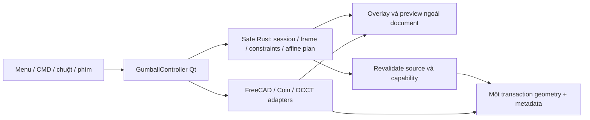

# Thiết kế Gumball lõi OpenMatrix9

Ngày: 2026-10-11. Trạng thái: người dùng đã duyệt thiết kế và Native inline execution; code và native supported slice đã triển khai.

## Mục tiêu và phạm vi đã chốt

Người dùng yêu cầu kiểm tra khả năng tương đương Gumball của FreeCAD và triển
khai đầy đủ ba spec lõi. Người dùng đã chọn phạm vi này trong câu trả lời ngày
2026-10-11:

| ID | Lệnh và mục menu | Trách nhiệm |
|---|---|---|
| OM9-INFO-020 | Gumball / InfoSettingsGumballON | Hiển thị gizmo và thao tác Move, Rotate, Scale, Copy, Extrude |
| OM9-INFO-021 | GumballAlignment / InfoSettingsGumballAlignment | Chọn frame CPlane, Object, World |
| OM9-INFO-022 | RelocateGumball / InfoSettingsRelocateGumball | Đổi pivot và hướng gizmo bằng CMD hoặc chuột |

Smart Target MSR `OM9-INFO-019` và Clayoo/SubD Gumball Modes `OM9-SUBD-002`
nằm ngoài phạm vi đã được người dùng chọn. Lệnh Move/Rotate/Scale độc lập có
spec riêng; dùng Gumball không tự chứng minh các lệnh đó đã hoàn tất.

Thành công được xác định bằng thao tác thật trong FreeCAD: chọn object, nhìn
thấy handles, kéo hoặc nhập số, commit đúng geometry, hủy sạch preview, và giữ
kết quả qua Undo/Redo và FCStd save/reload. Một icon hoặc API transform chạy
được chưa đủ nghiệm thu.

## Bằng chứng đã đọc

### Spec của OM9

- [Gumball](../../../OpenMatrix9_Codex_Spec_v1/specs/01-core/om9-info-020-gumball.md),
  đặc biệt hợp đồng thiết kế, bảng tham số, ca nghiệm thu và checklist.
- [Gumball Alignment](../../../OpenMatrix9_Codex_Spec_v1/specs/01-core/om9-info-021-gumball-alignment.md).
- [Relocate Gumball](../../../OpenMatrix9_Codex_Spec_v1/specs/01-core/om9-info-022-relocate-gumball.md).
- [RCORE-03](../../../OpenMatrix9_Codex_Spec_v1/specs/00-rhino-core/03-coordinates-cplanes.md),
  [RCORE-04](../../../OpenMatrix9_Codex_Spec_v1/specs/00-rhino-core/04-command-engine.md),
  [RCORE-05](../../../OpenMatrix9_Codex_Spec_v1/specs/00-rhino-core/05-picking-snapping.md),
  [RCORE-06](../../../OpenMatrix9_Codex_Spec_v1/specs/00-rhino-core/06-selection-organization-blocks.md)
  và phần affine của RCORE-07.

Ba spec lõi đang ghi `not_started`, implementation notes còn trống và checklist
chưa có bằng chứng native. Checkout hiện có nhiều thay đổi đang phát triển ở
các family khác; phải bảo toàn chúng và chọn baseline chứa đúng source hiện có.

### FreeCAD trong checkout này

- `src/Gui/CommandDoc.cpp:2011-2055`: `Std_TransformManip` mở Transform edit
  mode của view provider. Gate hiện yêu cầu đúng một GeoFeature, có placement
  ghi được và không frozen.
- `src/Gui/Inventor/Draggers/SoTransformDragger.h:59`: API exported có dịch
  chuyển X/Y/Z, mặt phẳng XY/YZ/ZX, xoay X/Y/Z, callback và màu trục.
- Các trường `draggerSize`, `autoScaleResult` điều khiển kích thước hiển thị
  của gizmo. Header này không cung cấp phép scale geometry của object.
- `src/Gui/ViewProviderDragger.h:62-117`: có TransformOrigin và API đặt frame
  dragger. Implementation cập nhật Placement trong Transform edit workflow.
- `src/Gui/Inventor/Draggers/Gizmo.h`: có LinearGizmo, RotationGizmo và liên kết
  với QuantitySpinBox. Có thể dùng làm thành phần native; không chứng minh
  sẵn toàn bộ quy tắc Gumball của OM9.

Kết luận giới hạn: FreeCAD có gizmo tương đương để dịch/xoay, nhưng gọi nguyên
`Std_TransformManip` không đáp ứng toàn bộ ba spec lõi. Đây là kiểm tra source;
chưa có runtime proof cho phương án OM9.

### Đối chiếu Rhino 5

Đã đọc [Rhino 5 Gumball Help](https://docs.mcneel.com/rhino/5/help/en-us/commands/gumball.htm)
ngày 2026-10-11. Trang này chứa cả GumballAlignment và GumballRelocate. Nó xác
nhận Alt toggle Copy, Alt-click nhập số cho bản sao, nhập số khi kéo và Ctrl
arrow extrusion. Shift khi scale ép uniform 3D. Relocate có thêm điểm định
hướng Y. Các mục này được dùng để bổ sung tương tác; màu trục và alias của OM9
vẫn theo spec dự án.

Spec OM9 chọn Z vàng và yêu cầu báo unresolved khi không xác định được Object
frame. Đây là quyết định của OM9, không tuyên bố đồng nhất mọi chi tiết Rhino.
Các manual Matrix nằm ở registry private và tồn tại; trước khi công bố fidelity
Matrix phải xác định và đọc đúng trang liên quan, giữ nguồn private nguyên vẹn.

## Các phương án và lựa chọn

| Phương án | Ưu điểm | Giới hạn |
|---|---|---|
| Gọi Std_TransformManip | Tận dụng toàn workflow host | Gate một object; thiếu Scale/Copy/Extrude theo OM9; mutation và event semantics của task host khác yêu cầu preview |
| Ghép dragger native với controller OM9 | Dùng API hiển thị/hit-test đã có; Rust sở hữu logic; plugin xây độc lập | Cần bổ sung scale/free-origin handles và bộ điều phối event |
| Viết lại toàn bộ gizmo native | Tự kiểm soát hình thức và event | Lặp lại nhiều phần dragger của FreeCAD, tăng khối lượng cần kiểm chứng |

Chọn phương án thứ hai. Dùng thành phần `SoTransformDragger`/Coin của SDK như
scene overlay do OM9 sở hữu; không mở Transform edit task của object để thực
hiện preview. Thêm square scale handles và origin handle trong plugin. Nếu API
composite không phân biệt đủ handle identity, dùng exported linear/rotation
dragger components dưới cùng overlay; quyết định này không đổi hợp đồng Rust.

## Kiến trúc và ownership

Rust sở hữu enable/alignment settings, selection identity, phase, pivot/frame,
handle identity, raw/accepted numeric input, Copy/Extrude policy, constraints,
checkpoints và affine plan double precision. Rust không giữ pointer host.

C++ giữ QWidget/Coin references có lifetime native, capture source/topology,
adapter geometry, preview nodes và transaction FreeCAD trên GUI thread. Đây là
ngoại lệ native bắt buộc cho Qt/Coin/FreeCAD/OCCT/openNURBS; không đặt bản sao
logic nghiệp vụ trong C++ hoặc Python. Python chỉ dùng fixture/bootstrap.

Dùng lại `CoreObjects` snapshots, `CoreCoordinates`, units/angle parser,
`CoreSnaps`, các capability/prepared geometry và preservation contracts hiện có.
Các adapter Builder/Edit có thể tái sử dụng primitive, nhưng không đổi owner
hay gọi operation Builder để giả lập Gumball.

### Các đơn vị dự kiến

| File | Trách nhiệm |
|---|---|
| rust/src/gumball.rs | State, typed events, frame, modifier policy, affine plan và session Undo |
| rust/src/gumball_ffi.rs | ABI nhỏ, checked input/output buffers và error containment |
| Gui/GumballController.h/.cpp | Native observer, event routing, CMD/prompt, lifecycle |
| Gui/GumballOverlay.h/.cpp | Dragger composition, handle identity, DPI/camera sizing, numeric editor |
| Gui/GumballGeometry.h/.cpp | Capture/stage/validate/commit transform, clone và planar extrusion |
| Gui/GumballFrame.h/.cpp | Native geometry/frame observations cho Object alignment |
| rust/tests/gumball_*.rs | Semantic state/math/input/lifecycle tests |
| tests/gumball_core_smoke.FCMacro | Native menu/CMD/chuột/phím, geometry và transaction fixtures |
| tests/gumball_core_cold_smoke.FCMacro | FCStd reopening trong process mới |

Nối command catalog/router, Workbench activation/deactivation, CoreMouse,
CoreKeyboard, CurveController command input và CMake theo pattern hiện có.
Các entrypoint chia sẻ một executor, không đăng ký command Python trùng.

## Hợp đồng hiển thị và selection

1. `Gumball On/Off/Toggle` và menu cùng enable setting. Lần cài mới mặc định
   Off; lưu preference sau lựa chọn explicit. Đây là default OM9 vì spec chưa
   chốt default nguồn. Alignment mặc định CPlane, Copy mặc định Off cho mỗi gesture.
2. Gizmo xuất hiện khi bật và có selection editable hợp lệ; không tạo document
   object. Selection nhiều object dùng một pivot/frame chung và một batch transaction.
3. Màu X đỏ, Y xanh, Z vàng theo OM9. Arrows dịch một trục, plane handles dịch
   hai trục, origin dịch theo mặt phẳng màn hình qua pivot, arcs xoay, squares scale.
4. Chọn parent và child không biến đổi cùng geometry hai lần. Normalize thành
   owner roots và nêu selection áp dụng; invalid/mixed/locked selection có lý do.
5. Click geometry tiếp tục selection bình thường; chỉ click trúng handle mới
   chiếm gesture. Pan/zoom/orbit không nhận point hoặc commit object.
6. Subobject có thể cung cấp Object alignment; biến đổi whole object phải được
   UI thể hiện rõ. Sửa grips/CV độc lập thuộc editor khác, không tự bật từ icon.

## Hợp đồng thao tác OM9-INFO-020

State tối thiểu: Disabled, Ready, Dragging, NumericEditing, Relocating,
Preview, Committing. Bắt đầu gesture chụp source, units, view và frame;
hover chỉ cập nhật preview, không ghi property/Undo.

- **Move:** project displacement lên một trục hoặc hai trục được chọn. Origin
  Free move dùng mặt phẳng màn hình đã chụp; thay camera không tự đổi frame gesture.
- **Rotate:** quanh pivot và axis của gizmo. UI góc theo độ; solver dùng đơn vị
  angular đã chuẩn hóa. Negative angles và nhiều vòng giữ đúng nghĩa input.
- **Scale:** factor một axis theo square handle. Shift dùng uniform 3D đã đối
  chiếu Rhino 5. Pivot bất biến; zero/singular transform bị từ chối. Factor âm
  chỉ được commit qua adapter đã kiểm orientation và representation conversion.
- **Numeric click:** click handle mở editor distance/angle/factor đúng dimension.
  Enter tạo cùng plan như drag; lỗi giữ editor/phase và không mutation. Giá trị
  số double không bị thay bằng delta pixel hay float của render node.
- **Numeric khi drag:** nhập số và Enter đặt distance constraint hoặc bước góc;
  tiếp tục kéo chọn hướng/nghiệm. Enter này không tự kết thúc toàn gesture.
- **Copy:** Alt tap sau drag-start toggle; key auto-repeat không toggle liên tục.
  Alt-click numeric tạo bản sao. Hiện cursor dấu cộng. Copy giữ source geometry,
  tạo identity/ownership độc lập và giữ layer/material/group theo policy native.
- **Extrude:** Ctrl được nhấn sau khi bắt đầu arrow move và còn giữ lúc nhả
  chuột tạo extrusion cho planar curve/face. Curve tạo surface; planar face tạo
  solid khi topology kín hợp lệ. Hole loops phải giữ đúng. Không biến dạng object
  unsupported hay dùng mesh fallback; thông báo capability rõ trước mutation.
- **Confirm/Cancel:** nhả chuột commit một gesture; Esc hủy preview/editor và
  giữ model như trước gesture. Session Undo chỉ lùi input tạm; Ctrl+Z sau commit
  dùng document Undo. Gesture identity không tạo transaction/undo entry rỗng.

Số không hữu hạn, units sai, frame suy biến, direction zero và stale source đều
bị từ chối. Bounds/budget/tolerance geometry kế thừa đúng capability hiện có và
được ghi ở feature record; không áp giới hạn UI tùy ý cho mọi loại CAD.

## Alignment và Relocate

### OM9-INFO-021

CMD nhận CPlane, Object, World; menu cho cùng lựa chọn và hiển thị mode thật.
World dùng XYZ. CPlane dùng origin/basis active viewport. Object lấy observations
curve tangent/normal, planar face, mesh component, extrusion, light/camera từ
adapter có capability xác thực. Rust dựng frame orthonormal từ observations.
Không có hướng xác định thì giữ frame cũ và báo unresolved; không thay âm thầm
bằng World. Geometry và document Undo không đổi khi chỉ đổi alignment.

### OM9-INFO-022

Giữ alias spec `RelocateGumball`, nhận thêm `GumballRelocate` tương thích Rhino.
CMD/pick nhận origin, điểm hướng X, tùy chọn điểm hướng Y. Enter dùng current
CPlane để hoàn tất Y/Z nếu X đủ xác định; nếu X song song normal tham chiếu,
yêu cầu Y thay vì tự chọn frame tùy ý. Các tọa độ đi qua parser RCORE-03.

Ctrl có ngay lúc mouse-down trên widget chuyển sang relocate widget; thả Ctrl
rồi kéo cho phép pick/snaps. Ctrl được nhấn sau khi object drag đã bắt đầu chỉ
đi theo extrusion policy. Numeric Ctrl-click sửa frame gizmo, không sửa shape.
Pivot/frame preview có checkpoint riêng; Cancel khôi phục frame trước thao tác.

Một object giữ relocated frame theo stable identity qua deselect/reselect trong
document hiện tại; multiple/group selection reset transient pivot khi bỏ chọn.
Enable/alignment preferences được lưu. Relocated pivot là view state, không
ghi vào Shape/Placement hoặc giả thành associative History. FCStd geometry
save/reload phải đúng sau các gesture đã commit.

## Geometry, History và commit

Native adapters stage toàn batch từ immutable sources. BRep dùng phép affine
OCCT và kiểm conversion/orientation thật; Mesh/Points dùng native representations
và Rust count/value/index budgets. Instance sửa occurrence mà không sửa shared
definition; copies độc lập. Retained 3DM data dùng preservation adapter hiện có,
không cập nhật Shape đơn lẻ rồi bỏ archive/export state.

Parametric/history objects chỉ sửa property/placement nếu capability sở hữu
operation này. Scale/extrude không được ghi Shape tạm vào feature rồi bị recompute
ghi đè. Family chưa có replace/edit operation hợp lệ bị reject explicit và giữ
visible disabled; không coi refusal là bằng chứng hoàn thành toàn family.

Trước publication kiểm lại document lifetime, source incarnation/revision,
ancestors/world placement, locks, unit context, session generation và backend.
Mở đúng một transaction cho geometry/metadata/ownership; lỗi rollback toàn batch.
History existing links phải giữ đúng hoặc có diagnostic rõ trước sửa. Gumball
không tạo graph History mới chỉ vì có command transcript.

## Nghiệm thu bắt buộc

| Nhóm | Bằng chứng cần |
|---|---|
| Gumball enable/router | On/Off/Toggle, menu/CMD cùng state; empty/locked selection; multiple objects |
| Move | X/Y/Z và plane/free trên CPlane xoay; displacement và pivot độc lập với zoom |
| Rotate | Điểm radius 2 quay 90 độ; pivot đã relocate; numeric/drag và angle constraint |
| Scale | X không đổi Y/Z; Shift uniform; circle thành ellipse; zero rejected; negative orientation đúng |
| Copy | Alt toggle hai lần, Alt-click numeric, source bất biến, identity độc lập, metadata/links |
| Extrude | Planar curve/face, face có hole, negative/exact distance; Ctrl-at-start không extrude; nonplanar refusal |
| Alignment | World/CPlane/Object, face/edge/mesh observations; unresolved không mutation |
| Relocate | CMD/picks/Ctrl drag, X/Y frame, invalid collinear, Escape; geometry/count/Undo bất biến |
| Lifecycle | Cancel, source deleted/replaced, locks/units changed, workbench/document switch/close, view destroyed |
| Ownership | Nested App::Part; parent+child; App::Link occurrences; retained 3DM preservation |
| Persistence | Undo/Redo từng gesture; FCStd save/reload và reopen process mới |
| UI thật | Pointer hit đúng handles, numeric editor focus/IME, DPI 1 và 1.5, camera navigation, no callbacks còn sống |

Rust test theo TDD, bắt đầu RED có ý nghĩa trước implementation. Native fixtures
phải đo geometry độc lập với affine plan và thử event chuột/phím thật; gọi test
hook hay đọc trạng thái không thay chứng cứ hit-test. Ghi report JSON, process
exit thực tế, source/plugin hashes và screenshot những trạng thái cần nhìn.
Không công bố parity Rhino/Matrix nếu chưa có paired runtime fixture tương ứng.

## Build, review và đồng bộ

Chỉ build `OpenMatrix9Gui` qua `H:/FreeCAD-src/build/build-om9-plugin.ps1`, dùng
SDK `H:/FreeCAD-src/build/relWithDebInfo` và plugin cache phù hợp checkout.
Worker mặc định 60% logical CPUs. Runtime plugin tách biệt, chạy shared host
qua `build/run-om9-plugin.ps1` với profile test riêng. Không build root FreeCAD
hay sao chép một runtime đầy đủ cho từng phase.

Chạy Rust/native suites theo thay đổi; public source audit và diff whitespace
checks. Regression ưu tiên command input, mouse navigation, selection, layers,
units, History và retained 3DM transforms khi adapter liên quan bị thay đổi.
Kiểm layout/event thực tế sau build và chỉ mở rộng tests khi có concern mới.

Sau evidence, bổ sung `docs/features/OM9-INFO-020.md`, `021.md`, `022.md`, cập
nhật ba spec/checklist, FEATURES JSON/YAML, IMPLEMENTATION_STATUS, domain README,
MANIFEST, README dự án và progress ledger. Các mục chưa có evidence vẫn mở;
không nâng trạng thái do thiết kế, validator hoặc compilation đơn thuần.

## Trạng thái execution

Người dùng duyệt thiết kế, kế hoạch và current-checkout Native inline execution
ngày 2026-10-11; yêu cầu tiếp tục được giữ xuyên suốt. Tasks1–5 và evidence theo
[validation record](../../validation/2026-10-11-gumball-core.md).
Unsupported representation/capability, cold pivot và failed-transaction Redo
limitation được ghi riêng; không nâng toàn bộ Matrix/Rhino parity.
