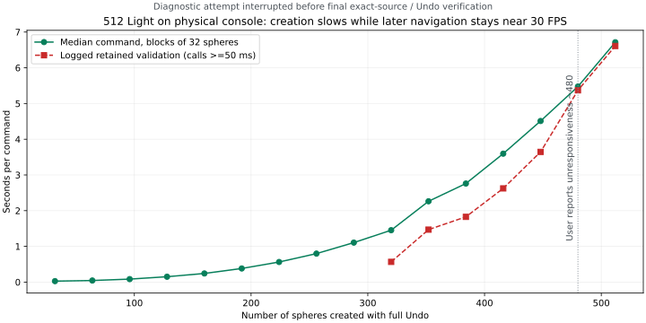

# Physical-console sphere measurements — 2026-11-16

**Stopped after user-reported unresponsiveness and enlargement of the whole OM9
window around 480 spheres.** Only the owned disposable benchmark process tree
was terminated. High 512 and both 768 runs were not started. The large-scene
Light/High matrix and manual performance acceptance remain incomplete.

The physical console reproduces multi-second CPU/UI stalls even though later
navigation publishes approximately 30 FPS. At sphere 480 the command takes
6.069 s; at sphere 512, 7.868 s. The longest creation callback interval is
8.094 s, of which 8.076 s is UI work. Repeated retained-owner admission checks
dominate the commands. The separated viewport does not remove this cost.

## Conditions and evidence

Active physical console, `remote_session=false`, AutoVsync, Vulkan, RTX 3060,
Ryzen 9 5900X (12 cores/24 logical CPUs), approximately 64 GiB physical RAM.
Monitor: 1920×1080 at 60 Hz; audit window client: 1600×1000. The existing
application/replay limit remains **30 Hz**, a software cap.

Ordinary Sphere commands (radius 5 mm), canonical exact BRep, four Shaded
viewports, full ordinary Undo, **no Boolean**. Existing 1024 MiB Undo policy
retained. Each replay waits for all four completed viewport images to contain
the new sphere before issuing another command; this does not prove arbitrary
unpaced bursts display every intermediate state. One run per configuration,
with opt-in phase profiling enabled; render and geometry algorithms unchanged.

Same executable for all attempts:
`ab8531dac1f90401be94bf63838e877fcd1fc21fdf81b87aae07fd1ee4c58b75`.
Test-only retained-object admission allowance: 100000 for 16 spheres and 400000
for 512/768, matching the earlier full-history fixture. The geometry point budget
remains 2000000; history depth and retention policy are unchanged. This is not a
default-limit test.

Evidence root: `build/standalone-validation/ui-artifacts/console-metrics-20261116`.
The [machine-readable report](2026-11-16-console-sphere-metrics.json) retains phase
distributions, command blocks, slow commands, native frames, GPU timestamps,
cache counters, CPU/thread/I/O/page-fault/memory samples and source provenance.

## Outcomes

| Configuration | Status | Orbit published FPS | Selected FPS | Peak / settled working set MiB | Undo |
|---|---|---:|---:|---:|---:|
| 16 Light | Full replay/source/Undo verification passed | 29.913 | 29.970 | 310.32 / 305.10 | 16 |
| 16 High | Full replay/source/Undo verification passed | 29.904 | 29.975 | 320.86 / 317.15 | 16 |
| 512 Light | Performance observed; final source/Undo verification interrupted | 29.729 | 29.921 | 543.41 / 536.38 | 512 at checkpoint |
| 512 High, 768 Light/High | Not started after UI failure feedback | — | — | — | — |

FPS counts unique completed Perspective GPU publications in fixed navigation
windows, including edge holds. It is not monitor scanout or proof of responsive
creation. The 512 orbit windows have maximum GPU image holds of 64/37 ms.

At 16, Light/High exact-source fingerprint multisets match; closed single solids,
zero naked edges, analytic volumes, placements and Undo/Redo pass. At 512, all
512 command commits and all 512 four-view presentation acknowledgements completed.
Performance-end records 512 objects, 512 Undo, zero Redo and Undo enabled. The
process was stopped before final Undo/Redo and analytic source result events.
**Exact source/restoration are not independently certified for this 512 attempt.**
No strict audit pass or synthetic `summary.json` was created for it.

512 Light creation, including paced presentation, takes 1146.954 s (19.12 min).
Command work totals 969.394 s. Median command / commit-to-present / end-to-end
times: 926.98 / 380.96 / 1499.29 ms; maxima: 7867.60 / 786.11 / 8500.25 ms.

## Where creation slows

| Sphere block | Median command ms | Median commit→all-view publication ms | Median logged retained-validation ms per command |
|---|---:|---:|---:|
| 1–32 | 27.28 | 471.58 | Below logging threshold |
| 97–128 | 150.87 | 353.91 | Below logging threshold |
| 225–256 | 798.00 | 215.20 | Below logging threshold |
| 321–352 | 2262.88 | 327.35 | 1469.15 |
| 417–448 | 4510.06 | 511.59 | 3645.50 |
| 449–480 | 5475.13 | 559.82 | 5369.21 |
| 481–512 | 6714.55 | 585.71 | 6610.56 |

Creation has 249 callback intervals over 1 s; p95 1516.04 ms, p99 5971.90 ms,
max 8094.25 ms. UI work max: 8076.17 ms. Platform/tessellation max: 2.64 ms.
Combined paint/event-wait max: 482.11 ms. The multi-second freeze is UI work.

At sphere 480, **46 logged retained-validation calls** total 5971.182 ms inside
a 6068.193 ms Sphere operation. At sphere 512, **47 logged calls** total
7756.858 ms inside 7867.289 ms (about 98.6%). External-owner storage work accounts
for 4289.292 ms, internal retained-owner work 3467.562 ms. Only calls >=50 ms
are logged; these counts/totals are lower bounds on all retained-validation work.

The two full Undo inventories at sphere 512 total 220.396 ms, nested in other
phases. They are overhead, but **full RAM inventory alone is not the dominant
explanation**; the earlier hypothesis was too narrow. Investigation targets:
`TransactionCoordinator::validate_retained_owners_with_external_except`,
`external_storage_usage`, and repeated admission/reservations during ordinary
Sphere preparation, incremental scene preparation and proof retention.

Nested/cumulative phases overlap: never sum them as independent costs.
`sphere_capture_ms` includes surrounding cache/admission work, not pure OCCT time;
`sphere_transaction_ms` includes preparation, incremental scene and publication.
This is phase instrumentation, not a complete sampled call-stack profile.

## Other metrics

- Creation CPU median: 0.9995 cores, approximately one saturated logical CPU,
  or only 4.16% over 24 logical CPUs. Raw samples identify the busiest OS thread.
- Creation GPU timestamp p50/p95/max: 1.251/3.333/18.725 ms. Orbit p50: 0.676 ms;
  selected orbit p50: 0.999 ms. These exclude driver/compositor/event waits.
- Whole-adapter creation utilization median/mean: 0%/6.58%; VRAM max 2446 MiB
  out of 12288 MiB. Driver samples are coarse (1 Hz), include other apps and
  are not process-exclusive GPU/VRAM measurements.
- Performance-end working set: 536.38 MiB, peak 543.41; private: 773.56 MiB;
  physical memory available: 39.47 GiB. No evidence of physical RAM exhaustion.
  Total page faults and process I/O are recorded; hard faults are not measured.
- Undo estimate: 186.02 MiB; 1024 full inventories at the 512 checkpoint. The
  estimate is pending refresh, not an exact byte census. Undo was not shortened.
- Selection projection p50/p95/max: 0.217/0.322/0.453 ms over 232 rebuilds.
  The cached selection frame is not the multi-second bottleneck here.
- Cumulative GPU transfers: 1.6549 GB geometry and 2.1688 GB overlays, versus
  16.82 MB final shared scene buffer bytes. These are transfers, not live RAM or
  evidence of a leak. Repeated append uploads deserve secondary cache analysis.
- Commit-to-publication often follows a half-second cadence. Combined
  paint/event wait approaches 482 ms. Wakeup/completion/presentation scheduling
  remains a separate investigation; its cause is not isolated by these samples.

## Whole-window enlargement

The user clarified that the **whole OM9 window**, not a viewport, enlarged.
Win32 sampling started during creation: 1060 visible main-window samples show
1600×1000 clients, with none minimized or cloaked. The window was not foreground
for much of creation, and throughout the orbit measurement windows. Visible does
not prove unoccluded or physically scanned out. This does not disprove the user
report: the original probe did not log maximize state, hung state, nonclient
events or an OS ghost window. No cause or fix for the enlargement is established.

The probe now supports `IsZoomed` and `IsHungAppWindow` for the next run. **These
fields were added after stopping; no values are claimed for this attempt.**

## Validation and next action

Release passed with `CARGO_TARGET_DIR=L:/om9-target`, `-j 2` (8m35s).
**39 focused checks passed**: 30 GPU publication, one smooth-normal/exact-source,
eight Undo memory. `atomic_transactions` remains blocked by five existing
`NativeBrepSource`/`CanonicalBrep` fixture type errors; no full-suite pass claimed.
Public-source audit passed (16106 source files, no errors). Artifact pruning ran:
zero removals; the newest ten and older evidence referenced by records are retained.

Tools: `benchmark_sphere_console.py`, `analyze_sphere_console.py`,
`om9_window_metrics.py` under `tools/`. `--include-incomplete` extracts diagnostic
performance with an explicit interrupted status, without bypassing source/history
acceptance. Samples after performance-end are excluded from resource comparisons.
Audit-wide phases can include final verification; command-only summaries exclude
it. Sampler wall time (about 0.1–0.2 s per 1 Hz sample) is recorded; profiling and
sampling can perturb timings. No default runtime business rule changed.

Next: reduce repeated retained-owner admission/storage work, preserving budget
safety, exact BRep and every Undo. Verify small scenes, capture native
resize/maximize/hung transitions, then retest the 448–512 boundary before resuming
Light/High 512/768. Approximately 30 FPS after creation does not justify continuing
an unresponsive creation workflow.
