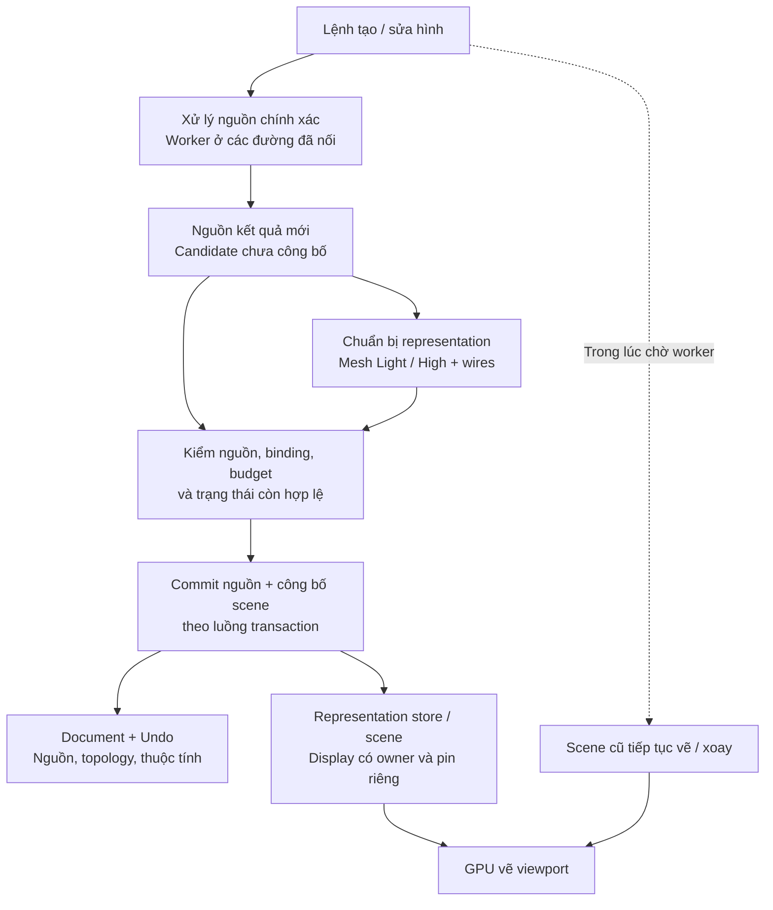

# Trạng thái tách nguồn chính xác và viewport

Đối chiếu ngày 2026-11-16 với `main` tại commit
`dc570216219f6fdd6b1facb0628706c05fc13173`. Đây là rà code và tổng hợp bằng
chứng đã có; không sửa runtime, không build hoặc mở benchmark mới. Người dùng
chấp nhận mức tối ưu hiện tại và sẽ tối ưu thêm khi triển khai từng lệnh.

**Kết luận:** ranh giới dữ liệu nguồn và representation đã tồn tại thật trong
model hiện tại, và lát cắt Sphere/viewport/Undo đã có bằng chứng native. Chưa
hoàn tất toàn bộ vòng đời cache, persistence và mọi consumer; không đóng C1–C5
hoặc gán phần trăm hoàn thành từ số test.

## Luồng đang có

Sơ đồ mô tả ranh giới trách nhiệm, không có nghĩa tất cả lệnh đều chạy worker
hoặc mọi bước commit đều dưới 33 ms. Luồng audit Sphere đợi đủ bốn viewport
hiện object trước khi gửi lệnh tiếp; không chứng minh burst không điều tiết.
Boolean Union có thêm mesh preview dùng một lần chạy song song với nhánh nguồn
chính xác; preview không được commit làm nguồn CAD. Các đường Boolean khác
không được suy ra có cùng cơ chế preview chỉ từ Union.

## Đã xác nhận ở code hiện tại

| Thành phần | Trạng thái thực tế | Mức bằng chứng |
|---|---|---|
| OCCT document source | `Geometry::Brep(CanonicalBrep)`; mặc định giữ nguồn/topology, display ở `BrepRepresentation` | Rà kiểu, equality, serialization và store; native Sphere có đối chiếu nguồn |
| Native document source | `Geometry::NativeBrep(NativeBrepSource)`; kiểu nguồn chỉ có payload/CRC | Rà kiểu hiện tại; chưa chứng minh payload opaque tự nó không chứa cache nội bộ |
| Kết quả native tạm | `Brep` / `NativeBrep` vẫn có thể mang nguồn và display để tách khi handoff | Đây là kiểu kết quả adapter, khác với kiểu trong enum document |
| Light / High | Hai profile mesh trên cùng nguồn; linear deflection yêu cầu 0,1 / 0,01 mm | Code profile và native source parity; không phải chứng nhận sai số toàn cục |
| Document / Undo | Snapshot model dùng các kiểu nguồn trên; history checksum OCCT dựa nguồn/topology | Undo đầy đủ trong cảnh Sphere; không chứng minh mọi evidence/cache phụ đều không pin display |
| Scene / cache | Store, reservation, source binding, display pins và freshness checks riêng | Code và các test có phạm vi; không phải toàn bộ ma trận lifecycle |

Mốc code chính: `crates/om9-core/src/geometry.rs:1027`, `brep.rs:33`,
`brep.rs:228`, `brep.rs:331`, `geometry.rs:657`,
`crates/om9-app/src/session/topology_remesh/viewport_detail.rs:21`.
Kiểu `CanonicalBrep` còn một trường chẩn đoán opt-in để dựng lại đối chứng
document-owned display cho benchmark; startup sản phẩm không bật nhánh này
(`brep.rs:338`). Không nhầm đối chứng đó với đường sản phẩm mặc định.

## Những gói chưa đóng

| Gói | Đã có | Còn thiếu / giới hạn |
|---|---|---|
| C1: source / representation | Cả OCCT và NativeBrep trong model đã là kiểu nguồn; kết quả tạm, scene và store có đường handoff riêng | Kiểm đủ caller, owner phụ, native payload disposition, accounting và lỗi ở các đường chưa chạy |
| C2: cache miss, Undo/Open, eviction | History worker tìm representation thiếu, dựng lại với proof; Native có helper rebuild; OCCT có nhánh thu hồi history-only không pin | Chưa có nghiệm thu tổng quát Undo lạnh sau eviction, block/result, cancel/stale/budget, pin cuối và áp lực bộ nhớ; opaque native chưa được tùy ý evict |
| C3: `.om9` v5 | Container v5, nhánh migration v4 và atomic-save có code | Writer và reader v5 **từ chối document có OCCT/Native BRep** vì durable topology/payload disposition chưa hoàn tất; chưa có round-trip v5 source-only cho BRep |
| C4: consumer / từng lệnh | Boolean, history, STL, picking/snap, Builder và nhiều đường tạo/sửa đã được chuyển ở các phạm vi ghi trong ledger | Không có bằng chứng mọi lệnh/mode/instance/trim/SDK đã đúng; chuyển sang nguồn không tự bảo đảm thuật toán chính xác |
| I1: wireframe/isocurve | OCCT có source edges và interior wires mặc định, scene/extraction có đường chuẩn bị | Chưa đóng trim/binding/density trên toàn bộ route; opaque native face/trim extraction còn unsupported |
| C5: bàn giao toàn bộ | Có code, build và bằng chứng theo từng lát cắt | Chưa đủ điều kiện tuyên bố tách xong toàn ứng dụng hoặc qua M09 |

Guard persistence nằm ở `crates/om9-archive/src/container.rs:104` và `:445`.
Save ứng dụng dùng `Archive::save_with_admission`; atomic writer gọi encoder
đó trước khi tạo file staging (`atomic_file.rs:64`). Do vậy đây là giới hạn
thực của luồng lưu BRep hiện tại, không chỉ là mục kế hoạch chưa tick.
Không suy ra `.3dm` hoặc mọi định dạng xuất đều bị chặn bởi guard `.om9` này.

## Bằng chứng runtime được tái sử dụng

- [M1-R cuối](2026-11-16-m1r-storage-receipts.md): 10 cấu hình
  16/64/128/512/768 Light/High qua kiểm nguồn, placement, publication và cặp
  Undo/Redo cuối. Source fingerprints Light/High khớp ở mọi size; còn đủ số
  Undo tạo cầu. Fixture cho phép 4M điểm; default 2M không đổi. Không Boolean.
- [Đối chứng coupled / separated](2026-11-15-coupled-source-display-ab.md):
  64/128 cầu, 16 lượt native và 19 test có phạm vi; giảm thời gian final UI
  poll, cùng nguồn chính xác. Đây là đối chứng ghép lại trên cùng binary,
  không phải phục hồi nguyên cả bản Rhino hoặc OM9 lịch sử.
- [Speculative Boolean](2026-11-15-speculative-boolean.md): preview và nguồn
  chính xác riêng; 512 Light hoàn tất, 512 High từng lỗi worker cuối và giữ
  inputs/Undo. Không dùng batch M1-R không Boolean để coi lỗi đó đã hết.
- [Normals / selection cache](2026-11-15-smooth-normals-selection-cache.md):
  shader normals và bounds cache ở đường GPU scene sản phẩm; không đổi nguồn.

512/768 Light/High orbit hiện gần 30 published FPS dưới cap 30 Hz, nhưng
creation UI ở 768 còn cực đại 728,50/821,12 ms. High có độ trễ khung mới khi
bắt đầu selected phase 1,590 s ở 512 và 3,195 s ở 768. Những số này không phải
trần tất cả lệnh hoặc bằng chứng cache lifecycle/persistence đã hoàn tất.

## Đính chính ghi chú lịch sử và bước tiếp

Một số entry ngày 13–14/11 còn viết NativeBrep document giữ display hoặc
eviction chưa nối. Đó là checkpoint cũ: enum model hiện tại đã giữ nguồn native,
và `TopologyProofCache::reclaim_optional_memory` đã có nhánh thu hồi OCCT đủ
điều kiện (`session/topology_cache.rs:255`). Không xóa lịch sử hoặc đổi các
claim compile-only thành runtime pass. Snapshot này ưu tiên cho trạng thái
code hiện tại; các gate rộng vẫn mở.

Hướng đi hiện tại là tiếp tục kiểm nguồn/representation và tối ưu ở từng lệnh
khi người dùng yêu cầu. Theo dõi C2/C3 như công việc vòng đời dùng chung;
đặc biệt C3 không được bỏ qua khi cần lưu BRep bền vững. Không tự mở thêm
ma trận hiệu năng hoặc thay quota trong lượt rà này.

## Preview nhẹ song song: đối chiếu theo câu hỏi tiếp theo

Đây là giải thích khả năng mở rộng và nghiên cứu tham khảo, chưa phải yêu cầu
triển khai cơ chế preview chung cho mọi lệnh. Có thể dựng proxy/preview nhẹ
từ tham số hoặc display hiện có, hiển thị nó trong khi một worker khác tính
nguồn chính xác. Khi kết quả hợp lệ và đủ scene mới thì thay preview và commit
nguồn theo transaction. Sự phụ thuộc vào kết quả CAD không biến mất: lệnh sau
cần kết quả chính xác phải đợi hoặc có hàng đợi phụ thuộc được thiết kế rõ.

Trong code hiện tại, `session/boolean_union_worker.rs:235` khởi động
`mesh_preview::PreviewJob` riêng cho `OM9-SOLID-003` trước khi spawn worker
nguồn chính xác. `mesh_preview.rs:27` chia sẻ buffer đã admit và chạy mesh CSG
trên thread riêng; preview bị giới hạn tài nguyên, có cancel và không nhận
nguồn canonical. `boolean_union_worker.rs:398` chỉ expose dữ liệu render tạm
sau khi kiểm context/cancel; nó không phải CAD object để lưu hoặc commit.
Đây là triển khai có phạm vi của ý tưởng, chưa phải preview tức thời ở mọi
primitive/Boolean/lệnh khác. Preview cũng có thời gian tính và có thể thất bại.

Đối chiếu nguồn chính thức, kiểm ngày 2026-11-16:

| Ứng dụng | Cơ chế được nguồn chứng minh | Phạm vi khác với OM9 |
|---|---|---|
| [OpenSCAD](https://files.openscad.org/documentation/manual/The_OpenSCAD_User_Interface.html) | OpenCSG preview dùng GPU/Z-buffer để thể hiện CSG mà không cần mô tả mesh kết quả Boolean; Compile/Render F6 tính geometry kết quả riêng | Hai chế độ preview/render riêng; nguồn này không chứng minh F5 tự động chạy F6 nền rồi thay kết quả. Không phải kernel BRep/NURBS của OM9 |
| [ParaView](https://docs.paraview.org/en/v5.12.0/ReferenceManual/parallelDataVisualization.html#basic-rendering-settings) | Dùng geometry ít polygon khi tương tác và full detail khi dừng; có delay trước still render | Là LOD/rendering dữ liệu, không phải tính Boolean CAD chính xác nền |
| [Blender](https://docs.blender.org/manual/en/latest/modeling/modifiers/generate/subdivision_surface.html) | Subdivision có Levels Viewport và Render riêng | Phân biệt chất lượng hiển thị/kết quả render; không chứng minh tự động nâng preview Boolean thành BRep chính xác |

Mã [vtkPVRenderView.h](https://github.com/Kitware/ParaView/blob/master/Remoting/Views/vtkPVRenderView.h)
phân biệt `InteractiveRender`, `StillRender`, threshold và resolution của LOD.
Mã [openscad.cc](https://github.com/openscad/openscad/blob/master/src/openscad.cc)
cũng tách `prepare_preview` và `GeometryEvaluator::evaluateGeometry` trong
đường export. Đây là bằng chứng phân tách hiển thị nhanh với xử lý đầy đủ,
không là tuyên bố mọi ứng dụng đó dùng chính xác cùng scheduler với OM9.

Áp dụng cho OM9 theo từng lệnh: primitive có thể dùng unit mesh đã cache cùng
transform/tham số; Boolean có thể dùng preview CSG có giới hạn như đường đã
có. Preview mang trạng thái tạm, có revision/job ID và quota riêng; chỉ nhận
kết quả exact còn khớp input/context. Không lấy preview làm dữ liệu đo/xuất
chính xác hoặc thêm một bước Undo cho lần thay hình hiển thị. CPU preview,
worker exact, GPU upload và UI commit đều phải có ngân sách để tránh chuyển
đoạn freeze từ chỗ này sang chỗ khác. Các điều này là yêu cầu thiết kế cho mở
rộng tương lai, không được ghi thành nghiệp vụ đã triển khai.
