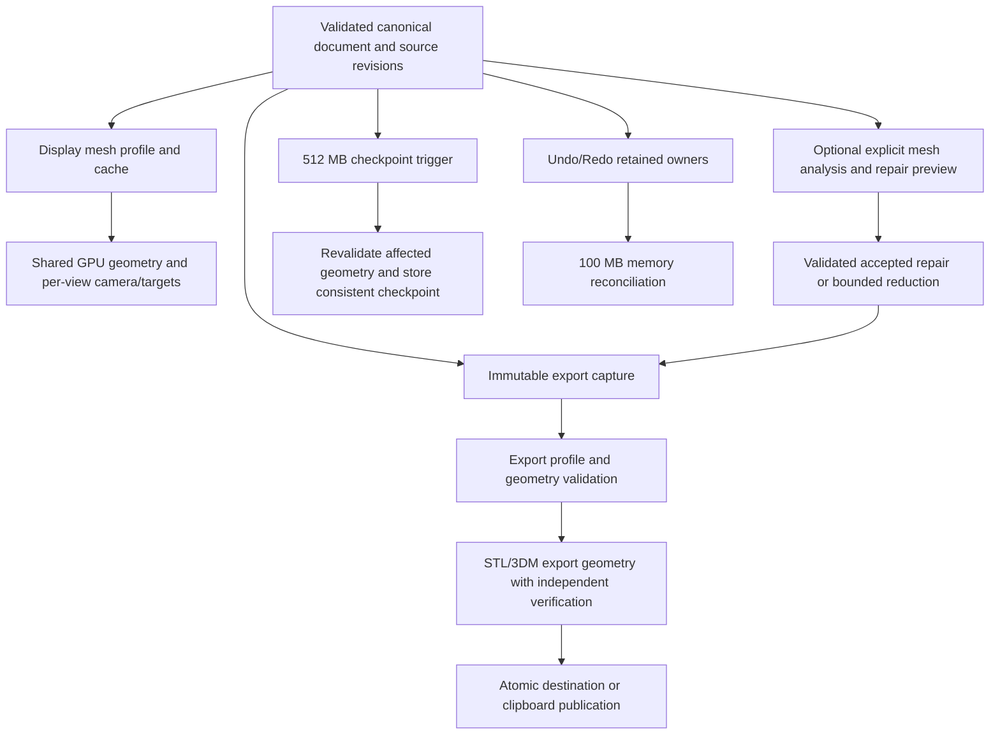

# Historical plan and evidence — archived 2026-11-05

This file preserves the previous plan verbatim below. It is historical reference, not the active task queue. Read PLAN.md for current work and the validation reports for proven scope.

# OM9: viewport, export and memory ownership

Created: 2026-11-02. Revised: 2026-11-03 after reviewing the DeepSeek commentary, current code, the retained PresentMon CSV, Blender 5, open-source CAD references and the gvMeshRepair research. This is the implementation plan; revising it does not establish implementation or acceptance. The memory-settings changes listed under Current delivery are implemented; the remaining phases require their own evidence.

Revision 2026-11-04: the user reports having tested Gumball without the reported problem. Prioritize removing the interactive 256 MiB ceiling with a bounded, end-to-end RAM milestone below; the earlier entries remain a dated evidence history, not a current task checklist. This revision changes the plan only and does not resume the paused implementation goal.

## Confirmed decisions

1. Undo defaults to 1024 MB, configurable up to 50% of total physical RAM. The shared runtime ceiling is 60% of physical RAM: actual live document, retained Undo/Redo, CPU caches and outstanding allocation reservations must fit together, counting shared owners once. The configured Undo maximum is a soft retention limit, not a reservation. Do not refuse a larger valid setting merely by adding its unused maximum to current document bytes. Show configured maximum, actual tracked history and remaining managed headroom separately; budget errors name the retaining owner. MB in the UI means 1,048,576 bytes.
2. Reconcile the complete tracked Undo-memory inventory after each 100 MB of conservatively accounted retained growth; do it earlier on pressure, policy changes and ownership changes such as Undo/Redo. This is a complete accounting of managed owners, not an exact process-RSS measurement.
3. At 512 MB of newly committed canonical geometry data, schedule a checkpoint/revalidation of the affected dependency subgraph. The user clarified that 512B means 512 MB and chose verification within the current session. This checkpoint is independent of the 100 MB memory audit; it adds neither autosave nor crash recovery.
4. Keep canonical CAD geometry valid to document tolerance at commit. A checkpoint verifies/materializes existing geometry; it must not silently turn an approximate committed model into a different final model. Undo eviction never determines geometric precision.
5. Preserve 100% viewport pixel resolution, current antialiasing, and 30 FPS / fallback 24 FPS scheduling targets. No automatic image downscaling, frame generation, automatic mesh decimation or new adaptive LOD in the initial split. Separate quality settings may be introduced with reviewed fixtures; their defaults initially preserve current display behavior.
6. The user authorized implementation of the agreed plan. This document revision alone implements no runtime feature and records no new reusable business rules in skills. DeepSeek's additional numeric thresholds are proposals, not previously approved product rules.
7. When indispensable visible geometry exceeds the GPU budget, completeness takes precedence over cadence: draw all batches at full resolution and publish a complete image, accepting reduced FPS. Avoid blocking CPU waits on the UI thread; retain the ordering/fences required for safe buffer reuse and retirement. Submitted GPU work may complete, but publication still checks document, source, size and presentation state. Superseded preparation may be discarded.
8. Existing evidence includes both a hidden-window replay (~94 ms p50, cause unresolved) and a user-recorded visible-window ETL with ~31.251 ms median between Present calls. Neither proves displayed FPS or input-to-display latency. Do not conclude that P1/P2 can only improve p99, or that the app renders at ~94 ms on the desktop. Require matched measurements for performance claims.
9. GPU cache defaults to Auto, at most 50% of the active adapter's dedicated VRAM and within its OS budget after 10% headroom, with an optional lower MB limit. UMA/shared allocations participate in the shared RAM budget without double counting. If hardware capacity cannot be established, use the agreed temporary 256 MiB limit and report that the hardware ceiling is unverified.
10. STL uses an immutable capture taken when Export is invoked; normal subsequent edits do not restart it. Default linear tolerance comes from the captured document, independent of display quality. Keep the current 0.3 rad angular mesher criterion initially and expose a separate export control; a 5-degree preset requires fixture validation before adoption.
11. Native project storage moves from v4 to v5 to separate source/topology from disposable display caches. Read existing files through checked compatibility conversion, preserve earlier migration paths, and route the first save of a converted file through Save As so the original remains intact. Older OM9 builds cannot read the new format.
12. `gvMeshRepair` is a separate, explicit workflow with diagnosis, preview and user acceptance of shape-changing repairs; normal STL export must not silently fill holes, union objects, delete small pieces or decimate. Preserve input by default. A genuinely absent surface cannot be certified against its unknown original, even if a repair closes the mesh. P3d below is proposed behavior, not an already-approved reusable skill rule.
13. For STL reduction, never promise a fixed reduction percentage or file size. Accept a reduced candidate as tolerance-bounded only when appropriate two-way bounds, topology and encoded-output checks pass; otherwise keep the unreduced result or explicitly report sampled/unverified status under the existing open-export policy. An incomplete test, timeout or unsupported case is `unknown`, not a pass.

## Evidence, interpretation and limits

### Rhino 5 local native decompilation

Source: `ref/rhino5/ghidra/Rhino.exe.c`, 96,060,696 bytes, SHA-256 `7a4a9d4fe3cdb94b9c42b71b3ed8468bd7fdbbe2d49da5f78063d72ef5b7711e`. Bounded procedure reads only; original source remains unchanged and no decompiled implementation is copied.

| Procedure | Export RVA / definition | Observed behavior | Use in OM9 |
|---|---|---|---|
| `CRhinoBrepObject::CreateMeshes` | RVA `0x232c10`; definition line 382973 | Casts the stored object to B-rep, chooses mesh parameters including an object-specific branch, calls `ON_Brep::CreateMesh`, and replaces mesh data of the requested type after generation | Canonical source with purpose-specific derived meshes; do not rebuild geometry just to draw |
| `CRhinoBrepObject::GetMeshes` | RVA `0x233890`; line 383587 | Iterates B-rep faces and obtains `ON_BrepFace::Mesh(mesh_type)` | Retrieve existing purpose-specific mesh data rather than treat the visible triangles as source geometry |
| `CRhinoDoc::CullUndoRecords()` | RVA `0x3f3c20`; line 696290 | Reads configured minimum count and MB value, shifts MB to bytes, calls the explicit-limit overload | Count and RAM policy belong to journal retention |
| `CRhinoDoc::CullUndoRecords(int, uint64)` | RVA `0x3f3c40`; line 696305 | Checks record count and `UndoRecordMemorySize`, retains minimum records and frees the older tail | Preserve a valid retained Undo chain; eviction is not a high-precision modeling operation |

The local managed `Geometry/MeshType.cs` names Render, Analysis and Preview mesh purposes. Decompiled native pointer types and boolean parameter names are not fully trusted; no conclusion is drawn from a guessed field type alone. Export RVAs are recorded as exported; a native VA/PE/disassembly cross-check was not performed. Confidence is high for the named calls and visible branches, medium for full subsystem behavior. This does not prove Rhino GPU buffer lifetime, LRU behavior, meshing error guarantees or relative performance.

Official [Rhino 5 mesh settings](https://docs.mcneel.com/rhino/5/help/en-us/documentproperties/mesh.htm) and [STL settings](https://docs.mcneel.com/rhino/5/help/en-us/fileio/stereolithography_stl_import_export.htm) corroborate independent render-mesh and export tolerances. They are behavioral references, not code to import.

### Blender 5

- [5.2.3 draw-cache implementation](https://github.com/blender/blender/blob/v5.2.3/source/blender/draw/intern/draw_cache_impl_mesh.cc): `mesh_batch_cache_valid` checks cache state; `DRW_mesh_batch_cache_dirty_tag` has distinct selection, shading, UV and full-dirty paths. Adapt the separation of invalidation reasons, not a claim that selection never invalidates any buffer.
- [5.2.3 dependency graph](https://github.com/blender/blender/blob/v5.2.3/source/blender/depsgraph/DEG_depsgraph.hh): evaluate tagged operations in dependency order and distinguish viewport/render contexts. Use source/context keys for selective evaluation.
- [5.0.1 subdivision implementation](https://github.com/blender/blender/blob/v5.0.1/source/blender/modifiers/intern/MOD_subsurf.cc): separate viewport/render levels and CPU/GPU subdivision runtime state. A finer subdivision is not a physical-unit CAD tolerance certificate.
- [5.2 STL release notes](https://developer.blender.org/docs/release_notes/5.2/pipeline_io/) explicitly add Viewport/Render evaluation selection. The 5.2.3 exporter implementation body was unavailable from browsing; this specific behavior is release-note evidence. The [5.0.1 exporter body](https://github.com/blender/blender/blob/v5.0.1/source/blender/io/stl/exporter/stl_export.cc) was inspected and reads evaluated or pre-modified meshes rather than the Undo stack.
- [5.2.3 Undo preference definitions](https://github.com/blender/blender/blob/v5.2.3/source/blender/makesrna/intern/rna_userdef.cc) retain the 0..256 Undo preference and an independent memory budget. OM9 follows the user's RAM-based retention decision; it does not adopt a 256-recipe replay limit.

Blender code is GPL licensed. Independently implement the architecture in existing OM9 Rust owners; this plan copies no Blender code. No matched Rhino/Blender/OM9 benchmark has established an optimal algorithm.

### Open-source CAD comparison

- [FreeCAD's mesher](https://github.com/FreeCAD/FreeCAD/blob/main/src/Mod/MeshPart/App/Mesher.h) exposes separate linear and angular deflection for meshing a shape. This supports retaining a CAD source and a separate output-mesh profile; the existence of those inputs does not certify a global deviation bound.
- [SolveSpace's reference](https://solvespace.com/ref.pl) describes separate on-screen and export chord tolerances, and notes that some Boolean calculations also use chord tolerance. Keep display-only settings out of canonical operations, while explicitly documenting the tolerances actually used by each operation.
- [OpenSCAD's primitive documentation](https://files.openscad.org/documentation/manual/Primitive_Solids.html) exposes fragment settings for curved primitives. Its polygonal representation illustrates the detail/cost tradeoff, but is not evidence that polygon facets are an exact NURBS or B-rep source.
- Apply Blender's invalidation and evaluated-context ideas, not an assumption that all Blender meshes are disposable display approximations: authored meshes can be the source. The reviewed 5.2.3 draw-cache source and 5.2 release notes establish only the stated behavior, not equivalent CAD tolerance guarantees.

### Current OM9 evidence and review corrections

- [Hidden-window replay](../../../../docs/validation/2026-11-01-viewport-navigation-cache.md) established cached-image reuse and no further preparation/upload/encoding in three unchanged views for its recorded fixture. It did not directly count native tessellation calls or establish visible FPS. Its ~94 ms median cannot identify the desktop bottleneck.
- [Visible-window trace follow-up](../../../../docs/validation/2026-11-01-user-viewport-present-trace.md#new-release-trace-follow-up): the retained `L:/om9-nav-target/om9-new-present-trace.csv` contains 2,082 rows, with inter-Present median 31.25065 ms (rounded in the report to 31.251 ms). Display/input-to-photon metrics are unavailable; gesture windows and scene equivalence were not independently marked. Keep this evidence and acquire a controlled comparison rather than treating the hidden replay as the only measurement.
- Historical baseline before the P3a changes used stored display deflection, global `f32` welding and edge-incidence parity. It is not the current implementation. The current path uses captured export linear/angular settings for B-rep and NURBS meshing, retains `f64` until binary encoding, applies source-scoped positional welding and reports that global deviation is unverified. See Current delivery for bounded evidence; positional proximity alone does not prove seam identity. Existing code and tests do not establish all P3 gates.
- [OCCT meshing documentation](https://github.com/Open-Cascade-SAS/OCCT/blob/master/dox/user_guides/mesh/mesh.md) distinguishes linear/angular criteria, interior-face controls and source-shape tolerance. Check the installed SDK's behavior. A smaller requested deflection or angle is not by itself a global error certificate, and an existing shape tolerance can limit the achievable result.
- Existing `ExportCapture`, `ExportReceipt` and staged publication in `om9-exchange` are reuse points. The 3DM path already syncs and inspects the written file and has source revalidation at publication. Its current policy rejects changed sources; reusing it must not accidentally defeat the user's captured-at-start STL policy or weaken existing 3DM guards globally.
- Existing tests include B-rep CRC round trips and mathematical curve comparisons, not only object counts. They still do not establish a general surface-deviation bound. In `legacy3dm/ThreeDmBrep.cpp`, `alreadyNurbs` skips `BRepBuilderAPI_NurbsConvert`, but export still constructs a new `ON_Brep`, checks trim gaps and calls `MatchTrimEnds`; it is not proof of byte-identical or unchanged-CV/trim output.

The [DeepSeek review](REVIEW-VI-2026-11-02.md) is retained as historical design input. This revision corrects its measurement interpretation, publication policy and unvalidated thresholds; the review does not override the confirmed user decisions above.

The [gvMeshRepair research and detailed plan](../../AFTER/gvmeshrepair-20261103/PLAN.md) distinguishes the recovered Matrix managed wrapper from its opaque Netfabb engine. Existing OM9 `mesh_repair.rs` includes centroid-fan hole filling, a quantized-cell weld and a QEM-guided reducer; none is established as a general accuracy-preserving or watertight production route. The bounded `mesh_csg` repair has narrower closed-oriented-input and resource limits. Reuse only with its documented preconditions and new evidence. Binary STL size is `84 + 50 × triangle_count` bytes, separate from OCCT/process memory peaks. The measured one-face sphere Delabella result below applies only to its recorded fixture and scoped export path.

## Target flow

Use existing crates: safe Rust in core/session/scene/render/exchange owns policy, IDs, queues and publication; capability-scoped kernel/native adapters only perform the native operation. Do not introduce a second document owner or a parallel command engine.

## Phases and gates

### Current priority — finish the interactive RAM transition

**Bảng theo dõi ngắn sau khi người dùng thử Gumball — 2026-11-04.**

| Thứ tự | Việc bàn giao | Tình trạng và điều kiện hoàn tất |
| --- | --- | --- |
| Đã ghi nhận | Kéo Gumball | Người dùng xác nhận đã thử và không còn lỗi. Giữ test hồi quy liên quan; chỉ điều tra lại khi có lỗi tái hiện. Không suy rộng thành đã nghiệm thu mọi tay nắm hoặc picking. |
| Đã có, phạm vi kiểm thử | Cấu hình Undo | Mặc định 1024 MiB, trần cấu hình 50% RAM vật lý, kiểm kê tăng trưởng được hạch toán mỗi 100 MiB; xem bằng chứng bên dưới. Đây là mức giữ lịch sử, không cấp sẵn 1024 MiB và không bảo đảm giới hạn toàn tiến trình. |
| 1 | Đường tương tác với bản vẽ lớn | Tận dụng kết quả release đã có cho file hình học 288.315.030 byte; rà các đường New/Open/sửa còn thiếu, bổ sung test đúng đường thiếu và kiểm tra desktop với bản vẽ đại diện khi có. Báo riêng các giới hạn CLI/3DM. |
| 2 | An toàn bộ nhớ được quản lý | Dùng cơ chế hiện có để hạch toán và giữ chỗ các chủ sở hữu đồng thời; kiểm tra không mất tài liệu, Undo/Redo khi từ chối hoặc hủy. Công bố rõ những đường đã và chưa bao phủ. |
| 3 | OCCT và xuất | Đo đỉnh RAM native theo tác vụ và kiểm soát nhận việc/đồng thời theo bằng chứng; bảo vệ file đích khi lỗi. Không gọi mức 60% của Rust là giới hạn cứng toàn bộ RAM OCCT. |
| 4 | Các hạng mục còn lại | Tiếp tục tách nguồn/display, STL/3DM, GPU và checkpoint theo cổng riêng bên dưới; không bắt cấu hình Undo chờ các hạng mục này. |

**Kỷ luật thời gian:** ghi thời gian thực tế cho từng mốc và nêu test nào chạy, lý do chạy lại; chỉ mở rộng phạm vi khi có phụ thuộc hoặc lỗi cụ thể. Không ước lượng thời gian còn lại từ tổng thời gian trước đó khi thiếu số đo theo công việc. Mốc 100 MiB là kiểm kê bộ nhớ, không phải tính lại độ chính xác hình học; checkpoint 512 MiB là việc riêng.

**Phạm vi bàn giao để tránh kéo dài cấu hình RAM.**

1. **Đã có — cấu hình Undo:** ghi nhận kết quả theo [bằng chứng kiểm thử](../../../../docs/validation/2026-11-02-undo-ram-cap-and-inventory.md). Không triển khai lại hoặc chờ OCCT, GPU, STL hay checkpoint để công nhận phần cấu hình này; giới hạn đó không đồng nghĩa giới hạn toàn bộ RAM của OM9.
2. **Ưu tiên tiếp — đường tương tác:** liệt kê cụ thể đường New/Open/sửa còn chưa được kiểm chứng, chọn một đường có rủi ro hoặc thiếu bằng chứng, bổ sung kiểm thử phù hợp và báo riêng kết quả. Giữ kết quả fixture release lớn đã có, chỉ chạy lại khi thay đổi có thể ảnh hưởng nó. Nếu phát hiện lỗi, giới hạn sửa và kiểm thử vào lỗi đó trước khi chuyển mốc.
3. **Sau đó — bộ nhớ đồng thời và OCCT:** xử lý từng chủ sở hữu hoặc tác vụ được xác định bằng bằng chứng; kiểm tra từ chối an toàn và không mất Undo/Redo. Đo riêng bộ nhớ native và công bố giới hạn đo được; không hứa trần 60% cho toàn tiến trình khi chưa kiểm soát mọi cấp phát.
4. **Các mốc STL/3DM, GPU, checkpoint:** tiếp tục theo cổng riêng trong kế hoạch. Chỉ đưa chúng vào mốc RAM tương tác nếu chỉ ra được phụ thuộc cụ thể. Mỗi mốc có báo cáo ngắn gồm phạm vi, thời gian thực tế, test và điều chưa kiểm chứng.

**Lý do kéo dài:** việc chỉnh ô cấu hình không tự nó là công việc 24 giờ. Công việc đã mở rộng sang giới hạn đường tương tác, dữ liệu cùng tồn tại, bộ nhớ OCCT, xuất file và nhiều đợt kiểm thử. Đây là vấn đề phân chia và ưu tiên phạm vi; hiện không có nhật ký đủ chi tiết để xác nhận hoặc phân bổ chính xác 24 giờ. Không gán thời gian còn lại cho từng mốc khi chưa đo.

**Tóm tắt cho quyết định tiếp theo — 2026-11-04.** Bạn đã xác nhận Gumball hoạt động trong lần thử của mình; giữ kiểm thử hồi quy, không tiếp tục xem lỗi kéo đã báo là công việc ưu tiên. Cấu hình Undo mặc định 1024 MiB, trần 50% RAM và kiểm kê sau mỗi 100 MiB đã có bằng chứng trong phạm vi được kiểm thử. Phần còn lại không chỉ là đổi một con số: cần chứng minh các đường mở/sửa tài liệu lớn dùng đúng ngân sách, tính các dữ liệu cùng tồn tại và giữ nguyên bản vẽ cùng Undo/Redo khi thiếu bộ nhớ. OCCT, STL, GPU và checkpoint có cổng nghiệm thu riêng, không chặn việc báo hoàn tất cấu hình Undo trong phạm vi đã chứng minh. Việc mở rộng sang các phần này và kiểm tra lặp lại đã làm tiến độ kéo dài; nhật ký chưa đủ để phân bổ hay xác nhận con số 24 giờ, cũng chưa đủ để ước tính thời gian còn lại đáng tin cậy. Ưu tiên tiếp theo: kiểm tra đường tương tác còn thiếu và một trường hợp tài liệu lớn bị từ chối an toàn, sau đó báo kết quả riêng trước khi mở rộng phạm vi.

**Gumball status.** On 2026-11-04 the user reported that they tested Gumball and no longer see the issue. Treat the reported drag failure as resolved for that user test; the exact build, model, handle and full gesture matrix were not supplied. Do not keep reopening the same investigation without a new reproducible failure. Retain existing regression tests and rerun the relevant ones after changes to camera, picking, input, scene ownership or GPU publication. This report does not certify all picking cases or desktop performance.

**Worker snapshot allocation:** viewport and hover now use fallible metadata allocation for scene snapshots, preserving shared geometry; this is not persistent scene-owner accounting. A follow-up injected an error before each metadata-allocation stage and verified cleanup; it did not force a real allocator failure or exercise that error in the UI. [Evidence](../../../../docs/validation/2026-11-04-interactive-ram-transition.md#fallible-viewport-and-hover-scene-snapshots).

**GPU preparation snapshot owner:** scene, line and overlay jobs share a tracked, reserved snapshot for the same document allocation/epoch/hidden set, including across Gumball preview changes; unneeded bounds calculation is skipped while close culling is disabled. A 2026-11-05 follow-up shares render-buffer leases between the current scene and worker snapshots, and transfers existing leases across incremental scene updates that retain all old buffers. An old worker retains its lease after scene edit or New. Registration starts at first viewport snapshot; complete rebuilds or other versions sharing individual buffers can still be charged twice, and lazy cache/other owner coverage remains incomplete. [Initial evidence](../../../../docs/validation/2026-11-04-viewport-snapshot-ram-owners.md); [shared-buffer follow-up](../../../../docs/validation/2026-11-05-viewport-shared-buffer-lease.md#incremental-scene-follow-up).

**Pressure retry:** a snapshot RAM-budget refusal now backs off 250 ms for the same scene key even if other UI frames arrive; a new scene key is not delayed by the old retry. Controlled offscreen GPU tests cover both cases and recovery. This does not remove the conservative duplicate accounting or establish desktop CPU/latency under pressure. [Evidence](../../../../docs/validation/2026-11-04-viewport-snapshot-ram-owners.md#admission-pressure-retry-backoff).

**Inline hover admission:** scenes with at most 128 objects now reserve estimated pick scratch before synchronous hover, including the transformed-vertex workspace for one large mesh; a managed-pressure refusal retries after release. Controlled UI and GPU regressions pass. The estimate is incomplete and persistent published-scene/index ownership, measured peak and desktop cost remain open. [Evidence](../../../../docs/validation/2026-11-04-inline-hover-ram-admission.md).

**Background hover shared buffers:** the hover worker now uses the viewport's shared scene-buffer lease, while reserving its snapshot metadata and picking scratch separately. Managed-pressure and New-document lifetime fixtures pass; scene registration before the first capture, lazy caches and desktop timing remain open. [Evidence](../../../../docs/validation/2026-11-05-hover-shared-buffer-lease.md).

**STL capture session:** pending UI, detached and experimental-worker captures now observe a shared session token invalidated on successful New/Open, snapshot/Master replacement or window-close request; ordinary edit/Undo/Redo still retain the capture. The final staged-file rename is serialized with invalidation. Controlled New/close boundary tests, same-file Open, failure/restore checks and 60 STL integration tests pass. The worker is not yet connected to the UI; detached-export admission, native peaks and cancellation inside an OCCT call remain open. [Evidence](../../../../docs/validation/2026-11-04-stl-capture-session-identity.md#session-invalidation-through-final-publication).

**Controller lifetime follow-up:** the export-session owner also invalidates on Controller destruction, covering headless Controller replacement; failed Open keeps the old capture valid. Focused worker, headless and document-contract checks pass. Detached-export RAM admission and background UI integration remain open. [Evidence](../../../../docs/validation/2026-11-04-stl-capture-session-identity.md#controller-owner-destruction).

**Detached STL reservation:** direct capture exports now acquire sampled shared-account headroom through a peer that observes registered document versions, and hold it through publication. A subsequent follow-up tracks a conservative high-water scene value at selected publication/usage points while captures exist and rechecks it immediately after admission. This is not a live owner inventory: auxiliary bytes may be stale, not all scene growth is observed, and later growth remains possible. Native peaks and other owners remain unbounded; the lease reserves all currently available managed headroom. This is partial admission, not a reason to enable the background UI worker. [Initial evidence](../../../../docs/validation/2026-11-04-detached-stl-shared-reservation.md); [scene and structural-quota follow-up](../../../../docs/validation/2026-11-04-stl-scene-high-water-and-structural-quotas.md).

**Per-document structural quotas:** validation no longer subtracts other document versions' node and point quotas; bytes remain separately accounted. This fixes two valid block clipboard operations while preserving single-document structural limits. The focused regression and its limitations are recorded in the scene follow-up above.

**Top11 candidate scene:** changed-document Top11 commits now reuse the shared construction reservation through scene publication; the helper also avoids subtracting the already-retained candidate's object quota when validating it. Focused pressure/retry tests and Top11 regressions pass. Post-publication scene ownership and native/preparation peaks remain open. [Evidence](../../../../docs/validation/2026-11-04-top11-scene-admission.md).

**Clipboard candidate scene:** OM9 paste now uses the same shared scene-construction admission, with selection memory included before transaction preparation. A controlled shared-pressure test preserves selection, scene and Redo, then verifies retry and Undo/Redo; native 3DM clipboard fixtures also pass. Persistent published-scene ownership and lazy caches remain open. [Evidence](../../../../docs/validation/2026-11-04-clipboard-scene-admission.md).

**Plugin candidate scene:** plugin edits now use the same shared scene reservation while validating staged selection and through publication. A reserved-scene owner releases buffers before its reservation on failure; related plugin, shared-pressure, clipboard and Top11 regressions pass. Published-scene ownership remains open. [Evidence](../../../../docs/validation/2026-11-04-plugin-scene-admission.md).

**Native 3DM clipboard follow-up:** the three previously ignored clipboard cases now pass with the configured native adapter: line copy/paste and Undo, B-rep with two nondefault tolerances, and layer-sidecar conflict handling. These are small fixtures, not large-model or desktop evidence. [Evidence](../../../../docs/validation/2026-11-04-stl-scene-high-water-and-structural-quotas.md#native-3dm-clipboard-follow-up).

**Why RAM work has taken too long.** The original interactive route inherited `Limits::default().max_bytes` of 256 MiB even when the shared-account ceiling was higher. Interactive startup now derives its limit from physical RAM and preserves it across the tested New/Open paths; `Limits::default()` remains 256 MiB for other contexts, and not all entrypoints are verified. A setting alone cannot safely account for the document, Undo/Redo, display caches, simultaneous jobs and OCCT scratch, or preserve history and files when an allocation fails. STL work also expanded into many small buffer-accounting changes and repeated checks before the interactive limit was closed; that was an execution-priority problem, not a reason to make a simple settings change wait for full native accounting. The measured 6m25s isolated release test build and the 23.28s large-mesh roundtrip are individual results, not an estimate of the remaining work or an explanation of any claimed 24-hour duration. Reuse the existing coordinator, reservations and evidence; do not create a second budget framework.

**Cập nhật theo kết quả thực tế.** Việc chỉnh Options Undo không cần chờ toàn bộ dự án bộ nhớ: thiết lập và kiểm thử có phạm vi đã hoàn thành. Với đường tương tác, fixture hình học tổng hợp 288.315.030 byte đã qua sửa, Undo/Redo, Save As, New/Open và kiểm tra từ chối khi thiếu ngân sách trên bản release; không cần chạy lại cùng phép thử chỉ để chứng minh lại mốc 256 MiB. Đây chưa phải kiểm thử desktop hay bảo đảm cho mọi loại bản vẽ. Phần còn lại có giá trị riêng: với một số đường sửa từng đối tượng, scene mới đã được giữ chỗ và đối chiếu dung lượng thực trước commit; nhưng dung lượng tăng thêm chỉ biết sau cấp phát, các đường scene khác và vòng đời scene sau công bố chưa được hạch toán đầy đủ. [Bằng chứng và giới hạn](../../../../docs/validation/2026-11-04-interactive-ram-transition.md#reconcile-incremental-scene-capacity-before-commit).

**Nguyên nhân thời gian và cách tránh lặp lại.** Cần phân biệt ba việc: (1) đổi và lưu mức Undo; (2) cho bản vẽ lớn hoạt động an toàn cùng lịch sử và cache; (3) đo, kiểm soát đỉnh cấp phát OCCT khi xuất. Việc thứ nhất đã có; hai việc sau cần xử lý các đường dữ liệu và kiểm tra riêng. Tiến độ còn bị kéo dài vì đã mở rộng sang xuất STL/3DM và nhiều lần kiểm thử trước khi chốt từng mốc, không phải vì bản thân ô cấu hình RAM cần 24 giờ. Chưa có nhật ký phân bổ thời gian đủ để xác nhận hoặc giải thích chính xác tổng 24 giờ. Từ đây ghi thời gian thực tế theo từng mốc, tránh lặp lại bộ test không liên quan và chỉ mở rộng khi có đường sử dụng hoặc lỗi cụ thể cần bảo vệ.

**Scope and status, 2026-11-04:**

| Deliverable | Status and evidence | Still needed |
| --- | --- | --- |
| Undo configuration | 1024 MiB default, 50% physical-RAM maximum, low-RAM clamp and 100 MiB reconciliation implemented. [Evidence](../../../../docs/validation/2026-11-02-undo-ram-cap-and-inventory.md). | Verify end-to-end behavior with all owners and pressure; this setting does not reserve 1024 MiB. |
| Interactive 256 MiB limit | Interactive ceiling derives from 60% of sampled RAM; a >256 MiB resource and an approximately 289 MiB in-memory synthetic mesh passed scoped release lifecycle checks. A synthetic 288,314,639-byte geometry file also passed release SaveAs/New/Open. [Evidence](../../../../docs/validation/2026-11-04-interactive-ram-transition.md#release-geometry-archive-larger-than-256-mib). | Verify remaining entrypoints and desktop on representative large files; unknown RAM still uses an explicitly reported conservative fallback. |
| Shared managed RAM | Coordinator and reservations exist and selected paths use them. | Finish live owner inventory, peak admission, simultaneous jobs and failure atomicity; 60% is not a proven whole-process cap. |
| OCCT and STL | Selected STL allocations and the synchronous route have admission checks; measured native peak demonstrated a separate risk. | Measure representative operations and address native/transient allocation and direct-capture admission before enabling the background UI worker. |
| Gumball | User reports the tested Gumball works. | Keep relevant regression tests; investigate anew only on a reproducible failure. |

OCCT measurement follow-up: a twelve-edge fillet and curved 32-section loft each passed three isolated release measurements and analytic-volume/closedness checks. Their process high-water deltas are fixture observations, not native allocation bounds or reservation factors; representative complex models and native admission remain open. [Evidence](../../../../docs/validation/2026-11-04-kernel-operation-memory-probe.md#twelve-edge-fillet-and-curved-32-section-loft).

**Sizing rule:** report configuration, implementation and validation separately. No reliable remaining-hours estimate is available without measuring the remaining milestones on the actual code and fixtures; elapsed time includes investigation and validation, not just changing a number.

**Reprioritization after the user's Gumball test — 2026-11-04.** The reported Perspective drag is no longer the active blocker. Preserve the user's successful test as evidence for that tested case; do not expand it into a claim that every handle, model or input path has been accepted. Investigate again only if a new reproducible failure appears, and run targeted regressions when a change could affect interaction.

**Why the RAM work is larger than the Options setting.** The 1024 MiB default and 50% Undo setting are already implemented for the documented paths. The remaining work is a separate safety and coverage problem: an edit can temporarily retain the old model, the new model, Undo/Redo and a rebuilt scene at once; exports and native kernel operations can allocate additional memory outside the managed Rust account. A configured maximum therefore does not prove the combined peak fits. Shared allocations must be counted once, a failed operation must leave the model and history intact, and native peaks require measurements and explicit admission or isolation. The 100 MiB inventory is an accounting trigger, not a geometry recalculation; the 512 MiB checkpoint is separate and is not a prerequisite for the Undo setting.

**Execution correction.** Previous work spread into STL, 3DM, native accounting and repeated validation while the interactive limit still needed a clearly bounded acceptance gate. That expanded the elapsed work; the available records do not establish a 24-hour breakdown or justify claiming a remaining duration. Complete and report the smallest useful milestone first. Do not require GPU batching, v5 migration, mesh repair, checkpointing, or a universal bound on OCCT internals to call the Undo setting implemented or to validate the tested interactive route. Conversely, do not claim that a tested route provides complete process-wide RAM protection.

**Next work packages and explicit stop conditions:**

1. **Undo Options — implemented; close only the scoped verification gap.** Check default, 50% cap, low-RAM behavior, 100 MiB inventory and retention under pressure using the existing tests and add a focused regression only for a demonstrated missing case. Report the setting and its test scope; do not redesign the accounting system for this package.
2. **Interactive model above 256 MiB — scoped release evidence obtained; remaining GUI coverage next.** Reuse the existing 288,315,030-byte release edit/Undo/Redo/SaveAs/New/Open and low-budget refusal result. Audit the remaining interactive Open/New/edit paths for unintended default limits and test a representative user model on desktop when available; do not rerun the same large synthetic fixture absent a relevant change or unresolved failure. List unrelated CLI and codec limits separately rather than making all of them blockers for this GUI milestone.
3. **Managed-owner pressure — separate deliverable.** Complete the required owner and simultaneous-reservation coverage for the paths being delivered, including old/new document and scene lifetime, shared allocations, success/cancel/failure and atomic history pruning. State precisely which paths are covered. Expand to another owner only when its path is being enabled or a test demonstrates a gap.
4. **OCCT and export — separate measured deliverable.** Measure representative native operation peaks and implement justified admission, concurrency controls or isolation for each enabled path. Preserve destination files and the active document on failure. If native peaks cannot be bounded, document that limitation rather than treating the managed 60% policy as a process or OCCT hard cap.
5. **Resume the remaining plan independently.** Source/display separation, accurate STL and 3DM, GPU budget and complete batching, the 512 MiB checkpoint, and explicit mesh repair retain their own acceptance gates below. Each can advance after its actual prerequisites are satisfied; none changes the reported status of the Undo setting.

At each package boundary record changed paths, a concrete fixture, targeted test results, gaps, and measured elapsed build/test time. Run broader suites once at a relevant boundary or again after a change that can affect them; avoid repeated full validation for unrelated edits. Only estimate remaining time after collecting representative timings, and label such estimates as uncertain rather than as a deadline.

**Separate delivery milestones so a settings change does not wait for the entire memory project:**

| Milestone | Completion gate | Current assessment |
| --- | --- | --- |
| A. Undo setting | Default 1024 MiB, configurable ceiling 50% of physical RAM, low-RAM handling and the 100 MiB tracked-growth inventory rule work and retain history correctly in the tested paths. | Implemented with scoped evidence above; remaining cross-owner pressure cases are not proof that the setting itself is missing. |
| B. Interactive document limit | Supported interactive routes use the existing 60% managed-RAM policy instead of the inherited 256 MiB session ceiling; exercise New/Open and a genuinely >256 MiB geometry file, including failure without lost document or history. | Partial: after fixing summed history node counts, a 288,315,030-byte synthetic geometry archive passed release edit/Undo/Redo/SaveAs/New/Open and low-budget refusal. Other routes, representative file types, OS-wide pressure and desktop remain open. [Evidence](../../../../docs/validation/2026-11-04-interactive-ram-transition.md#per-document-node-limits-across-retained-history). |
| C. Shared managed owners | Account and reserve simultaneously live document/history, scenes, caches and jobs without double counting; refuse safely under pressure. | Partial; the policy is not yet a demonstrated whole-process or all-owner ceiling. |
| D. Native OCCT and export peaks | Measure representative native peaks, control concurrency/admission as justified, and verify cancellation and preservation of the destination and live document. | Separate open gate; OCCT's internal allocations are not automatically bounded by a Rust reservation. |

The 256 MiB mentioned in the older Undo evidence describes that evidence at the time it was written; use the later interactive-transition evidence for the current tested startup path. The 256 MiB unknown-GPU fallback and free-RAM reserve remain different rules. Milestone A does not require completion of B–D; report each gate independently. Do not infer that changing the configured number has completed real memory ownership or native accounting, and do not delay delivering a verified gate for unrelated GPU, STL or checkpoint work.

**Delivery sequence:**

1. **Finish tracing the interactive limit.** The original startup rejection has been reproduced and addressed for the tested routes. List the remaining document/history, scene and export entrypoints that can reintroduce `Limits::default()` or clamp the session. Classify each as interactive managed budget, per-operation protection, or untrusted file/codec safety. Keep the 256 MiB *GPU fallback* and the `max(256 MiB, 10% RAM)` free-physical-memory reserve: those are separate approved rules.
   - Remaining entrypoint audit, 2026-11-04: the `migrate`, `inspect` and plugin CLI functions in `om9-app/src/main.rs` construct `Limits::default()` independently of the interactive session. They can therefore still refuse larger documents. Treat these as separate CLI document policies to implement and test with appropriate admission, not as evidence that the tested GUI startup fix failed. `report` and `create_fixture` in the same file also pass the default and require an appropriate scoped audit. `BuilderSession` uses defaults for individual field-domain checks, not a demonstrated whole-document limit; `dock_layout` uses them to parse layout data. The 3DM native source-file, JSON and pipe caps listed below are separate untrusted-input/transport limits and remain subject to bounded-streaming work.
   - Follow-up: `--inspect` and `--audit` use hardware-derived limits and staged archive/report reservations without constructing a scene; a 288,314,639-byte synthetic file passed release `--inspect` and nine cold-process regressions passed. The conservative retained archive lease can still cause early refusal; other CLI limits require separate review. [Evidence](../../../../docs/validation/2026-11-04-interactive-ram-transition.md#cli-inspect-and-audit-open-admission).
   - CLI `import_3dm` now uses the hardware-derived session limit, applies the shared physical ceiling to its coordinator and reserves available headroom through archive serialization and verification. Its report uses the same document limits. Native tests cover refusal at a 32 MiB override with the destination unchanged, successful import at 512 MiB, and a curve/NURBS/mesh roundtrip. Native peaks, file/transport caps and large 3DM files remain separate open gates. [Evidence](../../../../docs/validation/2026-11-04-interactive-ram-transition.md#cli-3dm-import-ram-admission).
   - CLI `export_3dm` now opens its input using the reserved Controller lifecycle and hardware-derived limits, retaining the saved document name and allowing archive filenames without an `.om9` suffix. Small native tests cover input refusal with both files unchanged and a successful export. This does not yet account for all export projection/native allocations, remove 3DM transport caps, or prove large-model accuracy. [Evidence](../../../../docs/validation/2026-11-04-interactive-ram-transition.md#cli-3dm-export-open-admission).
   - Normal 3DM export now reserves its configured native process and pipe allowance in the coordinator's shared account across native write and inspection. A competing reservation can force refusal while preserving the source and destination; retry after release succeeds. This is an allowance, not a bound on OCCT or all native allocation; conversion before this reservation, packet/response buffers, selected projection lifetime and GPU/scene ownership still need admission. [Evidence](../../../../docs/validation/2026-11-04-interactive-ram-transition.md#3dm-export-native-allowance-in-shared-account).
   - `ExportCapture::all` registers its immutable source document with the existing shared-owner inventory. When a document changes and history no longer retains the old version, that version remains charged while the capture lives and is released after its last owner drops. Conversion and packet allocations still require further admission. [Evidence](../../../../docs/validation/2026-11-04-interactive-ram-transition.md#export-capture-source-lifetime).
   - Selected export/clipboard capture reserves a clone estimate before constructing its private projection and retains it until the capture drops. The estimate now excludes shared Arc-backed resource, B-rep source and native B-rep payload bytes; controlled shared-payload, pressure and native selected-export tests pass. Other shared owners, projection growth, validation scratch and B-rep conversion need further audit and admission. [Evidence](../../../../docs/validation/2026-11-04-interactive-ram-transition.md#shared-payloads-in-selected-clone-estimates).
   - Whole-document 3DM export now reserves the estimated nonshared document clone before an editable B-rep conversion and retains that reservation with the capture. A controlled bridge checks the reservation is present during conversion; an OCCT-generated sphere exports as one native B-rep without changing the source. The converted payload's growth and OCCT's internal allocations remain unbounded by this clone estimate. [Evidence](../../../../docs/validation/2026-11-04-interactive-ram-transition.md#brep-export-clone-before-conversion).
   - Normal 3DM export now serializes the packet directly to a private staged file with a reserved 64 KiB buffer, incremental hash, cancellation and an explicit length bound. This replaces the earlier growing in-memory packet and its exact-growth fallback. The native adapter still reads a bounded packet into a DOM and enforces 16 MiB, so large-3DM streaming and native/response memory remain open. [Evidence](../../../../docs/validation/2026-11-04-interactive-ram-transition.md#3dm-export-streamed-staging-packet).
   - The native openNURBS adapter now performs JSON preflight and DOM parsing from the same held read handle, without an additional full packet string; it rejects an already-open writer and retains its 16 MiB, depth, node and schema limits. Actual DOM/SDK memory, >16 MiB input and performance are not established. [Evidence](../../../../docs/validation/2026-11-04-interactive-ram-transition.md#native-3dm-packet-file-streaming).
   - Isolated A/B tests on two point-cloud fixtures did not demonstrate a meaningful decrease in native job peak memory. Initial unbuffered file parsing was slower in these small samples; a 64 KiB native read buffer reduced the observed time gap, but three runs are insufficient for a general speed claim. Prioritize native DOM/SDK allocation profiling before claiming memory or performance improvement. [Evidence](../../../../docs/validation/2026-11-04-interactive-ram-transition.md#native-packet-ab-measurements-and-buffered-reader).
   - An opt-in native profile found JSON DOM construction responsible for the largest observed increase on the 256,000-point fixture. Releasing each root object's JSON geometry after its native model component is created reduced median native write-job peak from 73,428,992 to 68,116,480 bytes in three paired samples (about 7.2%); cold-verification regressions passed. Other geometry, larger files, full allocation bounds and desktop performance remain open. [Evidence](../../../../docs/validation/2026-11-04-interactive-ram-transition.md#native-json-dom-phase-profile-and-root-release).
   - The same lifetime change now covers geometry members of native block definitions after dependency traversal and conversion. On a synthetic eight-definition fixture the median native write-job peak fell from 73,592,832 to 68,276,224 bytes in three paired samples; shared/nested-block regressions passed. Full DOM construction, other model types, large-file limits and desktop remain open. [Evidence](../../../../docs/validation/2026-11-04-interactive-ram-transition.md#native-definition-json-release).
   - `render_frames` now obtains the hardware-derived session limit and uses the reserved Controller Open path rather than decoding with `Limits::default()` before constructing a Controller. Focused tests cover low/sufficient budgets, preservation of the input and nonstandard file extensions; two offscreen GPU tests passed including geometry comparison. An actual >256 MiB file through `--render-4`, GPU allocation peaks and desktop performance remain unverified. [Evidence](../../../../docs/validation/2026-11-04-interactive-ram-transition.md#headless-render-open-admission).
   - Plugin batch execution now uses the hardware-derived limit and reserved Controller Open/Save rather than loading and saving with the 256 MiB default. A real plugin and 2 MiB resource fixture verify low-budget refusal preserves existing files and a higher-budget retry succeeds; >256 MiB plugin input and native allocation limits remain unverified. [Evidence](../../../../docs/validation/2026-11-04-plugin-cli-ram-admission.md).
   - Explicit v1/v2/v3 CLI migration now uses a hardware-derived limit and a shared-account headroom lease through the existing verified schema-4 replacement. A 100,000-point v3 fixture passes low-budget preservation and retry; large legacy files, v1/v2 fixtures and native/allocator peaks remain open. This does not implement v4-to-v5 Save As. [Evidence](../../../../docs/validation/2026-11-04-legacy-cli-ram-admission.md).
2. **Finish the bounded interactive transition.** Startup derives its ceiling from 60% of sampled physical RAM and tested New/Open retains the policy; propagate and verify it across remaining transactions and entrypoints. Keep structural, overflow and justified file/operation limits separate; do not globally raise `Limits::default()` or silently remove trust-boundary protection. Reuse the existing coordinator, retained-owner accounting and reservations. If physical RAM cannot be obtained, retain a conservative explicitly reported fallback; do not present it as the requested hardware-derived ceiling. Keep Undo's 1024 MiB default and 50% physical-RAM maximum, with the low-RAM clamp, as already approved.
3. **Prove the transition before expansion.** With a real supported fixture, demonstrate managed live data exceeding 256 MiB under a sufficient derived ceiling; test the boundary at 60%, concurrent reservations and sampled free-RAM reserve, shared-owner deduplication, low/unknown RAM, and New/Open. Failure or cancellation must preserve document, Undo/Redo and an existing destination; successful history pruning stays atomic. Verify actual allocations and the operational path, not just an injected counter. If unknown owners prevent a safe claim for a path, name that path and keep its gate open rather than reclassifying it as complete.
4. **Cover heavy native and export work as an explicit separate gate.** Measure representative STL tessellation, Boolean, fillet and loft process peaks and elapsed time in isolated release runs. Use operation-specific admission or isolation justified by those results, account known live inputs/outputs and concurrent jobs, and expose unverified native memory honestly. OCCT allocation is not inherently constrained by a Rust reservation; measured examples are not universal upper bounds, and the 60% managed limit is not an RSS guarantee. Complete direct-capture reservation, cancellation and destination-preservation tests before wiring the worker into the UI.
5. **Return to the remaining mainline.** Continue P1 source/display separation and v4/v5 migration, P2 GPU budgeting and complete batching, P3 STL/3DM correctness, P4 checkpoints, and P3d explicit mesh repair under their existing acceptance gates. The interactive-cap milestone is not full P0, native-memory completion or completion of this plan.

**Efficient execution and reporting:** implement each coherent milestone end-to-end before expanding incidental accounting. Run focused red/green and relevant integration checks during development; run the wider Rust, GPU or export suites once at the milestone boundary and again only after changes affecting them. Build outside the checkout with `-j 2`, keep the existing OM9 session and files safe, audit source and prune artifacts as required. Record actual commands, fixture sizes, failures, measured outcomes and unresolved owners in one consolidated milestone entry; do not infer a completion percentage or promise a duration without measurement. Do not lower precision, resolution or silently drop data to meet a budget.

**Interactive transition in progress, 2026-11-04:** interactive startup now derives its byte limit from sampled physical RAM; a real 270 MiB document resource reproduced the previous rejection and passed after the change. A release fixture with a deliberately overlapping, approximately 289 MiB mesh also passed; a separate 2,000,000-point case initially hit a structural point limit and now passes startup after the scoped point-accounting correction below. A >256 MiB resource archive and a 288,314,639-byte synthetic geometry archive passed Save/New/Open; the latter ran in debug. Full owner/native-memory, representative file and desktop gates remain open. [Evidence and remaining work](../../../../docs/validation/2026-11-04-interactive-ram-transition.md).

**Partial B-rep display sharing, 2026-11-04:** document/history clones now share an immutable, fingerprint-bound B-rep display allocation and its inventory is deduplicated across the tested owners. Tests cover aliases, independent allocations, Undo/capture, JSON roundtrip, picking and offscreen viewport publication. This is a memory-ownership step, not an evictable display cache, v5 migration or completion of P1; native clone peaks and full owner accounting remain open. [Evidence](../../../../docs/validation/2026-11-04-brep-shared-display.md).

**Snapshot transfer follow-up:** the kernel-to-STL handoff no longer silently clones a shared display without a reservation; it moves unique buffers or returns `Busy`. A real-OCCT kernel test covers both paths and 60 STL integration tests pass. Other OCCT peaks and export-owner reservations remain open. [Evidence](../../../../docs/validation/2026-11-04-brep-shared-display.md#snapshot-handoff-follow-up).

**Interactive limit audit — pavé Reset:** the typed and floating-window reset paths now use the current Controller's limits instead of `Limits::default()`; a refused recomputation leaves the previous preview unchanged. Scoped controller tests pass; UI click replay, actual large pavé data and admission of all recomputation temporaries remain open. [Evidence](../../../../docs/validation/2026-11-04-interactive-ram-transition.md#pav%C3%A9-reset-uses-session-limits).

**Prepared candidate visibility:** changed candidate documents are now registered with the shared owner inventory before `prepare` returns, including paths that do not construct a scene. Focused tests verify peer visibility, competing-reservation refusal and release on drop. The earlier clone gap was subsequently addressed as described below; complete transaction-preparation admission remains open. [Evidence](../../../../docs/validation/2026-11-04-interactive-ram-transition.md#prepared-transaction-candidate-peer-accounting).

**Document clone reservation follow-up:** participant document-copy estimates are now reserved before cloning and transferred to registered candidate owners under shared locks; targeted pressure/cancellation and transaction regressions pass. The Controller now samples free RAM for this reservation as described below; other preparation allocations, release/desktop and large-scene latency remain open. [Evidence](../../../../docs/validation/2026-11-04-interactive-ram-transition.md#transaction-document-clone-reservation).

**Physical headroom follow-up:** the application Controller supplies a fresh OS memory sample for the document-clone reservation. Low sampled headroom refuses before copying while preserving Redo; unavailable samples retain managed-limit admission without a claim about current free RAM. Other allocations, independent coordinator users, low-RAM desktop and release/latency checks remain open. [Evidence](../../../../docs/validation/2026-11-04-interactive-ram-transition.md#sample-physical-headroom-before-transaction-document-clone).

**Planning indexes:** known temporary transaction BTree indexes are now estimated and reserved before insertion and released with their owners. A separate empty-transaction history-accounting regression found by the Layers suite was corrected. Other validation/mutation/native scratch and full background-export admission remain open. [Evidence](../../../../docs/validation/2026-11-04-interactive-ram-transition.md#transaction-planning-index-reservation).

**GPU overlay inventory:** opt-in diagnostics now track overlay vertex and uniform buffers across encoded and in-flight work and report a deduplicated window union. Offscreen GPU tests cover submission and completion; staging, driver/eframe owners, actual budget enforcement and complete batching remain open. [Evidence](../../../../docs/validation/2026-11-03-viewport-snapshot-diagnostics.md#overlay-buffers-in-encoded-and-submitted-work).

**GPU scene camera inventory:** diagnostics now track actual scene and ghost camera buffers through queue completion. Two-view/ghost fixtures and four-camera image comparison pass; staging, other GPU owners, enforcement, batching and desktop evidence remain open. [Evidence](../../../../docs/validation/2026-11-03-viewport-snapshot-diagnostics.md#scene-camera-buffers-in-flight).

**GPU arena capacity:** vertex and index chunks choose separate size classes, and scene creation defers geometry arenas until needed. The two asymmetric fixtures now use 10 MiB logical arena capacity, versus 14 MiB after the independent-size change and 20 MiB under the original rule. Offscreen image, empty-to-filled viewport and Gumball checks pass. Real-scene allocation, budget enforcement and complete batching remain open. [Evidence](../../../../docs/validation/2026-11-03-viewport-snapshot-diagnostics.md#allocate-geometry-arenas-only-for-nonempty-scenes).

**GPU minimum target guard:** before allocating normal viewport targets, OM9 rejects a full-resolution target set whose logical minimum alone exceeds the selected-adapter ceiling (or 256 MiB unverified fallback), retaining the last complete same-document image. Simulated GPU tests cover refusal and recovery. This is a necessary lower bound only, not full GPU admission, total-window accounting or over-budget batching. [Evidence](../../../../docs/validation/2026-11-03-viewport-snapshot-diagnostics.md#minimum-viewport-target-budget-guard).

**Resolved fixture blocker:** the large mesh Save/New/Open fixture initially failed during Save with `Budget("nodes")`; bounded geometric writer growth and separate verification/parser structural accounting were added. [Initial evidence](../../../../docs/validation/2026-11-04-interactive-ram-transition.md#large-mesh-save-buffer-growth-and-structural-node-refusal).

Two small red/green fixtures isolate and correct structural-counter subtraction for the save verification copy and conflation of model nodes with archive JSON tokens. The parser remains bounded by input size and byte admission; typed document validation retains its model limit, and generic operation JSON keeps its existing token cap. The approximately 289 MiB synthetic mesh passed release Save/New/Open, producing a 198 MiB file; a later UV-rich synthetic mesh produced a >256 MiB file and passed the lifecycle in debug. Complete input-safety, representative large geometry files, native accounting and desktop acceptance remain pending. [Evidence](../../../../docs/validation/2026-11-04-interactive-ram-transition.md#geometry-archive-above-256-mib-fixture-development).

**Point-limit follow-up:** document and derived scene point quotas are now checked independently while their bytes remain combined. The original 2,000,000-vertex fixture passes isolated debug and release startup; point-boundary, Copy/Paste, Undo/Redo and scene/Gumball regressions pass at the stated scopes. Actual desktop and remaining owner/operation paths are not established by this result. [Evidence](../../../../docs/validation/2026-11-04-interactive-ram-transition.md#independent-document-and-scene-point-quotas).

**Change-feed before-state:** Undo/Redo, Builder, Clear History and plugin paths now retain and register the immutable prior document rather than deep-cloning it solely to compute a change batch. Focused debug tests include the actual packaged plugin; no RSS reduction has been measured. [Evidence](../../../../docs/validation/2026-11-04-interactive-ram-transition.md#shared-before-state-for-change-notifications).

**Undo/Redo publication:** candidate scene preparation now precedes history publication, and a competing-reservation fixture checks refusal preserves the prior snapshot and scene. This is scoped to Undo/Redo; other post-commit scene refresh paths and concurrent/native peak accounting remain open. [Evidence](../../../../docs/validation/2026-11-04-interactive-ram-transition.md#undoredo-scene-preparation-before-publication).

**Transform publication:** Gumball drag, numeric Gumball and the common transform path prepare a candidate scene before committing. Scoped pressure, transform and GPU/egui checks pass; complete reservation, desktop checks and the other editing paths remain open. One separate transform availability test conflicts with the current catalog and needs reconciliation. [Evidence](../../../../docs/validation/2026-11-04-interactive-ram-transition.md#candidate-scenes-for-transform-and-gumball).

**Additional edit publication:** multi-object geometry, mesh utilities, Gem, Job Bag insertion, Solid results, stress meshes, deletion and FourRailProfile prepare their candidate scene before commit. Scoped Delete pressure and geometry checks pass; Solid's post-commit selection and other remaining refresh paths need review. Candidate-scene construction still needs full transient and concurrent-owner admission. [Evidence](../../../../docs/validation/2026-11-04-interactive-ram-transition.md#candidate-scenes-for-more-editing-paths).

**Candidate-scene admission:** the common helper now registers its staged document and reserves known scene preflight/construction estimates through commit; a shared-account lifetime test covers cancellation and publication. This is a partial improvement: transaction preparation, caller-owned caches across peers, allocator/native memory and other paths are not fully reserved. [Evidence](../../../../docs/validation/2026-11-04-interactive-ram-transition.md#shared-admission-during-candidate-scene-construction).

**Builder and 3DM publication:** Builder and History paths and interactive 3DM import now prepare the candidate scene before committing. A small self-generated 3DM passes pressure refusal and retry, and current native-adapter clipboard cases pass; broader 3DM roundtrip failures and native/import memory accounting remain open. [Evidence](../../../../docs/validation/2026-11-04-interactive-ram-transition.md#builder-history-and-3dm-candidate-publication).

**B-rep 3DM follow-up:** an editable B-rep conversion in a private export projection now reconciles retained bindings before validation, without changing the live source; scoped native Controller/CLI roundtrips pass. No-B-rep exports avoid a redundant full-document clone. Unresolved-unit policy, comprehensive 3DM geometry/topology comparison and import/native memory remain open. [Evidence](../../../../docs/validation/2026-11-04-interactive-ram-transition.md#b-rep-3dm-export-projection-and-retained-bindings).

**3DM import process admission:** its existing default native/pipe allowance is 160.1875 MiB, explaining refusal at a 32 MiB test limit. That allowance is now reserved in the shared account for the actual import and released after success or error. It is not actual consumption or a complete snapshot/OCCT/process-wide cap; complete concurrent owners and measured native peaks remain open. [Evidence](../../../../docs/validation/2026-11-04-interactive-ram-transition.md#3dm-native-process-reservation).

**3DM source snapshot:** the existing conservative `3 × file bytes + 16 KiB` estimate is now added to shared admission before the locked source is read. Actual allocator/native peaks, other owners and real concurrent workloads remain open; the subsequent handoff improvement is described below. [Evidence](../../../../docs/validation/2026-11-04-interactive-ram-transition.md#3dm-source-snapshot-admission).

**3DM handoff and file limits:** the retained import bundle now carries a reduced shared reservation until the prepared candidate is registered. Conversion allocations before that estimate, private transaction clones, caller-held owners and concurrent peaks remain open. Import still has an independent 64 MiB source-file limit and 16 MiB default native stdout limit; audit and replace or justify these limits using bounded streaming and large-file evidence before claiming large-model 3DM support. [Evidence](../../../../docs/validation/2026-11-04-interactive-ram-transition.md#3dm-import-bundle-handoff).

**3DM conversion admission:** known inventory and map/diagnostic conversion estimates are now registered in shared admission before the corresponding conversion allocations. A controlled two-account native-import test observes the reservation and refusal of a competing request; JSON decode before inventory registration, unknown geometry/OCCT allocations, other owners and large-file evidence remain open. [Evidence](../../../../docs/validation/2026-11-04-interactive-ram-transition.md#3dm-conversion-estimates-in-shared-admission).

**3DM JSON preflight admission:** the normal bounded JSON scanner now incrementally grows a shared reservation before its estimated allocations, retained through typed decoding, with an exact-headroom fallback. Actual allocator and native/OCCT peaks, the completeness of typed estimates, other owners and large-file evidence remain open. [Evidence](../../../../docs/validation/2026-11-04-interactive-ram-transition.md#incremental-json-preflight-reservation-for-3dm).

**3DM limits and pipe capture:** the 64 MiB archive, 16 MiB native JSON/stdout and 16 MiB export packet/staged-file limits are separate; the native projection materializes JSON rather than streaming. Windows pipe capture now grows its buffer amortized while retaining the exact logical output cap. These changes do not lift the format limits or prove large-file support; implement bounded streaming and test actual large source/output files. [Evidence](../../../../docs/validation/2026-11-04-interactive-ram-transition.md#3dm-size-limit-audit-and-bounded-pipe-growth).

Execution order, with P5 evidence recorded for each delivery:

**Historical handoff (2026-11-03; priority superseded above).** New and Open recheck shared reservations through controller publication; deterministic tests cover a competing reservation, preservation of the old document and Redo, and retry after release. [Evidence and limitations](../../../../docs/validation/2026-11-03-file-replacement-ram-admission.md). This is a partial P0 correction: candidate construction is not fully reserved, and peers do not yet share a complete inventory of all live worlds and caches. Complete the necessary admission/lifetime prerequisites before a background repair/export job depends on them. This historical handoff does not establish P0 or P3b acceptance.

STL worker admission now includes a provable authored-mesh soup and topology-array minimum, counting both triangles of a quad. Hash tables, native allocations and other owners remain unbounded, so this is not a sufficient reservation for UI background export. [Evidence](../../../../docs/validation/2026-11-03-stl-worker-sampled-reservation.md#topology-array-floor-and-quads).

The experimental STL worker now caps the kernel snapshot byte limit at its reservation. This is only a per-snapshot bound; combined Rust/native working memory remains unbounded and UI integration remains gated. [Evidence](../../../../docs/validation/2026-11-03-stl-worker-sampled-reservation.md#native-adapter-ceiling-from-worker-reservation).

Existing STL point/triangle capacities and temporary converted source strings are deducted before the next native snapshot admission. Remap, output growth and native scratch remain open. [Evidence](../../../../docs/validation/2026-11-04-stl-soup-snapshot-admission.md).

STL now checks the retained snapshot plus minimum parent/radius/shell remap arrays together after deducting existing soup. Lookup maps, native scratch and output growth remain open. [Evidence](../../../../docs/validation/2026-11-04-stl-soup-snapshot-admission.md#topology-remap-minimum).

The same STL check now includes a conservative estimate for both remap lookup trees, with cancellation during the binding scan. Allocator behavior, output growth, native scratch and measured large-model performance remain open. [Evidence](../../../../docs/validation/2026-11-04-stl-soup-snapshot-admission.md#topology-lookup-estimate).

B-rep STL output growth now preflights old/new point or triangle buffers alongside the retained remap and source arrays. Authored-mesh growth, allocator over-allocation and native transient accounting remain open. [Evidence](../../../../docs/validation/2026-11-04-stl-soup-snapshot-admission.md#b-rep-output-buffer-growth).

Authored-mesh STL output growth now checks its old/new point and triangle buffers and uses bounded amortized growth with an exact-capacity fallback. Allocator and remaining topology/native owners still need admission. [Evidence](../../../../docs/validation/2026-11-04-stl-soup-snapshot-admission.md#authored-mesh-output-growth).

B-rep output now also plans both buffer peaks together, with amortized growth and exact fallback. The 64-instance fixture checks allocation-growth counts and output identity, not desktop performance. [Evidence](../../../../docs/validation/2026-11-04-stl-soup-snapshot-admission.md#amortized-b-rep-output-growth).

Indexed STL topology analysis checks the retained soup and its minimum union-find arrays together before allocation. Hash tables, fan data and later encoded-output analysis remain open. [Evidence](../../../../docs/validation/2026-11-04-stl-soup-snapshot-admission.md#indexed-soup-topology-minimum).

The indexed edge stage also checks known face/edge table capacity at growth boundaries. Hash-table metadata, fan data and encoded-output analysis remain open. [Evidence](../../../../docs/validation/2026-11-04-stl-soup-snapshot-admission.md#indexed-edge-stage-capacity-admission).

The following fan-list construction also checks known table and per-vertex vector capacity on growth. Hash metadata, per-fan adjacency and encoded-output analysis remain open. [Evidence](../../../../docs/validation/2026-11-04-stl-soup-snapshot-admission.md#indexed-vertex-fan-list-admission).

The indexed fan traversal also checks known adjacency, visited and pending capacities alongside retained fan lists. Hidden hash/allocator overhead and encoded-output analysis remain open. [Evidence](../../../../docs/validation/2026-11-04-stl-soup-snapshot-admission.md#indexed-fan-adjacency-and-traversal-admission).

The STL writer now admits known quantized-position hash slots together with retained soup capacity before and after growth. Hash metadata, buffered output, native/other owners and post-write encoded analysis remain open. [Evidence](../../../../docs/validation/2026-11-04-stl-soup-snapshot-admission.md#quantized-position-table-admission-during-stl-writing).

The STL path also includes its explicit 8 KiB writer-buffer capacity and no longer allocates a second buffered reader for staged verification. Stack, allocator and other owners remain open. [Evidence](../../../../docs/validation/2026-11-04-stl-soup-snapshot-admission.md#stl-streaming-and-staged-verification-buffers).

After soup creation, retained warning/skipped string and output path capacities also reduce topology and writer headroom. Their earlier allocation and other export owners remain open. [Evidence](../../../../docs/validation/2026-11-04-stl-soup-snapshot-admission.md#receipt-notes-and-output-path-during-stl-validation).

Skipped-object note construction now checks its known live soup and receipt capacities before allocation; warning construction and subsequent geometry growth still need full admission. [Evidence](../../../../docs/validation/2026-11-04-stl-soup-snapshot-admission.md#skipped-object-note-allocation).

Existing receipt notes now reduce the budget supplied to later mesh, B-rep and native surface construction; warning allocation and other owners remain incomplete. [Evidence](../../../../docs/validation/2026-11-04-stl-soup-snapshot-admission.md#receipt-notes-during-later-geometry-construction).

Warning strings now check known soup and receipt storage before allocation; coexisting native source and other owners remain incomplete. [Evidence](../../../../docs/validation/2026-11-04-stl-soup-snapshot-admission.md#warning-note-allocation).

The temporary converted NativeBrep/NURBS source is now released before warning allocation; broader native and allocator ownership remains open. [Evidence](../../../../docs/validation/2026-11-04-stl-soup-snapshot-admission.md#converted-native-source-lifetime).

STL writing now accounts for the retained temporary-path capacity and avoids cloning that path; allocation before the check and other path/OS costs remain open. [Evidence](../../../../docs/validation/2026-11-04-stl-soup-snapshot-admission.md#temporary-output-path-during-stl-writing).

The current synchronous UI and Controller STL route now holds managed export headroom through the operation, with a physical-memory sample and a capped per-export limit. Direct capture calls and native/transient accounting are still open; this does not enable the background UI worker. [Evidence](../../../../docs/validation/2026-11-04-stl-soup-snapshot-admission.md#synchronous-ui-export-reservation).

The synchronous route now shares the worker's account-level one-export permit. Direct capture calls, UI cancellation and background integration remain open. [Evidence](../../../../docs/validation/2026-11-04-stl-soup-snapshot-admission.md#shared-synchronous-and-worker-export-gate).

Direct captured-source exports now also acquire the one-export permit; their managed-memory reservation and the UI's background cancellation remain open. [Evidence](../../../../docs/validation/2026-11-04-stl-soup-snapshot-admission.md#direct-capture-export-gate).

STL instance traversal now links ancestor IDs through recursive call frames instead of allocating a separate heap stack; cycle/depth/cancellation and nested instance export regressions pass. Recursive stack and full direct-capture/export admission remain open. [Evidence](../../../../docs/validation/2026-11-04-stl-capture-selection-reservation.md#instance-traversal-without-a-heap-stack).

STL selection capture now samples available physical RAM before reserving its ID array, with managed-only fallback if the sample is unavailable. A controlled low-headroom refusal and retry passed; this does not cover the subsequent direct export or native allocations. [Evidence](../../../../docs/validation/2026-11-04-stl-capture-selection-reservation.md#physical-ram-sample-for-selection-capture).

A controlled live worker test confirms both competing direct and synchronous routes are refused until the worker exits and releases its reservation; desktop and native concurrency remain unverified. [Evidence](../../../../docs/validation/2026-11-04-stl-soup-snapshot-admission.md#running-worker-and-competing-export-routes).

The experimental worker now performs its authored-mesh reservation-floor scan on the worker with periodic cancellation; an insufficient floor is reported asynchronously while preserving the destination. The UI still uses synchronous export, and the native/owner admission gates remain open. [Evidence](../../../../docs/validation/2026-11-04-stl-soup-snapshot-admission.md#cancellable-authored-mesh-preflight-in-the-worker).

**Historical priority (superseded 2026-11-04):** the earlier next action was to investigate the Gumball drag. The user now reports a successful Gumball test; the present priority is the interactive RAM transition above. Keep the detailed interaction findings below as scoped historical evidence and retain relevant regression tests.

A GPU/egui fixture now verifies cancellation of a batched Gumball press on focus loss and a successful fresh drag after focus returns. This covers one handle and simulated events, not desktop acceptance. [Evidence](../../../../docs/validation/2026-11-03-perspective-gumball-early-gate.md#focus-loss-during-batched-gumball-input).

A fresh isolated release bundle passed fixture startup, but desktop window capture failed with `0x80070057`; the existing unsaved OM9 session was preserved and no desktop gesture was attempted. Desktop acceptance remains open. [Evidence](../../../../docs/validation/2026-11-03-perspective-gumball-early-gate.md#desktop-follow-up-build-and-capture-availability).

An old hover highlight is now cleared immediately when its input basis changes even if a worker remains pending; a controlled-channel regression covers pointer movement and later delivery of the stale result. Physical desktop and general picking acceptance remain open. [Evidence](../../../../docs/validation/2026-11-03-published-scene-picking.md#clear-old-hover-while-a-worker-is-pending).

The active viewport also clears exposed hover state while the published content is stale or hover is suppressed. A GPU/egui fixture checks that hovering resumes after the moved scene is published. [Evidence](../../../../docs/validation/2026-11-03-published-scene-picking.md#hover-state-while-the-published-scene-is-outdated).

Hover reuse now requires an unchanged pointer rather than allowing a three-point drift that could cross the pick boundary. The correctness regression passes; large-scene sustained-motion performance remains unmeasured. [Evidence](../../../../docs/validation/2026-11-03-published-scene-picking.md#small-pointer-movements-and-hover-freshness).

Hover state is also cleared when the active viewport changes and the pointer is outside the newly active view. A simulated view-switch fixture covers clearing and restoring the prior view; desktop acceptance remains open. [Evidence](../../../../docs/validation/2026-11-03-published-scene-picking.md#hover-state-on-active-viewport-change).

An opt-in 2,001-point synthetic motion probe now checks stale-hover refusal and final recovery while recording frame timings and available hits; debug and any subsequent release measurements are not desktop presentation evidence. [Evidence](../../../../docs/validation/2026-11-03-published-scene-picking.md#sustained-hover-motion-probe).

At synthetic 16/33 ms intervals, the point target in both a 2,001-point scene and a scene with 200 far-away shared B-rep instances received hover before the next input in 100/100 in-tolerance samples per run. This does not measure a B-rep surface hit or desktop presentation. [Evidence](../../../../docs/validation/2026-11-03-published-scene-picking.md#paced-hover-probes-with-points-and-b-rep-instances).

The paced probe also tests hover on a visible sphere B-rep with 200 distant instances. Both release runs received 100/100 in-tolerance hits before the next input; this uses display-mesh picking and does not establish exact kernel picking or desktop presentation. [Evidence](../../../../docs/validation/2026-11-03-published-scene-picking.md#paced-hover-of-a-b-rep-target).

The additional nonselectable B-rep reference fixture and associated picking/gesture suites pass; it confirms the tested front surface remains a snap reference, not that general occlusion or the desktop gate is complete. [Evidence](../../../../docs/validation/2026-11-03-brep-picking-precision.md#remaining-work).

The early gate also includes a red/green correction for shaded Hatch occlusion in Line and Snappy Gumball Surface snap; full occlusion coverage and desktop verification remain open. [Evidence](../../../../docs/validation/2026-11-03-published-scene-picking.md#hatch-display-occlusion).

A synthetic grouped B-rep Surface fixture now keeps valid exact hits when a different display-bound face misses the exact ray. Misses and invalid kernel inputs are distinguished, including cache and ordering checks; source reconstruction on fallback is unmeasured and broader NURBS edge cases, silhouette coverage and desktop validation remain open. [Evidence](../../../../docs/validation/2026-11-03-brep-picking-precision.md#exact-misses-among-grouped-display-candidates).

A separate synthetic NURBS miss no longer discards a valid B-rep Surface hit in the tested Wireframe and Shaded cases. This does not establish the real-world frequency of such candidates or close silhouette, general occlusion and desktop gates. [Evidence](../../../../docs/validation/2026-11-03-brep-picking-precision.md#nurbs-exact-miss-and-a-valid-b-rep-candidate).

An actual tessellated NURBS fixture also reproduced an exact hit beyond the far plane discarding a visible sphere hit; that clipped hit is now omitted in the tested orthographic and Perspective cases. A grouped B-rep fixture checks the corresponding slot handling. General clipping boundaries, visibility and desktop remain open. [Evidence](../../../../docs/validation/2026-11-03-brep-picking-precision.md#exact-surface-hits-beyond-the-far-clipping-plane).

Current-source release desktop follow-up: a synthetic Perspective Gumball drag moved a test box and Undo restored it. After zoom, the first drag showed no displacement in the immediate observations; a second visibly moved it. An offscreen GPU regression passed for the first drag after zoom, but its 40 ms frame pacing does not reproduce the desktop timing. The desktop observation is inconclusive, not a proven root cause or acceptance. Reproduce with timestamped input/publication and an independent geometry result. [Evidence](../../../../docs/validation/2026-11-03-perspective-gumball-early-gate.md#release-desktop-follow-up-after-surface-clipping-correction).

A separate GPU test reproduced a lost drag when press and movement arrived in one frame and release in the next after zoom. The tested one- and two-frame cases now use the still-valid published press basis; follow-up tests cover initial movement outside the viewport but inside the application window, including position-matrix comparison and Undo. Other handles, overlapping UI and the post-fix desktop check remain open. The diagnostic release tested on desktop predates these fixes, and automation later reported access denied. [Evidence](../../../../docs/validation/2026-11-03-perspective-gumball-early-gate.md#fast-initial-movement-outside-the-viewport).

A foreground-area fixture now verifies that a batched press on an overlay covering the Z handle does not move the object or create Undo. This covers one overlay and input sequence only; same-layer controls, other handles, popup transitions and desktop remain open. [Evidence](../../../../docs/validation/2026-11-03-perspective-gumball-early-gate.md#foreground-overlay-press).

A same-layer widget exposed a batched drag incorrectly moving the underlying Gumball; the press is now checked against last-pass interactive widget order and the canvas. Offscreen and interaction regressions pass; dynamically appearing controls, broader overlay cases and desktop remain open. [Evidence](../../../../docs/validation/2026-11-03-perspective-gumball-early-gate.md#same-layer-overlay-press).

An isolated release bundle containing the same-layer fix and current STL changes passed a hidden fixture-startup check; it has not been verified by a desktop gesture. [Evidence](../../../../docs/validation/2026-11-03-perspective-gumball-early-gate.md#isolated-release-for-desktop-follow-up).

Surface refinement cache hits now revalidate current camera, viewport, source and placement; a weak captured-document identity prevents cache reuse across different document snapshots. A targeted stale-camera test failed before the fix and passes after it, alongside precision, UI, gesture and offscreen GPU regressions. This does not establish a desktop manifestation or close the synchronous worker/admission and candidate-coverage gaps. [Evidence](../../../../docs/validation/2026-11-03-brep-picking-precision.md#cached-surface-candidate-context).

The experimental worker and scheduler now also bind receipts and queued work to the captured document allocation; same-ID replacement no longer accepts an old receipt or deduplicates a fresh request against old work. Focused and broader tests pass, but the worker is still not integrated into the UI and native peak/concurrency and desktop checks remain open. [Evidence](../../../../docs/validation/2026-11-03-brep-picking-precision.md#surface-worker-and-replacement-snapshots).

Experimental Surface workers now share one active slot per coordinator account, including New/Open account adoption; contention and reservation release have focused tests. This does not serialize independent accounts or other native work, and UI busy/retry, native peak sizing and desktop evidence remain open. [Evidence](../../../../docs/validation/2026-11-03-brep-picking-precision.md#surface-worker-slot-per-shared-account).

When that slot is occupied, the experimental scheduler retains the newest request and retries when polled; focused tests cover changing cursor, cancellation and stale selection. This is not yet UI integration or a fairness guarantee across schedulers. [Evidence](../../../../docs/validation/2026-11-03-brep-picking-precision.md#retrying-a-busy-surface-slot).

Worker admission now includes candidate-vector and instance-path capacity in its checked Rust storage minimum. This is not an OCCT peak or full managed-memory bound; candidates are already allocated before admission and the production reservation estimate remains open. [Evidence](../../../../docs/validation/2026-11-03-brep-picking-precision.md#surface-worker-candidate-storage-floor).

Two isolated release process probes now measure worker memory on one and 50 overlapping spheres; both saw about 4.1 MiB more process peak commit than their pre-worker high-water marks. These single synthetic runs are not native allocation bounds or a production reservation formula. [Evidence](../../../../docs/validation/2026-11-03-brep-picking-precision.md#isolated-release-surface-memory-probes).

Three isolated release runs on a generated 16-hole, 22-face B-rep took 14.592–14.830 ms for two Surface candidates before grouping, and 7.875–8.059 ms after the experimental worker began reconstructing one source per contiguous group of up to eight matching candidates. Tests cover mapped faces, placements and a trimmed hole; runs were separate under uncontrolled load. The UI remains synchronous, and broader validation, grouped allocation admission and desktop checks remain open. These measurements are not native-memory bounds or desktop latency. [Evidence](../../../../docs/validation/2026-11-03-brep-picking-precision.md#bounded-grouped-face-refinement).

Line and Snappy Gumball now also use the grouped adapter for contiguous uncached same-source faces while retaining validation, depth and occlusion checks; a partial cache uses individual refinement. Focused and regression tests pass. This path is still synchronous; the preceding worker timings are not UI timings, and native admission, scheduler integration and desktop evidence remain open. [Evidence](../../../../docs/validation/2026-11-03-brep-picking-precision.md#synchronous-ui-path-uses-bounded-face-groups).

An isolated release diagnostic now compares the synchronous UI resolver itself against individual face refinement on the 16-hole fixture: over 30 uncached samples, p50/p95/p99 changed from 13.525/14.765/15.816 ms to 6.901/7.466/7.863 ms. This excludes candidate generation, shaded occlusion, full frames and desktop presentation; fixed execution order and uncontrolled load limit generalization. [Evidence](../../../../docs/validation/2026-11-03-brep-picking-precision.md#release-measurement-of-the-synchronous-ui-resolver).

The synchronous UI now also groups faces interleaved by other objects, ordering by root and full member path then restoring original order for depth choice. Overlapping separate boxes and members of one block pass focused tests; temporary allocation admission and fresh release/desktop measurements remain open. The previous resolver timing predates this sorting change. [Evidence](../../../../docs/validation/2026-11-03-brep-picking-precision.md#interleaved-same-source-face-groups).

UI and worker groups now borrow up to eight candidates on the stack, and final UI selection avoids collecting a second candidate array. Tests preserve depth/tie behavior. Remaining index, result, cache and native allocations still need production accounting and measured peak; this is not a complete RAM budget. [Evidence](../../../../docs/validation/2026-11-03-brep-picking-precision.md#reducing-temporary-group-copies).

Grouped face-ray points and temporary candidate result slots now also use fixed storage; the vector API remains compatible. Focused and interaction regressions pass, but source paths, main output/cache/index allocations and OCCT memory still require production accounting; no fresh peak or desktop performance claim is made. [Evidence](../../../../docs/validation/2026-11-03-brep-picking-precision.md#fixed-storage-grouped-results).

A single test has exercised a Surface worker and STL capture outstanding against the same immutable sphere source; analytic snap, encoded vertices and unchanged source passed. Call-local OCCT reconstruction is visible in the adapters, but native-call overlap was not instrumented and this does not prove general OCCT concurrency safety or a global STL error bound. [Evidence](../../../../docs/validation/2026-11-03-brep-picking-precision.md#surface-refinement-alongside-stl-export).

Direct NURBS Surface snap now uses source-bound candidates and OCCT refinement for the tested Line and Gumball cases; candidate coverage, complex surfaces, synchronous cost and desktop evidence remain open. [Evidence](../../../../docs/validation/2026-11-03-brep-picking-precision.md#direct-nurbs-surface-snapping).

Surface snap now begins intersection tests at the camera near plane, so the tested visible rear surface is not hidden by an intersection clipped before it. Clipping boundaries and general picking still require coverage. [Evidence](../../../../docs/validation/2026-11-03-brep-picking-precision.md#camera-clipping-and-surface-snap).

An additional off-axis analytic sphere fixture checks near/far clipping and the refined rear point in Perspective and orthographic projections; full clipping-boundary coverage and desktop evidence remain open. [Evidence](../../../../docs/validation/2026-11-03-brep-picking-precision.md#off-axis-camera-clipping).

Surface candidate enumeration now uses the scene index, with a conservative fallback for unknown bounds and a near-parallel ray correction. A warmed-index synthetic release comparison and preview regression are recorded; cold rebuild, native refinement, managed allocation admission and desktop measurements remain open. [Evidence](../../../../docs/validation/2026-11-03-brep-picking-precision.md#surface-candidate-broad-phase).

A 720-ray analytic plane fixture exposed and now covers a missed shared display-triangle edge, including a Perspective preview and exact-source refinement. The numerical margin is not a general accuracy certificate. [Evidence](../../../../docs/validation/2026-11-03-brep-picking-precision.md#shared-triangle-edges-and-indexed-surface-coverage).

An additional analytic sphere silhouette probe casts 144 orthographic rays: 48 valid source hits near the edge produce no display candidate despite passing the spatial index. All 96 existing candidates refine correctly on that fixture. The missing source hits lie outside the coarse faceted silhouette, so the next design must specify visible-image/occlusion and face-binding semantics before implementing conservative source discovery. This is diagnostic evidence, not a fix or a desktop result. [Evidence](../../../../docs/validation/2026-11-03-brep-picking-precision.md#analytic-sphere-silhouette-coverage).

A separate red/green fixture found that the absolute ray/triangle determinant cutoff missed very small displayed surfaces; scale-normalized edge vectors now retain the tested candidate in Perspective and orthographic views and detect a small mesh occluder. Other near-degenerate cases, exact-source refinement at those scales, the silhouette omission and desktop behavior remain open. [Evidence](../../../../docs/validation/2026-11-03-brep-picking-precision.md#scale-dependent-display-triangle-intersections).

A NativeBrep display quad now uses the renderer's actual triangle fan for Surface candidate discovery. A synthetic non-planar quad fixture verifies previously missing coverage and display depth; it does not establish NativeBrep source refinement, which remains unsupported. [Evidence](../../../../docs/validation/2026-11-03-brep-picking-precision.md#nativebrep-quad-display-candidates).

Display-occlusion checks now use the existing scene ray index, conservatively including unknown bounds. Analytic quad, camera, preview and exclusion checks pass; cold/warm cost, managed index memory and general coverage remain unverified. [Evidence](../../../../docs/validation/2026-11-03-brep-picking-precision.md#indexed-display-occlusion).

B-rep and NativeBrep filled triangles now participate in display occlusion even if an occurrence is not a snap reference. A red/green synthetic NativeBrep fixture and real OCCT sphere scene check cover front/behind and exclusion; full transparency and desktop picking remain open. [Evidence](../../../../docs/validation/2026-11-03-brep-picking-precision.md#b-rep-display-occlusion).

Two additional headless Perspective Gumball fixtures verify cancellation after a camera or active-view change, no Undo entry, and a subsequent successful drag. They exercise programmatic workspace changes; desktop pointer and presentation behavior remain pending. [Evidence](../../../../docs/validation/2026-11-03-published-scene-picking.md#gumball-context-changes-during-perspective-drag).

Published colour texture isolation: a GPU pixel regression reproduced old image metadata paired with new pixels during a stationary display-mode transition. Document viewport rendering now alternates separate published and drawing colour textures and reuses them; the targeted pixel test and focused GPU/Gumball suites pass. A further offscreen test retains the old texture during resize and refuses an obsolete frame after a subsequent camera change. Extra full-resolution colour memory, GPU budget enforcement, moving-frame presentation timing and desktop acceptance remain open. [Evidence](../../../../docs/validation/2026-11-03-published-scene-picking.md#published-colour-texture-isolation).

Submission backpressure: one document frame per viewport may be encoded until its GPU queue completion receipt arrives, including when a pending stationary frame is superseded by motion. Moving images and their captured camera now publish after queue completion; if only the camera advances, a completed image may publish while the latest camera is rendered. Changed document, selection or preview invalidation has dedicated synthetic GPU tests. Physical display timing, actual latency, GPU budgets and desktop acceptance remain open. [Evidence](../../../../docs/validation/2026-11-03-published-scene-picking.md#moving-frame-publication-after-queue-completion).

A separate offscreen pixel test checks a selected mesh's Gumball preview before and after publication in Perspective and Looking Down with different synthetic cameras, including unchanged canonical placement and Undo. It does not establish desktop input or complete image correctness. [Evidence](../../../../docs/validation/2026-11-03-published-scene-picking.md#preview-pixel-publication-in-two-viewports).

Camera-only diagnostics separately count camera and instance snapshot initialization in the shaded main scene pass. A single immutable GPU instance snapshot is reused when the occurrence-array identity, visible order and static tint are unchanged; cache hits no longer serialize instance bytes. In a four-object/four-view fixture, four moving frames initialized 320 instance bytes versus 1,520 before reuse; unchanged views added none. Visibility/preview changes create new snapshots in focused tests. Cached and in-flight buffers are not yet enforced by RAM/GPU budgets, and the complete P2 gate remains open. [Evidence](../../../../docs/validation/2026-11-03-viewport-snapshot-diagnostics.md#smaller-cache-key).

When the shared scene changes, old instance cache owners are now dropped even if another viewport still holds the prior scene. A two-draw GPU readback verifies that already encoded draws remain correct after cache eviction; this is not proof of immediate GPU deallocation or complete RAM/VRAM budget enforcement. [Evidence](../../../../docs/validation/2026-11-03-viewport-snapshot-diagnostics.md#scene-replacement-and-in-flight-snapshot-lifetime).

The shared window pool tracks encoded and submitted main/ghost instance buffers until queue completion, including overlapping submissions and shared viewport use. Its opt-in `unique_instance_bytes` diagnostic deduplicates these against known live instance caches; it is not a complete GPU total or an admission controller. Other GPU owners and actual budget enforcement remain open. [Evidence](../../../../docs/validation/2026-11-03-viewport-snapshot-diagnostics.md#unique-instance-cache-and-in-flight-diagnostic).

The same pool now tracks logical colour/MSAA/depth target sizes used by encoded and submitted viewport render commands through queue completion, including old targets replaced during resize. These counts overlap live targets and exclude later eframe compositing; they are not a complete GPU budget or proof of physical deallocation. [Evidence](../../../../docs/validation/2026-11-03-viewport-snapshot-diagnostics.md#viewport-render-targets-in-flight).

1. **Baseline and safety boundaries:** inspect existing traces and the current 256 MiB admission limit; record a matched release baseline where possible. Missing desktop presentation measurements prevent performance claims, not correctness fixes.
2. **Reported Gumball issue — user tested:** the user reports no remaining Gumball issue in their test. Preserve that evidence at its stated scope and rerun applicable picking/Gumball regressions after P1/P2; broader gesture and desktop coverage remain separate.
3. **Interactive RAM transition — next:** execute the numbered delivery sequence above, including real data over 256 MiB, 60% policy and transactional refusal. Keep native and other uncovered owners explicit; this scoped milestone does not declare full P0 complete.
4. **P3a and minimum P0 for P3b:** continue STL correctness and complete the necessary reservations and native-peak investigation for captured background export before connecting the worker to the UI. Test concurrent admission, cancellation, errors and preservation of the destination; keep source/profile, topology and accuracy fixtures independent of P1.
5. **P1, source/display separation and v4/v5 migration:** preserve source, topology and IDs; run the established STL and picking/Gumball regression fixtures again against the new ownership and conversion paths.
6. **P2, GPU budgeting and complete batched rendering:** apply the GPU lifetime/budget rules and per-viewport invalidation; rerun the interaction and export regression gates, then measure on the desktop against the matched baseline.
7. **P3c, 3DM verification:** independent preliminary 3DM checks may start earlier and do not block STL fixes. Final acceptance reruns against the completed P1 source and v5 conversion paths, without weakening existing 3DM publication guards.
8. **P4 checkpoint and P5 mainline acceptance:** implement the lowest-priority verification checkpoint after source ownership is stable; rerun the applicable mainline correctness matrix and matched release/desktop measurements. A complete P3 including native conversion, workers and streaming is not assumed to be a small patch. P3d has its own P5 evidence and acceptance when delivered.
9. **P3d, explicit mesh repair/reduction (AFTER owner):** after the focused interaction fixes, P3a diagnostic foundations and relevant P0/P3b ownership/lifetime prerequisites, begin the bounded fixture/oracle and diagnosis work below. This is a dependency order, not a requirement to wait for completion of every item 5–8: source/display migration results are rerun when P1 changes them. Repair publication and background execution wait for their own transaction and admission prerequisites; P2 GPU work, P3c 3DM and P4 checkpoint are independent and must not be claimed complete or artificially blocked by an unfinished full repair product. P3d is not required to silently change or disable the existing open-surface STL export path.

#### Early picking/Gumball gate

- **Status:** the user reports that their Gumball test no longer reproduces the issue. Keep the focused automated regressions and remaining picking/image-consistency cases as explicit scope; do not treat this report as exhaustive acceptance for every handle, view or display mode.
- Resolve display-mode consistency as part of that gate: an offscreen GPU probe on 2026-11-03 rendered the same filled-face pixel `[0, 93, 61, 255]` in Wireframe and Shaded, while Surface snap uses the selected mode to decide mesh occlusion. A mode change must invalidate the affected viewport and its published-image receipt; picking must use the mode and camera of the published image. Verify actual wireframe edges and shaded faces, plus occlusion and stale-publication cases. Do not claim general isocurve coverage or desktop verification from this probe.
- A later offscreen comparison verifies that one authored quad edge in Wireframe differs from the same empty viewport, in addition to the existing Shaded face and publication checks. Ten Gumball GPU tests passed; B-rep isocurves, broader geometry and desktop remain open. [Evidence](../../../../docs/validation/2026-11-03-published-scene-picking.md#display-mode-and-published-input-basis).
- A separate spherical display-guide fixture exposed an incomplete sphere accepted as complete after a small nondegenerate triangle was removed. The numeric acceptance margin was narrowed and the fixture now passes; this heuristic is not a topology certificate, and arbitrary trims, tiny holes and desktop remain open. [Evidence](../../../../docs/validation/2026-11-03-published-scene-picking.md#display-mode-and-published-input-basis).
- If the visible-but-undraggable Gumball recurs, capture the exact build, view, model and gesture, then trace input capture, hit testing and published viewport state. Preserve the active document and normal gesture semantics.
- Hover cache and background results now reject changed preview, exact document allocation, viewport rectangle or camera in addition to scene epoch/pointer. This does not establish full GPU-receipt picking consistency or desktop Gumball acceptance. [Evidence](../../../../docs/validation/2026-11-03-published-scene-picking.md#hover-preview-freshness).
- Authored concave quads now share the same interior diagonal in viewport/picking and STL export; one fixture checks the previously false pick in the notch and preserves the face ID. Invalid-quad display and arbitrary polygons remain separate. [Evidence](../../../../docs/validation/2026-11-04-concave-quad-display-export.md).
- A parallel GPU publication test run was stopped after sustained CPU use without completion; 26 tests then passed serially with an available GPU adapter. Keep desktop presentation and Gumball acceptance open, and use `--test-threads=1` for this suite. [Evidence](../../../../docs/validation/2026-11-03-published-scene-picking.md#gpu-suite-resource-follow-up-2026-11-04).
- Add targeted headless/offscreen regression evidence for handle hit and drag, final canonical geometry, drag beyond the viewport, Escape, focus loss, and release without a stuck gesture. Include camera/source/topology freshness and stale GPU completion where applicable; use the published frame's receipt and reject stale identities.
- Check small features and coarse display meshes; distinguish candidate mesh hits from kernel-refined hits where supported, and explicitly record unsupported refinement or missing topology mappings. Do not claim general exact picking from the initial fix.
- Verify the Perspective interaction in a real desktop session separately when available; headless/offscreen results do not establish the user's reported desktop issue is resolved. If desktop verification is unavailable, record the gate as pending rather than claiming completion. P1/P2 must rerun these checks; this early gate does not replace the full P2/P5 gates.

### P0 — Memory admission and baseline measurements

- Open retains its archive reservation through candidate construction, adds estimated fixed controller/workspace overhead and scene planning/construction peaks, and transfers the guard under the publication lock. Dynamic initialization, other owners and actual allocator/native peaks remain incomplete; account joining can conservatively double-count. [Evidence and limits](../../../../docs/validation/2026-11-04-open-archive-input-reservation.md#candidate-controller-overhead-follow-up).
- Open scene-planning scratch admission now also samples physical RAM at its own reservation boundary. A controlled refusal preserves the previous snapshot and Redo; missing samples still fall back to managed-only admission. [Evidence](../../../../docs/validation/2026-11-04-open-archive-input-reservation.md#physical-headroom-at-open-scene-planning).
- Open's candidate preflight now reserves the larger of sequential document-validation and scene-planning scratch estimates. Other native/allocator peaks and live-owner accounting remain open. [Evidence](../../../../docs/validation/2026-11-04-open-archive-input-reservation.md#open-candidate-preflight-scratch).
- New now reserves identified document/controller and scene-planning/construction estimates in the shared account before constructing the candidate and transfers the reservation on publication. Full dynamic/native/GPU ownership and unsampled fallback remain open. [Evidence](../../../../docs/validation/2026-11-04-open-archive-input-reservation.md#new-candidate-preparation-reservation).
- Open registers the replaced coordinator's document versions and temporarily reserves its estimated scene/auxiliary and journal metadata until the old controller drops. Other independent worlds, GPU/plugin owners and actual allocator peaks remain incomplete. [Evidence](../../../../docs/validation/2026-11-04-open-archive-input-reservation.md#retired-controller-auxiliary-reservation-follow-up).
- Open registers its initial candidate for shared-account peers; direct/scoped commits register changed staged versions, and scope Finish rechecks shared reservations under lock through publication. Initial other coordinators and lifecycle paths still need continuous multi-world accounting; registry performance is unmeasured. [Evidence](../../../../docs/validation/2026-11-04-open-archive-input-reservation.md#scope-finish-shared-account-recheck).
- Coordinator `open_document` registers its candidate for peers before publication and excludes that exact candidate from the external pass when its preparation peak is already charged. Initial independent worlds and other memory owners remain open. [Evidence](../../../../docs/validation/2026-11-04-open-archive-input-reservation.md#coordinator-open-document-peer-inventory).
- Account adoption registers retained document versions in both directions and rolls back joining entries if admission fails. Other live owners and actual process peaks remain incomplete. [Evidence](../../../../docs/validation/2026-11-04-open-archive-input-reservation.md#symmetric-account-adoption-follow-up).
- Successful adoption retires stale handles to the joining account so they cannot start untracked export or surface-snap jobs; failed admission leaves that account usable. [Evidence](../../../../docs/validation/2026-11-04-open-archive-input-reservation.md#retired-joining-account-handles).
- Save now holds a conservative shared-account reservation through archive serialization, verification and publication. This may refuse concurrent jobs during Save; precise per-stage reservations and complete process accounting remain open. [Evidence](../../../../docs/validation/2026-11-04-save-memory-reservation.md).
- STL capture reserves its separately copied selection IDs for the capture lifetime. Allocator over-allocation, traversal scratch and native worker peaks remain open. [Evidence](../../../../docs/validation/2026-11-04-stl-capture-selection-reservation.md).
- STL soup construction no longer retains a per-triangle source flag array; source triangles are checked and generated collapses marked in place. Native and topology peaks and actual process measurements remain open. [Evidence](../../../../docs/validation/2026-11-04-stl-triangle-flags.md).
- The first B-rep in an STL export reuses its transient snapshot point allocation after topology remapping; later sources still append. [Evidence and limits](../../../../docs/validation/2026-11-04-stl-reuse-brep-points.md).

Owners: M01 L2-01-02 Undo/transactions, L2-01-03 document, L2-01-05 kernel, L2-01-06 GPU.

- Separate live document/scene, retained Undo, tessellation workers, export scratch and managed GPU allocations in admission receipts. The existing aggregate 256 MB hard byte limit can still reject before the 1024 MB soft Undo budget or 512 MB checkpoint trigger: resolve that conflict before claiming large-model operation.
- Do not merely raise every existing `Limits.max_bytes`. Preserve per-operation validity limits and add checked aggregate reservations that include retained owners, candidate publication peaks, native scratch and outstanding exports. A soft budget is not a guaranteed allocation. Explicit refusals must preserve current geometry, Redo and destination files.
- The aggregate ceiling is `floor(0.60 * total_physical_RAM)`. Before new heavy allocations, sample available physical RAM and leave at least `max(256 MiB, 0.10 * total_physical_RAM)` unused. Account for pending reservations that have not yet materialized so concurrent workers cannot each spend the same free-memory sample. Keep per-document/per-operation structural limits separate from aggregate byte accounting over historical owners.
- Normal controller initialization now sets a non-widening 60% shared-account ceiling when a physical RAM total is available; the existing 256 MiB cap still dominates. Initialization checks known held bytes but does not register every scene/preparation owner or sample current free RAM. [Evidence](../../../../docs/validation/2026-11-03-session-managed-ram-ceiling.md).
- World scene preflight uses effective limits from the same shared-account snapshot as its retained usage. Its estimated seen-set scratch is reserved for planning and its estimated construction peak through capture; the returned scene's persistent ownership and complete scratch accounting remain open. [Evidence](../../../../docs/validation/2026-11-03-scene-managed-ceiling.md#planning-scratch-reservation).
- The application supplies fresh available-RAM samples for world scene planner and construction reservations. Both controlled refusal paths release their reservations; missing samples, intermediate validation scratch and persistent scene ownership remain open. [Evidence](../../../../docs/validation/2026-11-03-scene-managed-ceiling.md#physical-ram-samples-for-world-scene-capture).
- The explicit document-validation step between world scene planning and construction now reserves its known scratch estimate and samples RAM. Inventory/admission's own validation, `candidate_scene_peak`, missing samples and persistent scene ownership remain separate open work. [Evidence](../../../../docs/validation/2026-11-03-scene-managed-ceiling.md#world-scene-document-validation-scratch-reservation).
- Scene cache inventory now includes allocated picking-sphere and BVH capacities. Their lazy construction is not yet reserved beforehand, and scene ownership is not registered persistently. [Evidence](../../../../docs/validation/2026-11-03-scene-managed-ceiling.md#lazy-picking-cache-inventory).
- Incremental scene preflight counts mesh and surface display buffers without constructing them; surface buffer admission precedes grid creation. The three single-entity publication routes now hold a peer-visible estimate through scene construction and commit, with controlled refusal/retry tests. Published-scene lifetime after the lease, other scratch/owners and release/desktop remain open. [Preflight](../../../../docs/validation/2026-11-04-interactive-ram-transition.md#mesh-and-surface-incremental-scene-preflight); [reservation](../../../../docs/validation/2026-11-04-interactive-ram-transition.md#incremental-scene-reservation-through-commit).
- Mesh, B-rep, surface and sampled-curve display arrays use fallible capacity requests after logical admission. Allocator failures elsewhere, OS-wide exhaustion and persistent ownership are still open. [Evidence](../../../../docs/validation/2026-11-04-interactive-ram-transition.md#fallible-display-buffer-allocation).
- Before scene publication, actual vector capacity and buffer-owner overhead beyond the logical estimate are checked against the scene byte limit. Incremental and full candidate Controller updates also grow the shared reservation before commit if their retained capacity is larger; Undo/Redo now retain the construction reservation continuously through publication. These checks occur after allocation; the allocation-time gap, other scene routes and persistent ownership remain open. [Undo/Redo handoff](../../../../docs/validation/2026-11-04-interactive-ram-transition.md#continuous-undo-and-redo-scene-reservation); [full candidate](../../../../docs/validation/2026-11-04-interactive-ram-transition.md#reconcile-full-candidate-scene-capacity-before-commit); [incremental](../../../../docs/validation/2026-11-04-interactive-ram-transition.md#reconcile-incremental-scene-capacity-before-commit).
- Layer and object-property metadata-scene updates now use the same shared reservation, with managed-pressure failure/retry and layer/widget/Gumball regressions. Persistent published-scene accounting and release/desktop measurements remain open. [Evidence](../../../../docs/validation/2026-11-04-interactive-ram-transition.md#layer-and-property-scene-reservations).
- Retained history now checks the largest per-document node count instead of adding the nodes of successive document versions, while their distinct storage bytes remain charged. A real >256 MiB mesh fixture that previously failed on Point now passes edit/Undo/Redo and save/reopen in release; individual document node limits remain tested. [Evidence](../../../../docs/validation/2026-11-04-interactive-ram-transition.md#per-document-node-limits-across-retained-history).
- World validation now applies node and point quotas independently to separate documents while retaining a shared byte budget; a two-document edit/Undo/Redo and tight-byte test passes. Large multi-document, release and desktop checks for this follow-up remain open. [Evidence](../../../../docs/validation/2026-11-04-interactive-ram-transition.md#independent-node-and-point-quotas-for-multiple-documents).
- Optional large-scene hover now registers its captured document and reserves a conservative snapshot allowance plus an estimate for picking scratch through worker completion, refusing optional hover when admission fails. Shared buffers are double-counted during overlap; allocator and all query scratch are not proved covered. UI-path cost, replacement races and desktop behavior remain to be measured. [Evidence](../../../../docs/validation/2026-11-04-hover-snapshot-reservation.md#hover-picking-scratch-estimate).
- Hover admission now uses a current physical-RAM sample when the platform supplies one. Sampling remains point-in-time; missing samples fall back to unsampled admission and are not yet surfaced to users. [Evidence](../../../../docs/validation/2026-11-04-hover-snapshot-reservation.md#physical-ram-sample-for-hover).
- Follow-up: optional background hover now requires the RAM sample and refuses work if unavailable. The current non-Windows provider supplies no sample, so large-scene background hover is unavailable there; feedback and retry policy remain open. [Evidence](../../../../docs/validation/2026-11-04-hover-snapshot-reservation.md#required-ram-sample-before-optional-hover-worker).
- A refused Windows hover now retries after one second while the pointer remains stationary; a changed input may retry sooner. A controlled deadline test covers recovery after a competing reservation is released; desktop scheduling and non-Windows sampling remain open. [Evidence](../../../../docs/validation/2026-11-04-hover-snapshot-reservation.md#stationary-hover-retry-after-temporary-refusal).
- Pending hover retries renew their delayed egui repaint after intervening frames. A controlled callback fixture fails without renewal and passes with it; real winit delivery and desktop behavior remain open. [Evidence](../../../../docs/validation/2026-11-04-hover-snapshot-reservation.md#retry-repaint-after-intervening-frames).
- Hover now requests the nearest pick directly instead of constructing the full disambiguation list; the overlapping curve/mesh fixture compares the chosen object and path. Picking scratch and real latency remain unmeasured. [Evidence](../../../../docs/validation/2026-11-04-hover-snapshot-reservation.md#nearest-only-hover).
- Picking retains the best candidate per object incrementally after B-rep topology mapping, eliminating the per-object hit vector. Other picking scratch and actual memory/latency measurements remain open. [Evidence](../../../../docs/validation/2026-11-04-hover-snapshot-reservation.md#stream-per-object-hit-selection).
- Nearest-only picking also retains one object hit rather than the full set; the full disambiguation path remains unchanged. Tests compare identity/path/depth on overlapping and equal-depth objects. [Evidence](../../../../docs/validation/2026-11-04-hover-snapshot-reservation.md#one-result-for-nearest-only-picking).
- BVH construction now reads retained occurrence spheres directly, eliminating its separate centre/radius copies while preserving candidate results in fixtures. Remaining node/order/sort allocations still need lifetime reservation and actual peak measurement. [Evidence](../../../../docs/validation/2026-11-03-scene-managed-ceiling.md#direct-bvh-sphere-input).
- OCCT transients are not measured by `Usage`. Measure peak native/managed memory for boolean, fillet, loft and tessellation fixtures and reserve a conservative operation-specific envelope, including input and output coexistence. Do not assume a universal 2–3x factor or advertise an RSS cap. Recoverable `std::bad_alloc`/native out-of-memory errors map to budget failures; other `Standard_Failure` errors retain their geometry/kernel classification. Catching an exception cannot guarantee survival of process-wide memory exhaustion.
- Initial isolated release measurements cover a light Boolean, Fillet and Loft, each with a volume and closedness check. They are not reservation envelopes; complex fixtures and native attribution remain open. [Evidence](../../../../docs/validation/2026-11-04-kernel-operation-memory-probe.md).
- Further isolated release fixtures cover a Boolean on a 16-hole body and a 32-section square loft, each with analytic volume and closedness checks. The setup high-water masks some Boolean allocations and the loft simplifies to six faces; neither result is an admission bound. Complex fillets, curved lofts, real models and concurrent/native peak attribution remain open. [Evidence](../../../../docs/validation/2026-11-04-kernel-operation-memory-probe.md#more-detailed-boolean-and-loft-fixtures).
- The Rust OCCT snapshot callback checks the aggregate minimum of its owned arrays before copying any of them. Native arrays, grouped bindings, allocator overhead and validation scratch remain separate. [Evidence](../../../../docs/validation/2026-11-04-occt-snapshot-copy-preflight.md).
- Grouped snapshots now account accepted Rust snapshot arrays and shell/binding copies together in either callback order. Native memory, allocator transient peaks and process-wide admission remain open. [Evidence](../../../../docs/validation/2026-11-04-occt-snapshot-copy-preflight.md#grouped-topology-accounting).
- Undo ceiling: `floor(total_physical_RAM / 2 / MiB)` configurable MB, with 1024 MB default and a low-RAM clamp. A setting is not a commitment to allocate its maximum. For actual pressure, reclaim optional caches first; if the candidate still cannot fit, refuse without altering current geometry or existing Undo/Redo. Oldest-history pruning is part of successful atomic publication, never a side effect of a later failed request. Preserve minimum-step semantics and explain which owner prevents admission.
- Undo inventory now deduplicates immutable B-rep source allocations shared by live and historical documents; external-only owners and inventory scratch admission remain open. [Evidence](../../../../docs/validation/2026-11-03-undo-shared-brep-inventory.md).
- External document weak references alone cannot distinguish an active capture from an Undo-owned document after the capture drops; add explicit capture-lifetime tracking before using external ownership to exclude it from Undo accounting, with publication lock order and drop/recheck tests. [Evidence](../../../../docs/validation/2026-11-03-undo-shared-brep-inventory.md).
- A tracked capture lease is used by STL and the experimental Surface snap worker and survives account replacement. Document/lease registration holds both account locks atomically. Undo inventory recognizes tracked owners and marks cached statistics pending after the last lease drops; reconciliation occurs at a subsequent policy action or successful publication, while failed edits preserve history. Legacy owners and complete attribution remain open. [Registration](../../../../docs/validation/2026-11-03-tracked-external-captures.md#atomic-tracked-registration); [Undo attribution and concurrency limits](../../../../docs/validation/2026-11-03-undo-tracked-capture-attribution.md).
- A two-thread capture-versus-peer-reservation fixture verifies lock serialization, refusal with the captured document charged, and success after its last owner is released. Concurrent publication and complete attribution remain open. [Evidence](../../../../docs/validation/2026-11-03-tracked-external-captures.md#concurrent-peer-reservation).
- Managed admission now charges lease-vector capacity and conservative Arc-block metadata, including the old/new vector coexistence during growth. Allocator overhead, the existing document registry, native allocations and full owner attribution are not complete. [Evidence](../../../../docs/validation/2026-11-03-tracked-external-captures.md#lease-metadata-in-managed-admission).
- Legacy and tracked capture preflight weak-document registry growth; tracked capture includes simultaneous lease-registry growth before either registry is published. Refusal preserves the old registry allocations. Neither path enforces the process peak or covers allocator overhead. [Legacy](../../../../docs/validation/2026-11-03-tracked-external-captures.md#legacy-document-registry-growth); [tracked](../../../../docs/validation/2026-11-03-tracked-external-captures.md#tracked-document-and-lease-registry-growth).
- GPU cache ceiling: at most 50% of the selected adapter's dedicated VRAM and within its current OS-assigned budget after headroom for active targets/pipelines/in-flight work. Read [DXGI QueryVideoMemoryInfo](https://learn.microsoft.com/en-us/windows/win32/api/dxgi1_4/nf-dxgi1_4-idxgiadapter3-queryvideomemoryinfo) using the actual adapter identity, not a similarly named or larger GPU. Refresh on pressure/budget change, not every pointer event.
- On UMA/shared-memory devices, do not count the same physical RAM as two independent pools. Use the agreed 256 MiB temporary GPU limit if hardware capacity is unknown and state that the hardware ceiling is unverified. 50% is a ceiling, not a utilization goal.
- Baseline the same light/heavy/repeated-object fixtures in release at fixed GPU, DPI and viewport sizes. Record frame median/p95/p99, input-to-submit, selection/Gumball latency, managed/RSS/VRAM measurements, upload/tessellation counts and memory-accounting time. Presentation timing needs OS evidence; GPU completion alone is insufficient, and the hidden-window replay is not a desktop cadence measurement. P1/P2 may claim a cadence gain only against a visible-window present trace and a frame-time comparison.

Gate: deterministic reservation/rollback tests plus measured baseline and an explicit hard/soft-budget contract.

### P1 — Split meshing purpose from canonical geometry

NativeBrep payload bytes now share an immutable allocation through document clones and Undo/Redo while preserving chunked serialization. Document, Undo and retained-owner inventories deduplicate the payload across tested versions and captures; display meshes still clone and other memory owners remain incomplete. One generated sphere's native ON_Brep payload survives a snapshot round trip and OCCT reconstruction with analytic volume and basic topology checks; the independent file-backed kernel fixture remains unavailable. [Evidence](../../../../docs/validation/2026-11-04-native-brep-shared-payload.md).

Native payload serialization streams chunks without a reference vector, and deserialization keeps at most one decoded chunk at a time alongside the growing payload; legacy irregular chunks remain accepted. Actual allocator peaks and performance have not been measured. [Evidence](../../../../docs/validation/2026-11-04-native-brep-shared-payload.md#streaming-payload-chunks).

Owners: `om9-core/src/brep.rs`, `om9-scene/src/scene.rs`, M01 L3-01-05-008 Shape Tessellation Interface.

- Keep canonical B-rep/NURBS/native payloads and f64 placement authoritative. Display/export meshes carry source revision, purpose and a complete profile fingerprint.
- Display cache key: document/source identity and generation, geometry revision, mesh-profile signature and only presentation properties actually affecting its data. Camera and root selection are not reasons to re-tessellate unchanged geometry.
- Keep object/source identity and topology ownership distinct from triangle indices. A topology-snapshot replacement invalidates old picks according to the existing SourceStamp/publication contract; never infer stable B-rep face IDs from a coarse triangle match.
- Keep display/output mesh allocations independently disposable and separately budgeted. An export must not replace the viewport mesh, modify its quality, invalidate its handles or pollute its native triangulation cache. Native operations use owned snapshots with verified concurrency, not a mutable shared OCCT shape across UI/export workers.
- Share immutable geometry owners across document versions and Undo; keep disposable display meshes outside canonical history. Persist canonical source, topology bindings, IDs, placements, resources and recipes in v5. Add a checked v4 conversion and preserve earlier migration paths; reject unknown/corrupt versions. Convert in memory, flag the compatibility change, and require Save As for the first converted save. Do not write v5 data under a v4 header.

Gate: changing display profile cannot change canonical geometry, CAD measurements or STL produced with the same export profile; swapped-source meshes and stale picks are rejected.

### P2 — Retain GPU data and narrow invalidation

Owners: `om9-app/src/gpu_viewport.rs`, `om9-render/src/scene.rs`, `om9-render/src/overlay.rs`, UI input owners.

**Regression and immediate next work:** a paired release replay exposed viewport starvation on the 729-object fixture when an unverified Vulkan 256 MiB fallback was smaller than one viewport's roughly 373 MB logical overlay buffers. Exact Vulkan-to-DXGI LUID matching now identifies the selected Windows GPU where supported; two corrected release replays of that fixture completed without viewport errors. The evidence points to splitting shareable world-space mesh edges from per-view grid/points before proposing buffer reuse. This is not proof that all overlays can be shared, that the 50% budget is fully enforced, or that desktop smoothness improved. [Evidence](../../../../docs/validation/2026-11-04-gpu-vulkan-luid-replay.md).

**Shared world lines:** unselected and selected mesh/curve lines, selected guides and the original-position Gumball ghost are shared per scene/selection/sample profile; viewport grid and point markers remain separate. On the tested unselected 729-object fixture, two earlier release replays reduced maximum sampled window overlay buffers from 1,490,910,976 to 372,741,744 logical bytes. A separate selected 8,192-triangle fixture reduced logical overlays from 11,028,416 to 2,770,880 bytes and matched Perspective pixels, including a separate mixed-scene translation preview/ghost comparison. The selected fixture is offscreen debug evidence, not a release or desktop measurement. Full GPU admission/batching and broad geometry, preview and desktop evidence remain open. [Unselected evidence](../../../../docs/validation/2026-11-04-shared-viewport-world-lines.md); [selected evidence](../../../../docs/validation/2026-11-04-shared-selected-world-lines.md).

- Retain immutable vertex/index buffers and pipelines. Camera-only updates change camera data and affected viewport targets; three unchanged panes reuse completed textures.
- Separate geometry changes from transform, selection, visibility, material, overlay and target-size changes. Use compact selected-object flags/indices or draw ranges where appropriate; do not rebuild a merged whole-scene mesh just to highlight one object.
- Affine Gumball preview updates model transforms, with fresh input handled independently of scene readiness. Preserve capture, final release position, Escape/focus cancellation, one-transaction commit and exact Undo/Redo.
- Cache eviction uses source-aware LRU for unreferenced derivatives only. Release GPU allocations after their queue fences; deduplicate shared scene buffers and include all four colour/depth/MSAA targets. Never evict canonical data or an in-flight pick publication as though it were an optional texture.
- Opt-in diagnostics now track unique main/ghost vertex/index buffers across live scenes, encoded work and submitted work through queue completion. Offscreen tests cover shared views and retiring a replaced scene. This is a partial logical ledger, excludes staging/overlays/other queues and is not budget enforcement or proof of physical VRAM release. [Evidence](../../../../docs/validation/2026-11-03-viewport-snapshot-diagnostics.md#scene-geometry-buffers-in-flight).
- The requested interaction log also reports a deduplicated window-wide union of live viewport targets and additional encoded/in-flight targets, including resize overlap. It returns unavailable on busy locks or unsupported target layouts; it excludes eframe compositing, driver overhead and other GPU owners and is not budget enforcement. [Evidence](../../../../docs/validation/2026-11-03-viewport-snapshot-diagnostics.md#window-wide-target-union).
- A diagnostic-only GPU budget preview now calculates the 50% reported dedicated capacity, 90% OS budget ceiling and observed OS headroom from the selected DX12 adapter; unknown/shared cases use an explicitly unverified 256 MiB fallback. It supports a lower limit in the calculation but is not wired to a user setting or allocator, does not refresh dynamically, and Vulkan heap mapping and UMA RAM admission remain open. [Evidence](../../../../docs/validation/2026-11-03-viewport-snapshot-diagnostics.md#selected-adapter-budget-preview).
- For the exact Vulkan adapter/device with one device-local heap, the minimum target guard also uses 90% of its reported OS budget. It keeps the unverified 256 MiB hardware fallback because Vulkan heap flags alone do not prove dedicated VRAM; multiple local heaps remain ambiguous. The guard is still per-target and does not enforce live GPU usage or UMA RAM ownership. [Evidence](../../../../docs/validation/2026-11-03-viewport-snapshot-diagnostics.md#vulkan-local-heap-budget-in-minimum-target-guard).
- When OS usage is available, the target minimum is now also compared to sampled headroom after the 10% reserve. This is not a reservation or complete live GPU accounting and may conservatively refuse resize while old targets are live. [Evidence](../../../../docs/validation/2026-11-03-viewport-snapshot-diagnostics.md#sampled-os-headroom-in-minimum-target-guard).
- The normal UI now subtracts the deduplicated known window target inventory, including encoded/in-flight targets, from the configured ceiling when allocating new targets. Inventory runs only for target creation or resize; unavailable inventory defers allocation. This is not accounting for all GPU owners or complete batching. [Evidence](../../../../docs/validation/2026-11-03-viewport-snapshot-diagnostics.md#window-target-inventory-during-allocation).
- Target admission also subtracts unique known live, encoded and in-flight geometry and instance buffers; encoded geometry is tracked even without diagnostic logging. Pending worker results and other GPU allocations remain outside this lower bound, and per-frame tracking overhead is unmeasured. [Evidence](../../../../docs/validation/2026-11-03-viewport-snapshot-diagnostics.md#known-scene-buffers-in-viewport-target-admission).
- The same deduplicated inventory now includes known live overlay buffers and encoded/in-flight overlay and camera buffers, even when logging is disabled. Pending workers, staging, driver and other owners remain open. [Evidence](../../../../docs/validation/2026-11-03-viewport-snapshot-diagnostics.md#overlay-and-camera-buffers-in-viewport-target-admission).
- Queued/running viewport GPU preparation now defers target allocation until its partial buffers can be inventoried; completed worker results retain a shared handle inventory until consumed or discarded. This does not reserve the worker's own allocation or account for staging, pipelines and drivers. [Evidence](../../../../docs/validation/2026-11-03-viewport-snapshot-diagnostics.md#viewport-worker-preparation-inventory).
- Apply Auto/lower-MB budgeting to the normal document renderer, not only the stress/cluster path. Count allocated buffer capacities, staging, colour/depth/MSAA targets, old/new coexistence and retired resources still in flight. Marking clusters non-resident is not evidence that their GPU allocation was released.
- For over-budget geometry, render all batches into persistent full-resolution targets, retaining depth and pass ordering and drawing overlays after scene completion. Prefer completeness over cadence; report the additional latency. Use bounded submissions and asynchronous completion/fences for safe reuse instead of blocking the UI or enqueuing unbounded staging allocations. If targets and a minimum batch cannot fit, retain the last complete image and report the limit.
- Each viewport holds at most one captured frame being built/submitted and the newest pending camera. Camera-only input does not repeatedly cancel the captured frame: complete it, publish with its actual camera receipt if other guards still match, then use the newest camera for the next frame. Document/source, size/DPI, selection, preview, CPlane or relevant display changes invalidate publication of obsolete results even if GPU work completes. Submitted work completing is not unconditional permission to publish it.
- Picking uses the published image's camera/source receipt and validates identities against the current document. A captured Gumball gesture continues independently of GPU preparation while its source guards remain valid; stale document/source data must never be selected through an old image.
- Treat display triangles as candidate generation, not proof of an exact CAD hit. Where the selected kernel supports it, refine an accuracy-sensitive hit against the matching canonical face/edge using the published camera, placement, source revision and topology mapping. Define screen-space hit tolerance separately from document-space geometric tolerance. If refinement or topology mapping is unavailable, report the limitation or reject an accuracy-dependent operation rather than silently present an approximate triangle hit as exact. Do not claim exact intersection solely from a successful adapter call.
- Exercise coarse display meshes, tiny features, overlapping or coincident objects, perspective/orthographic cameras, placement and visibility changes. Cover Gumball hover, capture, dragging beyond the viewport, Escape and focus loss during GPU preparation; compare the resolved target and final canonical geometry, not just pixels. Test stale completion after resize, Undo/Redo and New/Open.

Gate: camera-only tessellation/geometry-upload/pipeline-recreation counts are zero after settling; selection and Gumball tests verify correct pixels and geometry across four views after eviction, resize, Undo/Redo and document replacement.

### P3 — Independent export: P3a correctness, P3b background STL, P3c 3DM, P3d explicit mesh repair

Owners: `om9-app/src/session/stl.rs`, `om9-app/src/session/clipboard.rs`, `om9-exchange/src/stl.rs`, kernel adapters; M01 L3-01-12-008.

- Export quality is explicit in physical units. Default requested linear tolerance `T` is the captured document's absolute tolerance (0.001 mm for the OM9 template), independently configurable for export. Keep the current 0.3 rad angular criterion initially and expose it separately in the export dialog, converting UI degrees to API radians. A 5-degree preset is a candidate to benchmark on prong/milgrain/filigree fixtures, not a confirmed universal requirement; do not impose the proposed 1–15 degree range without SDK/fixture justification. Record requested settings separately from measured or bounded achieved error.
- The display profile keeps its own tolerance; the export dialog must not move it, and viewing at lower quality must not change STL produced with the same export profile.
- Replace `append_brep`'s dependency on `brep.display.deflection_mm` with the export profile. Retained native B-reps use their payload; NURBS use the mathematical surface; native mesh objects retain their authored geometry rather than inventing a missing smooth surface.
- One retained native sphere fixture produces byte-identical STL from the same payload with a full versus deliberately incomplete valid display cache. This tests export separation for that route, not P1 ownership or 3DM roundtrip accuracy. [Evidence](../../../../docs/validation/2026-11-04-native-brep-display-export-separation.md).
- Account for model units and placement, including non-uniform scale, so the deviation is controlled in exported world units. Capture immutable source owners, selection, placement, units, tolerance and revision at Export invocation. Normal subsequent edits may continue and do not restart the job. Receipt/UI identify the captured revision. Permit one active STL export; another request reports busy and offers cancellation. New/Open/window close cancels the job.
- Reuse the existing capture/staging/publication infrastructure with an explicit distinction between captured-revision and require-current acceptance. STL validates its immutable capture and job/destination/cancellation lifetime instead of requiring the live document revision to remain unchanged. Preserve current source revalidation for existing 3DM routes unless an explicitly tested route changes that policy; do not remove those guards globally to enable background STL.
- Evaluate only dirty dependencies needed by the capture. Reuse only export results with matching canonical source and complete export-profile keys. Do not replay Undo history.
- Replace the sampled 8..128 surface grid with exact NURBS input through the selected kernel adapter and the shared export tessellator. Inspect source-shape tolerances and boundary/interior meshing controls; report an unachievable request rather than silently loosening `T`, changing the source tolerance or stopping refinement at a resource cap and claiming success.
- The OCCT grouped snapshot now reports maximum face/edge/vertex tolerance metadata with a conservative placement-scale bound; a bound above the requested tolerance produces a diagnostic, not a finding of actual error. Controlled high-tolerance vertex, edge and face fixtures pass; full error accounting and unachievable-request detection remain open. [Evidence](../../../../docs/validation/2026-11-03-stl-occt-source-tolerance.md#high-tolerance-occt-source-fixtures).
- The receipt additionally exposes the maximum transformed OCCT metadata bound as a number, or null for an authored-mesh-only export. It is not measured deviation or the original tolerance of a converted source. [Evidence](../../../../docs/validation/2026-11-03-stl-occt-source-tolerance.md#structured-maximum-in-the-receipt).
- Measure triangle interiors and edges as well as vertices. Check source-to-output coverage as well as output-to-source distance, with refinement around trims, seams, high curvature and small features. Vertices on the exact source can still bound an inaccurate planar triangle. An analytic/independent oracle or conservative bound supports a bounded-error claim; adaptive sampling supports only a sampled-error claim, with coverage and maximum observed deviation stated. Neither a fixed 10,000 samples per face nor reimport alone certifies a global bound.
- For one 12 mm radius sphere, the encoded STL now also passes 35 sampled radial probes at/near the poles and seam (including repeated pole directions), with 0.000245094 mm maximum for those probes against 0.001 mm requested. Source-to-output coverage remains sampled and geometry-specific. [Evidence](../../../../docs/validation/2026-11-03-sphere-stl-mesher-memory.md#pole-and-periodic-seam-probes-2026-11-04).
- For one sphere scaled `[3,1,0.5]`, 25 sampled ellipsoid source rays (including repeated pole directions) reached the encoded STL with maximum radial discrepancy 0.000367165 mm against 0.001 mm requested. This remains sampled coverage. [Evidence](../../../../docs/validation/2026-11-03-sphere-stl-mesher-memory.md#nonuniformly-scaled-sphere-source-probes-2026-11-04).
- Every export receipt records the captured source/profile, units, requested `T` and angular criterion, plus one of: request-only/unverified; sampled with method, coverage, maximum observed error and known gaps; or globally bounded with the actual proof method, domain and complete error budget. A sampled maximum is not a global maximum. A claim of bounded error is forbidden when any relevant error or coverage contribution is unknown. Analytic fixtures or independent geometric oracles validate the checker itself; fail explicit bounds when an encoded result exceeds the allocated budget.
- Treat geometric error, coverage, topology and orientation as separate checks. Preserve authored mesh geometry instead of promising an unavailable smooth-surface tolerance. Report open/unsupported sources under existing export behavior; no printability claim follows solely from a valid STL or closedness flag.
- An authored fixture with two intersecting closed tetrahedra verifies that closed indexed/encoded topology does not suppress the explicit self-intersection-unchecked receipt. Actual geometric intersection analysis remains open. [Evidence](../../../../docs/validation/2026-11-04-stl-intersecting-closed-components.md).
- An encoded authored-mesh fixture with two tetrahedra sharing one vertex independently verifies edge incidence two while the receipt detects the disconnected vertex fan and does not report closed. [Evidence](../../../../docs/validation/2026-11-04-stl-disconnected-vertex-fans.md).
- Run expensive tessellation/validation off the UI thread with cancellation and aggregate memory reservations. Stream/chunk large output where supported, then verify and atomically replace the destination. Failure/cancel leaves the old file intact.
- Carry `f64` through conversion, placement, welding and the writer; quantize once at the binary-STL boundary. Use Euclidean quantization error in output millimetres, with budget at most `T/10` and no absolute floor that could exceed a small requested tolerance. Include bounded conversion, tessellation, placement, weld and quantization errors in the combined `T` budget. Reject non-finite/out-of-range results, a collapsed triangle or inverted orientation after quantization. Where a bound is unavailable, label the verification as sampled rather than claiming the combined bound was proved. Validate the encoded triangles, not just the pre-quantization soup.
- Verify triangle order when `det(placement) < 0`; `Transform` admits negative determinants (`crates/om9-core/src/geometry.rs:149`). The current path has a mirror-placement test; extend it to encoded output, multiple shells and cavity orientation before closing this gate.
- One encoded box-with-cavity B-rep under reflected nonuniform scale now has separate checked outer (+96 mm³) and inner (-12 mm³) oriented shell volumes. The signed-volume oracle is checked against a tetrahedron and reversed winding. This does not prove general shell containment/orientation. [Evidence](../../../../docs/validation/2026-11-04-stl-mirrored-cavity-orientation.md).
- Preserve solid/component ownership, including multiple shells within a solid. Weld only intended seams within a source, never across selected objects by default. Report boundary edges, incidence greater than two, inconsistent edge directions, disconnected vertex fans, duplicates/degenerates and component counts separately. Edge incidence two is necessary but not sufficient for a closed 2-manifold; it does not prove absence of self-intersection. Check shell containment/material orientation so inner cavity shells are not wrongly flipped to positive volume individually. Open-surface export remains possible with its warning.
- The receipt now counts source-scoped edge-connected indexed triangle components; this is not an encoded component, solid or shell count. Extra scratch memory is not yet reserved or measured. [Evidence](../../../../docs/validation/2026-11-03-stl-indexed-components.md).
- The writer reports distinct used soup indices that encode to identical positions, exposing an ambiguity that STL cannot preserve; this is not a full encoded-topology test. [Evidence](../../../../docs/validation/2026-11-03-stl-encoded-vertex-identity.md).
- The OCCT export-only snapshot with edge-node bindings skips separate sampled viewport edge polylines; the mesh and shell/binding checks pass on a box, and 60 STL integration tests pass. Process-memory savings and comprehensive geometry equivalence remain unmeasured. [Evidence](../../../../docs/validation/2026-11-04-stl-export-no-display-edge-sampling.md).
- When that index-to-encoded-coordinate mapping is injective, the receipt can transfer its indexed combinatorial checks to exact-coordinate indexing of the verified file; otherwise its encoded result is unknown. Self-intersection and tolerance-based reader welding remain unchecked. [Evidence](../../../../docs/validation/2026-11-03-stl-encoded-vertex-identity.md#conditional-encoded-combinatorial-result).
- Topology validation now releases edge/face scratch before building vertex fans; an isolated sphere release probe and regression tests show a lower process peak on that fixture, not a general budget bound. [Evidence](../../../../docs/validation/2026-11-03-stl-topology-scratch-lifetimes.md).
- Prefer verified shared source-edge/topology identities for seam welding; proximity within a source alone is not sufficient. If seam identity cannot be established, preserve distinct geometry or emit an explicit diagnostic under the applicable export contract, rather than silently fuse potentially unrelated features. Test separate shells in one source whose gaps are smaller than the weld radius, intentional shared seams, coincident components, narrow gaps and thin walls. Report self-intersection as checked, found, or not checked; never infer its absence from manifold incidence alone.
- Small-feature diagnostics are warnings, not manufacturing acceptance gates. Do not enable the proposed 0.2 mm bbox or 2× tolerance triangle-altitude heuristics as universal defaults: bbox is not wall thickness, and small triangles can result from successful refinement. If later enabled, record configurable thresholds and measured values, validate false positives on fixtures, and never repair silently. Wall-thickness analysis remains a separate optional capability.
- The binary writer no longer rejects a representable nonzero triangle solely because its cross-product magnitude is below a fixed `1e-30` floor. A near-origin encoder fixture, zero-area control and authored-mesh document export fixture pass; B-rep/kernel limits and global accuracy remain separate. [Evidence](../../../../docs/validation/2026-11-04-stl-small-triangle-normal.md).
- The current writer streams encoded STL to a same-directory temporary file; retain that behavior. Tessellation, soup, weld and topology maps still consume memory: bound or chunk them where supported and measure peak usage before claiming streaming bounds the whole export.
- Binary STL stores `f32` coordinates and carries no standardized unit metadata: explicitly show the output scale/assumed unit in the export flow and receipt without claiming the receiving application must honor it. Test the encoded output at large coordinates, including values near 100,000 mm where `f32` spacing is approximately 0.0078125 mm; test actual quantization error rather than rejecting every coordinate at that magnitude. If the agreed error allocation cannot be met, refuse with a clear diagnostic; any coordinate-origin change is a separate user-visible choice, not a silent repair.
- A three-axis authored-mesh fixture near 100,000 mm verifies the Euclidean quantization allowance: each axis can pass individually while their combined error fails; the prior destination survives refusal and a larger allowance succeeds. This does not establish a global geometric error bound. [Evidence](../../../../docs/validation/2026-11-03-stl-f64-quantization.md#three-axis-quantization-at-large-coordinates-2026-11-04).
- P3c verifies 3DM as a separate delivery: propagate document tolerance instead of the hard-coded 0.001 mm conversion value and write model absolute/angular tolerances with units, UUIDs and layers. Metadata tolerances do not certify geometric conversion error. Retain the existing file sync, cold-read inspection, fingerprint and publication guards.
- Separate unchanged native-payload preservation, editable already-BSpline export and analytic-to-NURBS conversion. `alreadyNurbs` does not prove an unchanged `ON_Brep`; rational analytic conversion is not inherently a lossy fit either. Extend existing CRC/curve/structural tests with source-to-reimport geometric checks over surface interiors, trim boundaries, seams and cavities, accounting for reparameterization and physical units. CV/trim equality is required only for paths that explicitly promise representation preservation. The review's 1e-9 mm / 1e-4 mm values are candidate fixture targets, not universal product gates; set acceptance from the captured tolerance and justified numeric error budget, and identify sampled versus bounded results.
- For each 3DM path, cold-open the actual published temporary output through the intended reader, then compare the correct captured/required-current source under that path's publication policy. Cover non-default document tolerances and units, large coordinates, transforms including mirrors/non-uniform scale, trimmed and periodic surfaces, cavities, UUID/layer identity and unsupported/corrupt payloads. Report source conversion, numeric budget, measurement coverage and unknowns independently of metadata; failed validation or stale-publication rejection preserves the destination. Native payload byte equality is required only when the path promises it.

Gate: display/export quality independence, measured STL and 3DM deviation, `f32` quantization, mirrored winding, per-shell manifold checks, fine features, units/scales, corrupted-source refusal and atomic file replacement all pass. Accuracy claims follow the proven/sampled/unverified receipt levels above; this gate does not turn an open surface into a closed one, or make completion of the separate P3d command a prerequisite for ordinary STL export.

#### P3d — `gvMeshRepair` and precision-constrained reduction (separate AFTER delivery)

Detailed fixture design, alternatives and gate rationale: [gvMeshRepair plan](../../AFTER/gvmeshrepair-20261103/PLAN.md). Owner remains `OM9-L2-10-02` / relevant AFTER L3s; M01 STL consumes only shared, independently validated services and accepted result snapshots. Rust owns analysis, document/IDs, transaction, preview, worker and report; a native dependency requires a documented necessity, ABI/lifetime/concurrency boundary, licensing review and measured benefit. Matrix reference behavior and OM9 proposals are distinguished; do not copy private code or assume the Netfabb algorithm is known.

**Resume queue and integration boundaries (2026-11-03).** The detailed AFTER plan is the authority for repair-specific fixtures and delivery gates. Start the ordered work packages below after the early picking/Gumball fixes; independent P3a fixtures may proceed earlier. Diagnosis alone does not depend on all P1–P4 work, while background execution and publishing repairs require the relevant P0/P3b admission, replacement, cancellation and transaction lifetime to be implemented and verified. A reservation prototype alone is insufficient. Rerun relevant checks after P1 migration; P2, P3c and P4 remain independent and ordinary open-surface STL export retains its existing warning contract.

For the baseline, record input type and source revision, units and placement, linear/angular settings, triangle count and file bytes, process peak commit and working set separately, timing and all unchecked conditions. The [sphere investigation](../../../../docs/validation/2026-11-03-sphere-stl-mesher-memory.md) recorded approximately 1,050 MiB versus 205 MiB peak commit for one 12 mm radius sphere at 0.001 mm requested tolerance; the output was about 12 MB. These are individual runs, the reverse-direction check was sampled, and the user's actual input/profile has not been established as equivalent.

**Implementation starting point:** inspect `crates/om9-core/src/mesh_repair.rs` and the current `session/stl.rs` capture/validator together with the fixture evidence before selecting the first small diagnostic change. Existing centroid-fan filling, quantized-cell weld, QEM-guided reduction and quadratic intersection checking are not accepted as general production repair merely because they exist. Keep their actual supported callers intact until a tested replacement has an explicit migration path. The recovered Matrix wrapper is evidence of a call to an opaque external repair engine, not evidence of that engine's algorithm.

1. **Foundation and independent oracle.** Establish public fixtures: sphere, box, torus, thin wall, prong/milgrain, holes and concave/nonplanar loops, cavities, neighboring shells, separate components, duplicates and self-crossings, trims/seams, nonuniform and mirrored placements, large coordinates. Include real user models only with their authorization and keep them private. Measure release full-process commit/working set, time distributions, triangle count and `84 + 50N` file bytes; document unavailable measurements. Create independently checked `pass / fail / unknown` diagnostics for boundary/non-manifold edges and vertices, winding/cavities, degenerates, duplicates, components, intersections including coplanar cases, and f32 encoding. A timeout, exhausted budget or partial checker is `unknown`. Analytic and independently bounded two-way distance oracles validate the checker; samples report coverage and observed maxima only. **Deliverable:** baseline table and versioned fixtures with expected findings; only reuse each diagnostic in export after its own independent checks pass.
2. **Analysis and preview.** Add an immutable source-revision-bound analysis/report with explicit defect locations, units, placement, triangle/byte counts and coverage. Connect Tools icon and typed command through the same dispatcher and existing UI/default/shortcut contract; diagnosis must not modify geometry or history. Run expensive work off the UI thread with a cancellation/lifetime guard and honest RAM reservation accounting. A changed source makes a preview stale; it must not overwrite newer edits.
3. **Conservative repair.** Preserve original input by default. Handle duplicates, winding, seam welding and existing bounded CSG only under checked topology, displacement, material/ownership and resource preconditions. Do not use centroid-fan hole filling for arbitrary loops, proximity alone to join separate features, or silently discard small components. Identify candidate holes and distinguish stitching against known source from new reconstruction. Preview and ask the user to accept changed/invented surfaces and explicit unions; check self-intersection, manifoldness and orientation after each accepted operation. Failed or canceled transactions preserve document and Undo/Redo. If a valid repair is unsupported or ambiguous, report it rather than claim success.
4. **Reduction.** Prefer remeshing canonical B-rep/NURBS directly at the export profile, validated against the applicable source; compare algorithms at the same tolerance and keep Delabella confined to its evidenced sphere path until additional fixtures prove a wider scope. For authored mesh compare to that original mesh, not an imagined smooth surface. Evaluate topology-aware QEM/edge collapse, feature/edge/component protection and candidate libraries on the fixture corpus; QEM cost and target face count are not an error proof. Do not enforce a target percentage or delete small features. If the candidate fails the error/topology/encoding gate or cannot be verified, retain the unreduced result or report the explicitly unverified state without a bounded-accuracy claim.
5. **Error accounting and publication.** Measure in output coordinates, accounting for unit changes, transforms, repair, simplification and f32 quantization. Add only defensible upper bounds in the same comparison domain to the existing `T` budget; P3a's `T/10` quantization ceiling remains unchanged. State source, method, coverage and proof limitations; report newly reconstructed regions separately, because they have no known reference. Verify topology and triangles again on the encoded temporary STL before publication; no single manifold count proves self-intersection-free geometry. Respect immutable STL export captures and atomic destination replacement, while interactive repair commits exactly one transaction against the current source revision. Keep open-surface exports with their existing warning separate from any claim of watertight print-ready repair.
6. **Acceptance.** Test command/menu parity and shortcuts, selection/layer/IDs, Preview/Cancel/Undo/Redo, new/open/close, background races, timeout/OOM, destination preservation, and real desktop independently. Compare repair/size/accuracy and process-memory results under identical fixture/release settings against the baseline; report accepted, failed and unknown cases. Slicer roundtrip is supplementary evidence, not a geometric certificate. Update milestone and ledger by proven scope, retain existing skill-consent procedure for changed business rules, and do not certify the whole feature from a single sphere.

P3d output may be called **verified watertight** only after the applicable encoded mesh passes the declared complete topology and self-intersection checks; unperformed or inconclusive checks remain explicit. A single repaired object may contain multiple disconnected components, and multiple objects must not be merged or deleted without a stated user choice. Full bounded deviation for a newly invented patch is not asserted without an independent matching source.

### P4 — 512 MB exact-geometry checkpoint

Owners: core history/document and session worker coordinator.

- Define growth as cumulative newly accepted canonical geometry payload versions since the previous successful checkpoint, counting shared payloads once per accepted source version. It is not total scene size, pixels, VRAM, reclaimed Undo bytes or a camera event count. Equal-size replacements still contribute; an unchanged source with only display changes does not.
- Crossing 512 MiB schedules one coalesced worker request for the latest dirty dependency subgraph. A single large command crossing several boundaries does not enqueue repeated rebuilds of the same revision.
- Revalidate canonical immutable inputs at document tolerance and retain a session manifest with IDs, units, topology/source bindings, resources, history dependencies and kernel/profile versions. Temporary captures share existing owners and are budgeted; completion must not retain another full geometry copy or pin obsolete payloads indefinitely. Do not adopt GPU floats or coarse display triangles as input.
- The worker does not block drag, zoom or input processing. Before attaching the checkpoint, verify document/source/context generations; a stale result is discarded or rescheduled, never mixed into the current scene. Failed checkpoint creation leaves the previous checkpoint and live document intact and reports why.
- No automatic recipe deletion, history baking or loss of earlier parameter editability. Such compaction is a separate product decision. Undo RAM eviction and geometry checkpoints remain independent.
- Export forces completion/validation of the dependencies it needs even if 512 MiB has not been reached. If nothing is dirty, checkpointing does not require an expensive replay merely to increase a counter.

Gate: below/at/above threshold, large single edits, cancel, edit-during-worker, Undo/Redo manifest validity and independent export equivalence all pass. New/Open/reopen cancels old work and starts fresh session checkpoint state; document save/reopen still preserves canonical geometry/history. Simulated byte counters establish trigger logic; large real fixtures are required separately for the runtime memory claim.

P4 is verification infrastructure: it does not improve print accuracy or geometry and must not sit on the export path. Keep the agreed 512 MiB trigger enabled by default, after the other phases, at the lowest worker priority (interaction, then export, then checkpoint). A later user-facing disable switch is optional scope, not an approved default-off change. Export validates its own capture regardless of the threshold and never waits for the checkpoint worker.

### P5 — Matched acceptance and rollout

Keep source-only, headless egui, offscreen GPU, native and real desktop evidence distinct. Build outside checkout with `-j 2`; use a separate executable/profile with verified runtime DLLs and preserve the active unsaved session. Record a matched light/heavy/repeated-object baseline before performance-affecting changes, supplementing the existing trace. Report achieved latency/cadence and measurement gaps; 30/24 FPS is a target, not a guarantee. Do not filter long intervals out of the main result without separately reporting the full distribution and identified idle/gesture periods. P1/P2 may claim cadence improvement only from comparable measurements; correctness gates do not depend on a performance win.

Acceptance matrix:

| Trigger | Required result |
|---|---|
| Camera-only movement | No canonical edits, tessellation or geometry uploads; only affected view rendered |
| Selection/Gumball | Correct handle hit/drag/preview/final geometry, current picking, no full-scene re-upload |
| Picking precision and freshness | Coarse mesh and small-feature fixtures distinguish candidate hits from kernel-refined hits where supported; unsupported refinement is explicit. Verify source/topology/camera identity and final hit under Perspective, resize, stale GPU completion, Undo/Redo and New/Open. Exercise Gumball capture, outside drag, Escape and focus loss. |
| Display quality change | Canonical geometry and fixed-profile STL unchanged |
| Export quality change | Output satisfies the requested error checks; viewport settings and document remain correct |
| STL geometric accuracy | Independent checks cover triangle interiors/edges and source coverage, including a curved fixture whose vertices are exact but facets exceed tolerance; combined error stays within `T` where bounded, and sampled results state their limits. Test prong/milgrain/filigree, trims, seams and non-uniform scale. No vertex-only or triangle-count oracle. |
| STL topology/encoding | Four-triangle edges, disconnected vertex fans, true seams versus separate nearby shells within one source, coincident separate objects, narrow gaps, cavity shells, mirror placement, quantization collapse and large coordinates have explicit outcomes; inspect encoded triangles. Report self-intersection coverage separately; open surfaces are reported separately from valid closed solids. |
| STL receipt and units | Record request, source, scale/assumed unit, measured coverage and verification level. Sampled and unverified results never claim a global bound. Test coordinates near 100,000 mm and reject an actual encoded error above its allocation, without rejecting all large-coordinate models categorically. |
| Mesh repair / unknown surface | Analyze boundary loops, manifoldness, orientation, components and self-intersections with pass/fail/unknown; distinguish stitched known seams from newly reconstructed surfaces. Preview/confirm shape changes, preserve the input by default, and test Cancel/Undo/Redo and source-revision races. Never certify an unknown filled surface as matching its original. |
| Mesh reduction / STL size | Measure `84 + 50N` encoded bytes and actual triangles. Confirm source-to-result and result-to-source error at the claimed verification level, f32 output and topology on sphere, holes, thin walls, prongs and separate components. Stop without forcing a reduction when accuracy or feature preservation cannot be established; a sampled value or QEM cost is not a bound. |
| Captured background export | Edit/Undo after Export still writes the captured revision without freezing UI; second job is busy; cancel/New/Open/close preserves the old destination; existing require-current 3DM routes still reject stale sources. |
| 3DM verification | Test native-preservation, editable B-spline and analytic-conversion paths separately; include non-default tolerance/units, large coordinates, transforms, trimmed/periodic surfaces and cavities. Extend CRC/curve/structure checks with independent source/reimport geometry and trim/containment checks, representation preservation only where promised, UUID/layer round-trip and publication failure preserving the destination. Numeric gates follow tolerance, error budget and stated verification coverage. |
| Fine feature | Missing coverage or unmet accuracy is reported; optional heuristic warnings do not become unsupported wall-thickness/printability claims. |
| 100 MiB retained growth | Full managed-memory inventory occurs; interim estimate is conservative |
| RAM/VRAM pressure | Eviction/refusal obeys the configured ceilings; no stale/freed in-flight resource |
| Budget configuration | A large unused Undo maximum is not charged as allocated RAM; concurrent pending reservations cannot spend the same headroom, and rejected work preserves Undo/Redo. Test real allocations above 256 MiB separately from simulated counters. |
| Continuous orbit / stale GPU completion | Camera input cannot starve completion; at most one captured frame and one latest camera are pending. Completion after document/size/selection changes cannot publish obsolete content. Picking/Gumball use the correct camera/source receipt. |
| 512 MiB canonical growth | One guarded checkpoint for the latest relevant revision |
| Undo eviction / session checkpoint | Geometry, recipes, dependency inputs, selection permissions and export remain consistent; no crash-recovery or checkpoint persistence is claimed. |
| Project v4/v5 compatibility | Checked v4 conversion preserves geometry/IDs/history, first converted save requires Save As and preserves original bytes, v5 reopens correctly, older migration paths remain checked, and unknown/corrupt versions are refused. |
| Cancel/error/OOM/device loss | Existing document and export destination survive; no false success |

## Current delivery and remaining work

Hatch display mesh validation no longer clones the mesh and now charges the original mesh buffer capacities. Mesh UV, Hatch loop-vector and pattern capacities are also counted, including empty buffers with reserved capacity; invalid UV counts and non-finite values are rejected on the Geometry path. Constrained-cap regressions expose the earlier undercounts. This does not close P0. [Evidence](../../../../docs/validation/2026-11-03-hatch-mesh-accounting.md).

Retained-owner memory: coordinator admission deduplicates immutable resource payload allocations shared across document/Undo versions, with an admitted temporary index and an allocation-free fallback. The follow-up also handles overlap with live external captures and across coordinator replacement. Shared and independently allocated payloads have red/green checks. Repeated aliases inside one document can still be counted conservatively; other geometry/cache owners, the 256 MiB cap and shared 60% policy are not resolved. [Evidence](../../../../docs/validation/2026-11-03-retained-shared-resource-admission.md).

Sampled external admission: a valid physical-memory sample establishes a conservative 60%-of-total ceiling retained by the shared account; later unsampled reservations and retained-owner checks cannot widen it. Relevant held transaction/scene bytes are subtracted from the constrained snapshot before admission. Tests cover sequential/competing requests, failed free-RAM checks, replacement and preservation of Redo. Normal initialization now also establishes the ceiling when total RAM is available; an unsampled request does not check current free RAM, other allocation owners/races and the interactive 256 MiB cap remain open. This is not complete global 60% enforcement. [External reservations](../../../../docs/validation/2026-11-03-sampled-reservation-60-percent.md); [session initialization](../../../../docs/validation/2026-11-03-session-managed-ram-ceiling.md).

Commit admission now rechecks the shared RAM ceiling and retained owners after the acceptance callback, holding the shared reservation lock through publication. Red/green fixtures cover a concurrent ceiling change or new reservation for recording and non-recording commits and preserve Redo. Preparation races, other operations/owners, the 256 MiB cap and performance/desktop evidence remain open. [Evidence](../../../../docs/validation/2026-11-03-transaction-ram-commit-race.md).

Coordinator `open_document` now likewise rechecks current retained owners and its candidate peak under shared locks immediately before publication. A competing reservation test refuses the over-budget open, preserves Redo and succeeds after release. Preparation lifetime, the separate application New/Open replacement path, physical/native/GPU accounting, the 256 MiB cap and lock cost remain open. [Evidence](../../../../docs/validation/2026-11-03-transaction-ram-commit-race.md#opening-a-document-while-another-owner-reserves-memory).

Retained-owner admission with externally held bytes now uses one locked RAM-policy snapshot while subtracting held bytes and inventorying owners. A combined held/reserved boundary fixture passes; it does not deterministically reproduce the former interleaving. Lifetime reservations for preparation and the remaining P0 owners are still required. [Evidence](../../../../docs/validation/2026-11-03-transaction-ram-commit-race.md).

The STL encoder now checks cancellation during preflight and optional strict topology as well as encoding; its existing public wrapper is retained. Deterministic unit fixtures interrupt both preflight paths before any output. Native operations, aggregate admission and actual cancellation latency remain open. [Evidence](../../../../docs/validation/2026-11-03-stl-writer-cancellation.md).

STL soup construction now checks cumulative triangle counts against the configured structural limit and the format's `u32` count before appending each source. An authored-mesh red/green fixture verifies refusal without mutating prior output; a B-rep-specific boundary and aggregate memory admission remain open. [Evidence](../../../../docs/validation/2026-11-03-stl-triangle-count-admission.md).

Selected STL block instances now expand nested supported members from the immutable capture, compose per-occurrence placements and correct reflection winding; hidden members are included with a receipt warning. Mesh and OCCT sphere fixtures pass. Aggregate memory admission, large-instance timing, broader visibility semantics and global geometric bounds remain open. [Evidence](../../../../docs/validation/2026-11-03-stl-instance-export.md).

Occurrence expansion now visits leaves incrementally instead of collecting the entire occurrence list. A capture/edit/export fixture verifies the original instance placement is retained. Output soup and native working allocations still require aggregate accounting and real peak measurement. [Evidence](../../../../docs/validation/2026-11-03-stl-instance-export.md#incremental-occurrence-traversal-and-capture).

One release diagnostic compared one sphere, eight independent copies and eight shared-definition instances at the same tolerance. All outputs had the expected triangle counts; the shared instances remain separately tessellated. These single-run process peaks are a baseline, not an OCCT-only or desktop measurement. Any shared export snapshot needs a complete source/profile key and accounted lifetime. [Evidence](../../../../docs/validation/2026-11-03-stl-repeated-instances-release.md).

The grouped export snapshot now has a checked inventory of its Rust-owned B-rep, shell and binding capacities; an opt-in probe reports it separately from process high-water counters. This is inventory after construction, not a pre-allocation reservation or a native-transient bound. [Evidence](../../../../docs/validation/2026-11-03-stl-snapshot-inventory.md).

Canonical B-rep source text is shared immutably across clones while preserving its serialized string representation. Initial World and retained-owner accounting deduplicate that allocation within and across documents, Undo/Redo and external captures; independent allocations remain separately charged. The allocation-free scans are quadratic and require performance measurement or an admitted index for large documents. Display buffers still clone, and full P1 and P0 gates remain open. Placement/Undo/Redo, archive, picking, STL and native 3DM fixtures pass. [Evidence](../../../../docs/validation/2026-11-03-shared-brep-source.md); [accounting follow-up](../../../../docs/validation/2026-11-03-shared-brep-source-accounting.md).

STL triangle finalization now compacts its private triangle vector in place, retaining the previous checks and cancellation while avoiding an additional full triangle array. A red/green allocation-identity test and 46 STL integration tests pass. A one-run release comparison for eight shared spheres showed nearly unchanged process peak and does not establish a performance gain; aggregate RAM accounting remains open. [Evidence](../../../../docs/validation/2026-11-03-stl-in-place-finalization.md).

The background STL worker requires a sampled reservation and now rechecks actual physical RAM and outstanding reservations at launch, refusing if capacity or policy tightened. Refusal releases reservation and permit. Native transient sizing, aggregate owner coverage and UI integration remain open. [Evidence](../../../../docs/validation/2026-11-03-stl-worker-sampled-reservation.md#launch-time-physical-ram-recheck).

For authored mesh occurrences the worker now rejects a reservation smaller than the known minimum vertex/triangle/flag arrays. This deliberately incomplete lower bound excludes generated B-rep meshes, spare capacity and scratch and is not proof of sufficient admission. [Evidence](../../../../docs/validation/2026-11-03-stl-worker-sampled-reservation.md#authored-mesh-allocation-lower-bound).

Editable B-rep conversion to 3DM now forwards the captured document's validated absolute tolerance instead of a fixed 0.001 mm. Mock capture and actual OCCT sphere-adapter tests pass; 3DM model tolerance metadata, cold-open geometric comparisons and the full P3c matrix remain open. [Evidence](../../../../docs/validation/2026-11-03-3dm-conversion-tolerance.md).

The current native adapter was separately built and all 10 staged-export and two existing clipboard native tests passed; an additional sphere clipboard round trip passed at two non-default tolerances. openNURBS and OM9 accept different angular/relative tolerance ranges, so metadata export must handle unrepresentable values explicitly and verify the actual cold-read metadata. [Evidence](../../../../docs/validation/2026-11-03-3dm-conversion-tolerance.md#current-native-executable-follow-up).

The paired host/native 3DM writer now records declared model tolerance and cold-verifies it before publication; nonrepresentable angular/relative values are refused and unspecified tolerance is reported. Native file fixtures cover non-default values and destination preservation. This does not certify geometry conversion or complete P3c; host and native executable must be updated together. [Evidence](../../../../docs/validation/2026-11-03-3dm-conversion-tolerance.md#model-tolerance-metadata-and-cold-inspection).

`gvMeshRepair` integration plan (2026-11-03): the [separate research plan](../../AFTER/gvmeshrepair-20261103/PLAN.md) is incorporated as P3d with bounded oracle/diagnosis, explicit repair preview, independent reduction and encoded STL gates. This is a planning change only; neither a new command nor a general repair, watertightness or error certificate has been implemented by this revision. The existing narrow mesh CSG and sphere-meshing evidence remains subject to its original limits.

Sphere STL memory investigation: the export-only adapter selects OCCT Delabella for validated one-face spherical solids with unchanged deflection and angle. Analytic sphere and topology tests pass; other source types retain the previous mesher. This is not a process-wide memory cap or a general accuracy certificate. [Evidence and limits](../../../../docs/validation/2026-11-03-sphere-stl-mesher-memory.md).

Targeted OCCT 8.0/8.0.1 review: evaluate mesher status, periodic seams, serial versus parallel scratch and BRepGraph roundtrip/identity before extending the implementation. OCCT's OpenGL visualization is separate from OM9's wgpu backend. [Review and prioritized checks](../../../../docs/analysis/2026-11-03-occt8-om9-optimization-review.md).

Display-mode/picking consistency: the document GPU pass now distinguishes Wireframe from Shaded and includes mode in its published-image receipt and per-view invalidation. Offscreen pixel and stale-receipt tests pass; changing one view's mode did not prepare or upload scene geometry or encode the other views in the tested fixture. The active Gumball Surface snap path uses the published mode for occlusion, tested directly and with synthetic full drags in both directions. General isocurve coverage, complete occlusion and desktop verification remain open. [Evidence](../../../../docs/validation/2026-11-03-published-scene-picking.md#display-mode-and-published-input-basis).

Picking occlusion: a visible NURBS surface now blocks a B-rep Surface snap behind its shaded display mesh; behind/hidden/Wireframe cases remain available in the tested fixture. Direct exact snap onto NURBS, other occluders and synchronous-scan cost remain open. [Evidence](../../../../docs/validation/2026-11-03-published-scene-picking.md#nurbs-display-occlusion).

Earlier Gumball evidence: default-feature egui tests pass for Perspective orbit/drag, outside-viewport release and Escape; offscreen GPU publication and combined MatrixApp/GPU drag tests pass. A reproduced camera/handle press race now holds the prior camera while a primary gesture is routed, then publishes the latest camera. In an isolated release desktop trial, synthetic Windows input successfully dragged a box's Perspective Z handle, Undo restored it, and another drag succeeded after zoom. The later user report says their Gumball test no longer shows the problem; neither result proves every gesture or general image/source receipt correctness. [Evidence](../../../../docs/validation/2026-11-03-perspective-gumball-early-gate.md).

A red/green CPU test exposed a stale picking index when a selected object's Gumball preview moved after the index was built. Changed previews and cancellation now invalidate cached bounds for lazy rebuilding; the test verifies both the moved and restored positions. One release CPU fixture with 2,001 point objects measured preview-plus-pick p50/p95/p99 0.546/0.569/0.592 ms; picking each changed preview can rebuild the full index, and dense B-rep timing plus desktop/GPU publication evidence remain open. [Evidence](../../../../docs/validation/2026-11-03-perspective-gumball-early-gate.md).

In a release CPU fixture with 2,000 consecutive occurrences of a shared B-rep, preview-plus-pick p50/p95/p99 changed from 7.121/7.463/7.576 ms to 0.507/0.522/0.534 ms after reusing local bounds while computing each instance's transformed sphere independently. Shared-instance, picking, Gumball, snap, app offscreen preview and renderer offscreen culling checks pass. The initial renderer-only test lacked a required feature and failed to link; a corrected invocation passed. Separate runs had uncontrolled system load, cover a favorable sharing pattern and do not establish desktop FPS. [Evidence](../../../../docs/validation/2026-11-03-perspective-gumball-early-gate.md).

Picking follow-up: a published document/scene receipt and primary-press receipt now guard new selection and Gumball/grip starts against stale scene revisions. A combined GPU test demonstrated both failure modes before the corresponding guards and passes after them; Undo/Redo and document identity have receipt checks. The earlier desktop executable predates this follow-up, and full framebuffer/selection/preview, OSnap, builder and precision coverage remains open. [Evidence](../../../../docs/validation/2026-11-03-published-scene-picking.md).

A subsequent GPU/egui test reproduced a Line point accepted against an unpublished Gumball preview even when the document epoch was unchanged. Input admission now compares the published selection, preview, CPlane, hidden sources and target size as well as document/scene; primary press also records its camera and input basis. Five combined GPU tests pass, including refusing a press made before preview publication and preserving Gumball capture after orbit. Stale clicks are refused rather than queued; framebuffer isolation, other overlays, asynchronous worker integration and desktop presentation remain open. [Evidence](../../../../docs/validation/2026-11-03-published-scene-picking.md).

Picking accuracy: analytic sphere fixtures, including a 0.05 mm radius feature, demonstrate that raw B-rep face/surface candidates carry approximate triangle points. The command and Snappy Gumball Surface paths now refine supported B-rep candidates against the captured source/instance/face through OCCT; unsupported NativeBrep face binding is reported rather than silently approximated. Source/instance, six box faces with nonuniform/mirrored placement, one drilled trim, a sphere seam and a Perspective sphere with changed-camera/source rejection passed. Headless Gumball cancellation on focus loss also passed in Perspective. A release desktop trial failed because interactive startup omitted the document tolerance; the initialization fix passes a focused test, but the rebuilt desktop retest was stopped before the Surface click. Generic `PickHit.world_point`, omitted coarse-mesh features, more complex trims, desktop checks and synchronous kernel cost remain open; do not claim a global accuracy or responsiveness guarantee. [Evidence](../../../../docs/validation/2026-11-03-brep-picking-precision.md).

Overlapping Surface candidates are refined against their canonical bound faces before final depth choice in command and Snappy Gumball paths. A red/green fixture with spheres 0.01 mm apart demonstrates the front canonical surface wins even when coarse display depth ranks it behind; an overlapping NativeBrep without face binding is refused. A box fixture supplies each intersected mapped face separately; a sphere fixture confirms the first forward canonical intersection wins even with a rear display reference. This is synchronous and scales with candidate count; omitted faces/features, unsupported occluders and desktop behavior remain unverified. The change postdates the current release desktop executable. [Evidence](../../../../docs/validation/2026-11-03-brep-picking-precision.md).

Release CPU measurements of candidate generation and exact refinement for 1/20/50 overlapping instances yielded p50 0.271/5.708/15.167 ms respectively on one synthetic sphere. A separate 20-instance run measured candidate and Controller/kernel stage medians of 0.870 and 4.764 ms. This is not desktop frame latency; stale-safe nonblocking or otherwise justified optimization remains necessary. [Evidence](../../../../docs/validation/2026-11-03-brep-picking-precision.md).

An experimental Surface worker now holds a registered source snapshot and caller reservation, supports cooperative cancellation, and rejects results after changes to view, cursor, selection, preview or source. Its canonical refinement is shared with the current direct path; tests compare the returned candidates and cover overlap, stale results, cancellation, insufficient reservation and dropped-job cleanup. A scheduler foundation coalesces changing cursors to one active and one latest pending request, discards obsolete results, and keeps identical requests running. Preview revision now changes only when its transform changes; red/green tests and GPU publication regressions pass. Neither worker nor scheduler is wired to the UI: publication/occlusion, application-wide admission, release semantics, native-peak sizing and concurrency validation remain required. The current UI remains synchronous. [Evidence](../../../../docs/validation/2026-11-03-brep-picking-precision.md).

In Shaded mode, Surface snap now refuses a point behind a visible authored mesh, with headless Line and Gumball coverage. Hidden, behind-target, clipped and Wireframe mesh cases retain access to the surface. Other occluder types, actual GPU publication and heavy-scene synchronous cost remain open. [Evidence](../../../../docs/validation/2026-11-03-brep-picking-precision.md).

Implemented now: native Windows physical-RAM query; safe Rust 50% configurable Undo ceiling; 1024 MB default with low-RAM clamp; 100 MB inventory cadence with early reconciliation on pressure/ownership changes; cached memory estimate in Options. The existing global hard admission limit is still independent. [Verification: 50 tests and separate executable startup](../../../../docs/validation/2026-11-02-undo-ram-cap-and-inventory.md). No matched performance improvement is claimed.

The `budget/memory.rs` reservation prototype and its unit tests exist, but current application paths do not consume it; this is not evidence of a runtime 60% RAM ceiling or native-peak coverage. Existing cached-view behavior and recorded Present intervals are bounded evidence as described above, not completion of the new phases.

Historical state on 2026-11-03: the prototype accounted conservatively for simultaneous outstanding requests against the same physical-memory headroom, and Windows exposed one total/available physical-RAM sample. It was not then connected to document or export admission, and the interactive ceiling remained. Subsequent progress and remaining gaps are recorded in the current status above. [Evidence](../../../../docs/validation/2026-11-03-memory-available-reservations.md).

STL captures register their immutable document with retained-owner accounting. The registry now transfers across controller replacement, and tested captures remain charged after New/Open until released. Other memory owners and independent sessions remain outside this accounting; the 256 MiB limit remains. [Evidence](../../../../docs/validation/2026-11-03-capture-across-replacement.md).

Retained Undo/Redo versions now contribute the maximum individual point count instead of the sum in the tested transaction paths; their bytes remain charged. Tests also cover a near-limit move and rejection of a genuinely oversized document. Other structural and multi-document paths still require audit. [Evidence](../../../../docs/validation/2026-11-03-undo-point-limit.md).

P3a partial: menu and typed command share a dialog for the requested linear STL tolerance, initialized from the document; Controller/MCP also accept the profile. Headless tests cover validation and Escape without deselecting. This is not desktop verification or a certified geometric-error bound; background work and the other P3 gates remain open. [Evidence](../../../../docs/validation/2026-11-03-stl-quality-dialog.md).

The STL dialog and profile now pass an angular deflection (default 0.3 rad) to canonical BRep, retained 3DM BRep and NURBS face meshing. Sphere and curved-surface fixtures verify that the parameter affects output; this is not a global accuracy certificate or desktop evidence. [Evidence](../../../../docs/validation/2026-11-03-stl-angular-profile.md).

STL NURBS surfaces now use the existing OCCT face conversion and requested linear deflection instead of the prior sampled grid; reversing a surface and mirror placement are tested. One curved fixture has a sampled triangle-center comparison, not global certification. Periodic/trimmed coverage and the rest of P3 remain open. [Evidence](../../../../docs/validation/2026-11-03-stl-nurbs-occt.md).

STL now captures the shared document allocation and selected IDs at menu/CMD invocation before its options and picker. Headless tests cover subsequent edits/deletion, New and close requests. Export still blocks; retention/reservations, background job cancellation and actual desktop checks remain open. [Evidence](../../../../docs/validation/2026-11-03-stl-capture-invocation.md).

The STL encoder now streams to a same-directory temporary file and removes it on reported encoding/I/O failure; it no longer builds an entire encoded byte vector in the app path. Tessellation, soup, welding and topology maps still reside in memory, and no measured peak or managed reservation is claimed. [Evidence](../../../../docs/validation/2026-11-03-stl-streamed-writer.md).

STL staged output now receives a bounded-chunk readback before atomic replacement, checking encoded length/count and a SHA-256 digest against the bytes written. Corruption, truncation, wrong count and cancellation are tested; a bad stage cannot replace an existing destination in the tested path. This verifies staged byte consistency, not a separate encoded topology, self-intersection or global-deviation certificate. Release I/O overhead and desktop/background behavior remain unmeasured. [Evidence](../../../../docs/validation/2026-11-03-stl-staging-readback.md).

The same readback now decodes each actual STL triangle and checks finite coordinates, nonzero area and normal/winding agreement, including deliberately invalid records with a matching digest. This is local triangle validation, not whole-mesh topology, source deviation or a release performance measurement. [Evidence](../../../../docs/validation/2026-11-03-stl-staging-readback.md#encoded-triangle-decoding).

The capture export API now has cooperative cancellation and serializes the final publication decision against cancellation. Weld and topology loops check cancellation periodically; the app no longer recomputes topology during encoding. The UI remains synchronous and a single native operation remains non-interruptible. [Evidence](../../../../docs/validation/2026-11-03-stl-cancel-topology.md).

An STL worker foundation can carry a capture, cancellation token and caller-supplied export reservation and return a result without blocking. It is not used by the UI, lacks a verified reservation estimate or global owner inventory, and has not established desktop responsiveness or lifecycle cancellation. [Evidence](../../../../docs/validation/2026-11-03-stl-background-job-foundation.md).

Windows diagnostics can sample DXGI from the exact wgpu DX12 adapter or per-heap Vulkan budgets when the selected device enables the extension. UMA classification, refreshed budgets and actual GPU accounting/enforcement remain open. [Evidence](../../../../docs/validation/2026-11-03-vulkan-selected-device-memory.md).

Controlled worker tests now cover dropping the handle during work and Rust panic: cancellation is signaled and the reservation stays charged until worker exit. The UI, native failure handling and production reservation sizing still need work. [Evidence](../../../../docs/validation/2026-11-03-stl-worker-reservation-lifetime.md).

The background STL worker now holds a shared-account export permit through worker exit; competing background jobs are refused, and the permit follows New/Open coordinator replacement. The synchronous UI is not wired to this worker and lifecycle cancellation, user feedback and verified reservation sizing remain open. [Evidence](../../../../docs/validation/2026-11-03-stl-worker-single-slot.md).

STL export and strict writing now use fallible capacity requests while building topology scratch structures. This handles a reported allocation failure but does not enforce the managed RAM ceiling or cover native peak; actual OOM and performance remain unmeasured. [Evidence](../../../../docs/validation/2026-11-03-stl-fallible-topology-allocation.md).

STL mesh construction now checks point/index overflow and uses fallible capacity requests for authored and generated output buffers; authored mesh loops periodically check cancellation. This is not complete reservation accounting or a native-peak bound. [Evidence](../../../../docs/validation/2026-11-03-stl-mesh-allocation-checks.md).

Isolated release process probes found a 12 mm radius sphere at 0.001 mm requested export tolerance reached a 1,050.44 MiB process peak-pagefile counter, with a similar peak already reached by the grouped tessellation/snapshot path. This demonstrates that the current 256 MiB usage limit is not a process/native peak cap; the measured cases are not a reservation upper bound. [Evidence](../../../../docs/validation/2026-11-03-stl-process-memory-probe.md).

Coordinator-retained usage now includes explicitly reserved external scratch by class, serializes competing admission and carries active guards through controller replacement. The STL worker requires a guard from its capture's account. Actual scratch sizing, the UI route, other owners, physical RAM enforcement at every heavy entry point, and replacing the 256 MiB limit remain open. [Evidence](../../../../docs/validation/2026-11-03-transaction-external-reservations.md).

STL authored quad faces now select an interior diagonal for a tested planar concave case and refuse a crossed example instead of silently exporting reversed triangles. Ill-conditioned/nonplanar cases and global intersection checks remain open. [Evidence](../../../../docs/validation/2026-11-03-stl-concave-quad.md).

STL binary encoding now refuses distinct input positions that quantize to the same output position, including a reproduced pair of nearby nondegenerate faces; the atomic path preserves an existing destination. The new index is proportional to unique vertices and is not yet included in production reservations; this check is not a full encoded-topology or geometric-error certificate. [Evidence](../../../../docs/validation/2026-11-03-stl-quantization-collision.md).

STL receipts now identify the captured document and epoch and state the requested settings, unverified global deviation, unchecked self-intersection, source-scoped topology scope and absence of STL unit metadata. The structured MCP response exposes the same limitations. The checks themselves remain partial; no global or encoded-topology certificate is implied. [Evidence](../../../../docs/validation/2026-11-03-stl-receipt-scope.md).

Generated-mesh proximity welding now reports the count of non-identical merges whose shared topology was not verified. A blanket refusal broke six existing sphere/curved fixtures, so it was not retained. The warning does not make proximity welding safe: binding shared canonical edges and testing nearby unrelated shells remain open. [Evidence](../../../../docs/validation/2026-11-03-stl-unverified-seams.md).

The nearby-solid risk was reproduced with two OCCT solids in one B-rep, separated by a 0.0000005 mm gap. The export-only OCCT snapshot groups face-mesh nodes by source shell. Close-solid and one-solid thin-cavity fixtures preserve encoded boundaries, including a retained NativeBrep with an independently checked converted source; cavity tests check indexed closedness and signed volume. This is not canonical edge identity: proximity welding within a shell, unowned faces and direct NURBS remain open. NativeBrep now converts to OCCT source without an initial mesh and tessellates in the grouped export snapshot; native costs and reservation coverage remain unmeasured. [Evidence](../../../../docs/validation/2026-11-03-stl-unverified-seams.md#avoiding-the-extra-nativebrep-tessellation).

An opt-in OCCT snapshot now returns mesh-node/source-edge bindings, optional edge parameters and verified snapshot-local endpoint identities. Box and periodic-sphere fixtures establish limited mapping evidence; the ordinary STL path does not consume it. Missing/periodic parameters, uncommon vertices and trims still need safe handling before topology-aware welding. [Evidence](../../../../docs/validation/2026-11-03-stl-unverified-seams.md#optional-canonical-endpoint-binding).

A conservative experimental topology snapshot now owns mesh and bindings together and can compare verified source-site identity plus transformed world-space distance, with a caller-supplied bound. Synthetic transform and OCCT seam fixtures pass; it is not wired to export. Missing bindings, periodic wraps, representative choice, transitive error and the complete weld algorithm remain required. [Evidence](../../../../docs/validation/2026-11-03-stl-unverified-seams.md#snapshot-bound-transformed-distance-check).

`Brep`, retained `NativeBrep` and direct NURBS STL export now use source-site topology remapping with a transformed displacement bound and periodic cancellation checks; non-identical collapsed or reversed triangles are refused. Close solids, a thin cavity, a narrow same-shell slot and a folded NURBS sheet pass fixtures. The unused positional-proximity pass was removed. Missing bindings can still leave an open mesh; periodic parameters, full error budget, resource admission, native cancellation and measured performance remain open. [Evidence](../../../../docs/validation/2026-11-03-stl-unverified-seams.md#direct-nurbs-stl-integration).

Encoded STL checks now cover a closed nonperiodic cylinder, certified periodic tube/torus in 12 placement/orientation cases, and a trimmed periodic tube. A one-way 252-point source-to-STL sample passed at 0.001 mm; this does not certify global error or all seam configurations. [Evidence](../../../../docs/validation/2026-11-03-stl-unverified-seams.md#periodic-nurbs-and-encoded-stl-checks).

Remaining: unverified interactive memory entrypoints and representative/release large-geometry file coverage; broader picking coverage and Gumball regressions when relevant code changes, respecting the user's successful test; P3a STL correctness; minimum P0 wiring for P3b captured export/streaming and full P0 owner admission; P1 source sharing and v4/v5 conversion; P2 normal-path GPU budgeting/complete batched rendering; final P3c 3DM verification; P4 session checkpoints; P3d's separately gated explicit mesh analysis/repair/reduction; and P5 acceptance. Follow the current priority and delivery sequence above, and keep the full acceptance matrix open until evidence supports each row. The historical review is not a completion record. Business-rule skill updates require their separate consent policy; this plan revision changes no skill.
